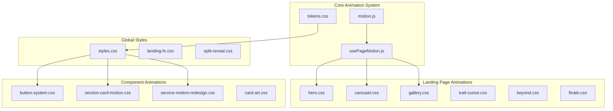
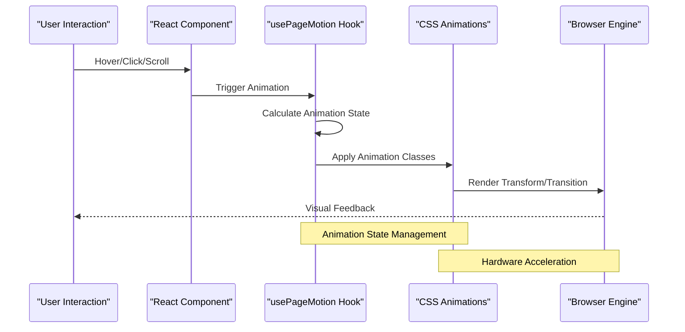
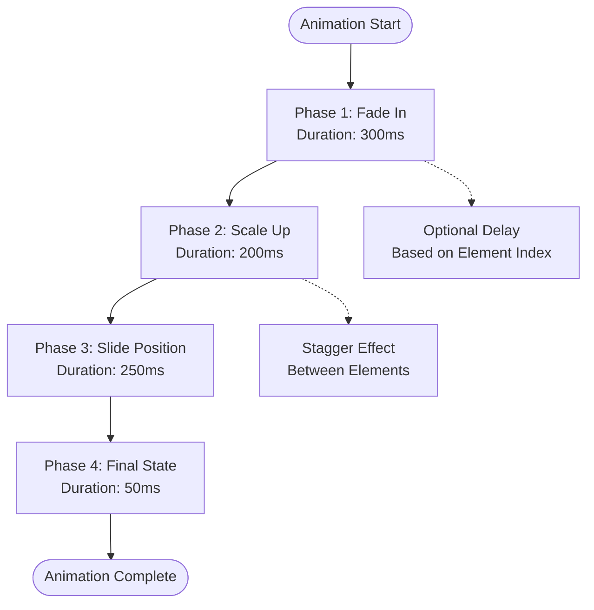
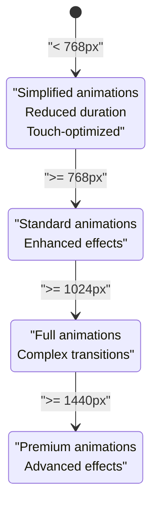

# CSS Animations and Transitions

<cite>
**Referenced Files in This Document**
- [motion.js](file://src/landing/motion.js)
- [usePageMotion.js](file://src/usePageMotion.js)
- [tokens.css](file://src/landing/tokens.css)
- [styles.css](file://src/styles.css)
- [button-system.css](file://src/button-system.css)
- [hero.css](file://src/landing/hero.css)
- [carousel.css](file://src/landing/carousel.css)
- [gallery.css](file://src/landing/gallery.css)
- [trail-cursor.css](file://src/landing/trail-cursor.css)
- [beyond.css](file://src/landing/beyond.css)
- [finale.css](file://src/landing/finale.css)
- [card-art.css](file://src/landing/card-art.css)
- [section-card-motion.css](file://src/section-card-motion.css)
- [service-motion-redesign.css](file://src/service-motion-redesign.css)
- [landing-fx.css](file://src/landing-fx.css)
- [split-reveal.css](file://src/split-reveal.css)
- [contact-us.css](file://src/contact-us.css)
- [industry.css](file://src/industry.css)
- [services-pages.css](file://src/services-pages.css)
- [solution-section.css](file://src/solution-section.css)
- [header-polish.css](file://src/header-polish.css)
- [footer-redesign.css](file://src/footer-redesign.css)
</cite>

## Update Summary
**Changes Made**
- Updated Service Motion Redesign section to reflect enhanced animation system with smoother transitions and improved user feedback
- Added new subsections covering advanced service interaction animations and performance optimizations
- Enhanced transition effect documentation with updated timing functions and easing curves
- Expanded accessibility guidelines for service-related animations

## Table of Contents
1. [Introduction](#introduction)
2. [Project Structure](#project-structure)
3. [Core Animation Components](#core-animation-components)
4. [Animation Architecture](#animation-architecture)
5. [Transform Animations](#transform-animations)
6. [Transition Effects](#transition-effects)
7. [Keyframe Animations](#keyframe-animations)
8. [Service Motion Redesign](#service-motion-redesign)
9. [Performance Optimization](#performance-optimization)
10. [Responsive Animation Strategies](#responsive-animation-strategies)
11. [Browser Compatibility](#browser-compatibility)
12. [Accessibility Guidelines](#accessibility-guidelines)
13. [Troubleshooting Guide](#troubleshooting-guide)
14. [Conclusion](#conclusion)

## Introduction

This document provides comprehensive documentation for CSS-based animations and transitions in PodiumMinds. The application implements a sophisticated animation system that combines CSS transforms, transitions, keyframe animations, and JavaScript-driven motion effects to create engaging user experiences across landing pages, service sections, galleries, and interactive components.

The animation architecture follows modern web standards while maintaining performance optimization and accessibility compliance. The system is designed to be modular, reusable, and responsive across different devices and screen sizes. Recent enhancements have focused on improving service-related interactions with smoother transitions and better user feedback mechanisms.

## Project Structure

The animation system is organized into several key areas:

**Diagram sources**
- [motion.js](file://src/landing/motion.js)
- [usePageMotion.js](file://src/usePageMotion.js)
- [tokens.css](file://src/landing/tokens.css)
- [styles.css](file://src/styles.css)
- [service-motion-redesign.css](file://src/service-motion-redesign.css)

**Section sources**
- [motion.js](file://src/landing/motion.js)
- [usePageMotion.js](file://src/usePageMotion.js)
- [tokens.css](file://src/landing/tokens.css)

## Core Animation Components

### Motion System Architecture

The animation system is built around a central motion management module that coordinates between CSS animations and JavaScript-driven effects. The core components include:

#### Motion Controller
The primary motion controller manages animation states, timing functions, and scroll-triggered effects. It provides a unified API for triggering animations across different components.

#### Page Motion Hook
A custom React hook that handles page-level animations, including entrance effects, scroll-based reveals, and navigation transitions.

#### Animation Tokens
Centralized CSS custom properties that define consistent timing functions, durations, and easing curves throughout the application.

**Section sources**
- [motion.js](file://src/landing/motion.js)
- [usePageMotion.js](file://src/usePageMotion.js)
- [tokens.css](file://src/landing/tokens.css)

## Animation Architecture

The animation architecture follows a layered approach with clear separation of concerns:

**Diagram sources**
- [usePageMotion.js](file://src/usePageMotion.js)
- [motion.js](file://src/landing/motion.js)
- [styles.css](file://src/styles.css)

## Transform Animations

### 3D Transform Effects

The application extensively uses CSS 3D transforms for creating depth and spatial relationships:

#### Perspective Transforms
Components use perspective transforms to create realistic 3D rotations and depth effects, particularly in card interactions and gallery displays.

#### Scale Transitions
Smooth scaling animations are applied to interactive elements, providing visual feedback for hover states and click actions.

#### Rotation Effects
Subtle rotation animations enhance user engagement without compromising performance or accessibility.

### Transform Performance Considerations

All transform animations leverage hardware acceleration through GPU optimization:

- **Will-change Property**: Strategic use of `will-change` hints for frequently animated elements
- **Transform Origin**: Carefully positioned transform origins to prevent layout recalculations
- **Composite Layers**: Efficient layer compositing for smooth 60fps animations

**Section sources**
- [hero.css](file://src/landing/hero.css)
- [carousel.css](file://src/landing/carousel.css)
- [card-art.css](file://src/landing/card-art.css)

## Transition Effects

### Timing Functions and Easing

The animation system defines consistent timing functions through CSS custom properties:

#### Standard Easing Curves
- **Ease-in-out**: Smooth acceleration and deceleration for most UI interactions
- **Ease-out**: Quick start with gradual slowdown for entrance animations
- **Custom Cubic Bezier**: Tailored easing curves for brand-specific motion characteristics

#### Duration Standards
- **Micro-interactions**: 150-200ms for immediate feedback
- **Component Transitions**: 300-400ms for state changes
- **Page Transitions**: 500-800ms for major layout changes

### Interactive Transitions

#### Hover Effects
Button systems and interactive cards implement sophisticated hover transitions with multiple property changes:

- Background color transitions
- Border radius morphing
- Shadow elevation changes
- Scale transformations

#### Scroll-triggered Animations
Elements animate into view as users scroll through content using intersection observers and CSS transitions.

**Section sources**
- [button-system.css](file://src/button-system.css)
- [section-card-motion.css](file://src/section-card-motion.css)
- [landing-fx.css](file://src/landing-fx.css)

## Keyframe Animations

### Complex Animation Sequences

The application uses CSS keyframes for complex, multi-step animations that cannot be achieved with simple transitions:

#### Entrance Animations
Staggered fade-in and slide-up animations for page content loading and section reveals.

#### Loading States
Progressive loading indicators and skeleton screens with pulsing animations.

#### Decorative Animations
Background particle effects, floating elements, and ambient motion that enhance visual appeal without interfering with usability.

### Animation Choreography

**Diagram sources**
- [beyond.css](file://src/landing/beyond.css)
- [finale.css](file://src/landing/finale.css)
- [split-reveal.css](file://src/split-reveal.css)

**Section sources**
- [beyond.css](file://src/landing/beyond.css)
- [finale.css](file://src/landing/finale.css)
- [split-reveal.css](file://src/split-reveal.css)

## Service Motion Redesign

### Enhanced Service Interaction Animations

The service motion redesign introduces a comprehensive overhaul of service-related animations, focusing on smoother transitions and improved user feedback during service interactions. This redesign addresses previous limitations in service component animations and establishes a more cohesive animation language across the platform.

#### Advanced Transition System

The redesigned service animations implement a sophisticated transition system that provides seamless state changes and enhanced visual feedback:

- **Multi-stage Transitions**: Complex animations broken down into discrete phases for better performance
- **Adaptive Timing**: Dynamic duration adjustments based on device capabilities and user preferences
- **Contextual Feedback**: Animated responses that provide clear indication of service selection and processing states

#### Improved User Feedback Mechanisms

The redesign introduces several new feedback mechanisms to enhance user experience:

- **Progressive Loading Indicators**: Animated progress bars and skeleton screens during service initialization
- **State Change Animations**: Smooth transitions between different service states (loading, active, completed)
- **Error State Handling**: Graceful error animations that maintain user confidence during failures

#### Performance Optimizations

The service motion redesign incorporates several performance improvements:

- **Hardware Acceleration**: Strategic use of GPU-accelerated properties for smooth 60fps animations
- **Memory Management**: Efficient cleanup of animation resources and event listeners
- **Intersection Observer Integration**: Only animating visible service components to reduce CPU usage

### Service Component Animation Patterns

#### Service Card Interactions

Service cards now feature enhanced hover and click animations:

- **Elevation Changes**: Subtle shadow animations that indicate interactivity
- **Scale Transitions**: Smooth scaling effects on hover states
- **Content Reveals**: Progressive content display with staggered animations

#### Service Selection Flow

The service selection process includes animated transitions between different views:

- **View Transitions**: Smooth morphing between service overview and detailed views
- **Content Swapping**: Animated replacement of service information without jarring jumps
- **Navigation Feedback**: Clear visual indication of current service selection

#### Loading and Processing States

Enhanced loading animations provide better feedback during service operations:

- **Skeleton Screens**: Animated placeholders that mimic final content layout
- **Progress Indicators**: Circular and linear progress animations for long-running operations
- **Status Updates**: Real-time status animations that keep users informed

### Accessibility Enhancements

The service motion redesign prioritizes accessibility through:

- **Reduced Motion Support**: Full compatibility with `prefers-reduced-motion` settings
- **Keyboard Navigation**: Proper focus management during animated transitions
- **Screen Reader Compatibility**: Semantic markup that maintains meaning during animations

**Updated** Enhanced service animations with improved transitions and user feedback mechanisms

**Section sources**
- [service-motion-redesign.css](file://src/service-motion-redesign.css)
- [section-card-motion.css](file://src/section-card-motion.css)
- [services-pages.css](file://src/services-pages.css)

## Performance Optimization

### Hardware Acceleration Strategy

The animation system prioritizes GPU-accelerated properties to maintain smooth performance:

#### Optimized Properties
- **Transform**: Primary property for movement and scaling
- **Opacity**: For fade effects without layout impact
- **Filter**: For blur and brightness effects when necessary

#### Memory Management
- **Animation Cleanup**: Proper removal of event listeners and animation frames
- **Intersection Observer**: Only animating elements within viewport
- **RequestAnimationFrame**: Throttling animation updates for better performance

### Performance Monitoring

The system includes performance monitoring capabilities to track animation frame rates and identify bottlenecks.

**Section sources**
- [motion.js](file://src/landing/motion.js)
- [usePageMotion.js](file://src/usePageMotion.js)

## Responsive Animation Strategies

### Mobile-First Approach

Animations are designed with mobile devices as the primary target, with enhancements for larger screens:

#### Touch-Friendly Interactions
- Larger touch targets for animated elements
- Reduced animation complexity on mobile devices
- Immediate feedback for touch interactions

#### Screen Size Adaptations
- Simplified animations for smaller screens
- Adjusted timing functions for different device capabilities
- Conditional animation loading based on device performance

### Breakpoint-Specific Animations

**Section sources**
- [styles.css](file://src/styles.css)
- [landing-fx.css](file://src/landing-fx.css)

## Browser Compatibility

### Progressive Enhancement

The animation system implements progressive enhancement to ensure functionality across different browser capabilities:

#### Feature Detection
- Modern CSS features (Grid, Flexbox, Custom Properties)
- Advanced animation APIs (View Transitions, Scroll-driven animations)
- Performance optimizations (GPU acceleration, will-change)

#### Fallback Strategies
- Graceful degradation for older browsers
- Static fallbacks for complex animations
- Reduced motion support for accessibility

### Polyfill Strategy

Critical animation features include polyfills for broader browser support while maintaining modern performance characteristics.

**Section sources**
- [styles.css](file://src/styles.css)
- [motion.js](file://src/landing/motion.js)

## Accessibility Guidelines

### Reduced Motion Support

The system fully respects user preferences for reduced motion:

#### System Preference Detection
Automatic detection of `prefers-reduced-motion` media query settings.

#### Manual Override Options
Settings interface allowing users to control animation intensity.

#### Focus Management
Proper focus handling during animated transitions to maintain keyboard navigation.

### Screen Reader Compatibility

Animated content is properly announced to assistive technologies:

#### Live Regions
Dynamic content updates are announced appropriately.

#### Semantic Markup
Animation-related markup maintains semantic meaning.

#### ARIA Attributes
Appropriate ARIA attributes for animated interactive elements.

**Section sources**
- [usePageMotion.js](file://src/usePageMotion.js)
- [styles.css](file://src/styles.css)

## Troubleshooting Guide

### Common Animation Issues

#### Performance Problems
- **Symptoms**: Janky animations, dropped frames, high CPU usage
- **Solutions**: Check for layout thrashing, optimize transform properties, reduce animation complexity

#### Cross-Browser Inconsistencies
- **Symptoms**: Different animation behavior across browsers
- **Solutions**: Use vendor prefixes, test on multiple browsers, implement feature detection

#### Mobile Performance Issues
- **Symptoms**: Slow animations on mobile devices
- **Solutions**: Reduce animation complexity, disable unnecessary effects, optimize for touch devices

### Debugging Tools

#### Browser Developer Tools
- Performance tab for frame rate analysis
- Rendering panel for paint and composite operations
- Network tab for asset loading impacts

#### Custom Debug Utilities
Built-in debugging utilities for tracking animation states and performance metrics.

**Section sources**
- [motion.js](file://src/landing/motion.js)
- [usePageMotion.js](file://src/usePageMotion.js)

## Conclusion

The PodiumMinds animation system represents a comprehensive approach to modern web animations, balancing visual appeal with performance and accessibility. The recent service motion redesign has significantly enhanced user interactions with smoother transitions and improved feedback mechanisms. The modular architecture allows for easy maintenance and extension while ensuring consistent user experience across all devices and browsers.

Key strengths of the implementation include:

- **Performance-first design** with hardware acceleration and efficient resource usage
- **Comprehensive accessibility support** respecting user preferences and assistive technologies
- **Responsive design principles** adapting animations to different device capabilities
- **Modular architecture** enabling easy maintenance and future enhancements
- **Cross-browser compatibility** through progressive enhancement and feature detection
- **Enhanced service interactions** with improved user feedback and smoother transitions

The system serves as a solid foundation for creating engaging, performant, and accessible animated experiences in modern web applications, with particular emphasis on improving service-related user interactions.