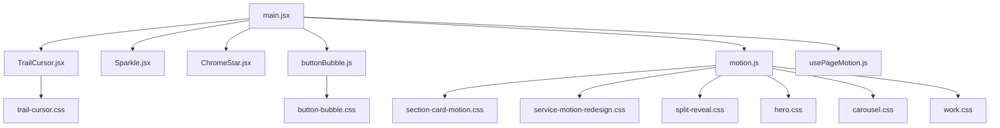
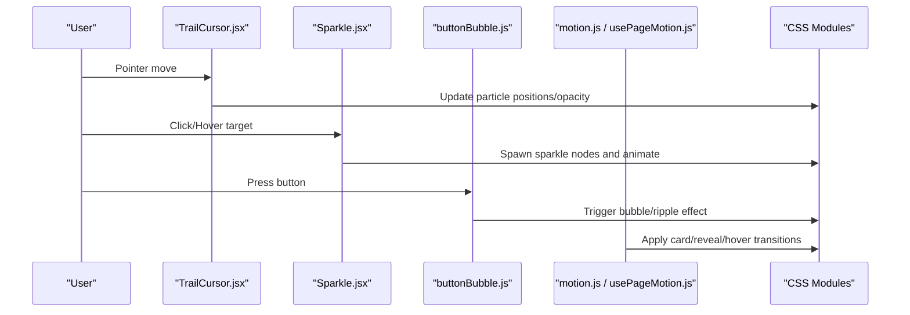
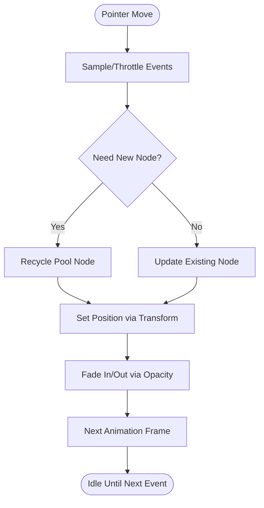
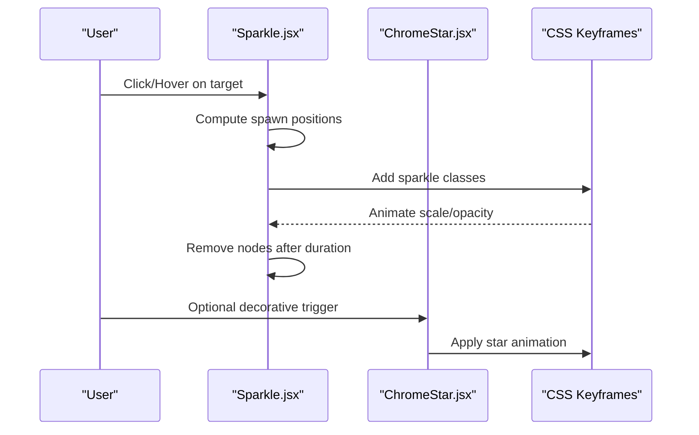
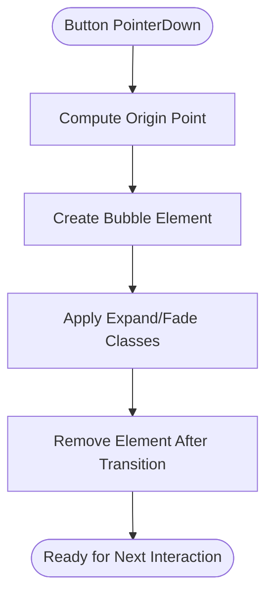
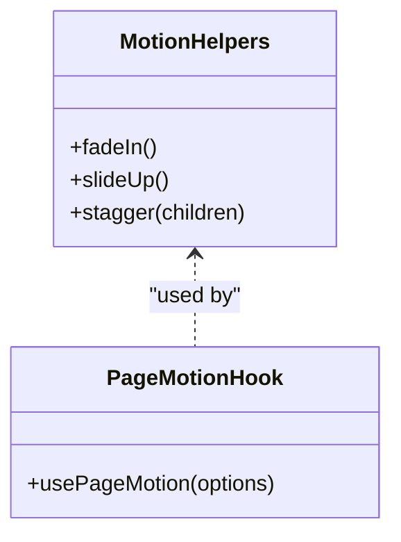
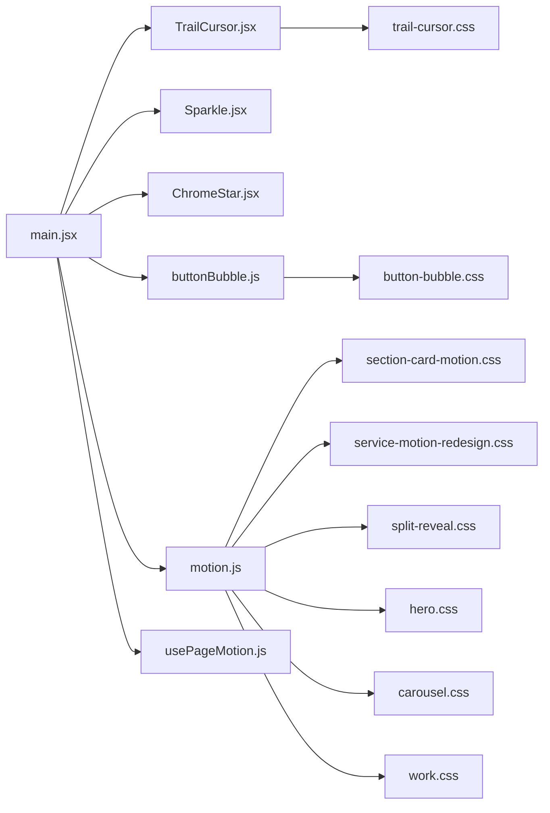

# Interactive Effects and Micro-interactions

<cite>
**Referenced Files in This Document**
- [TrailCursor.jsx](file://src/landing/TrailCursor.jsx)
- [Sparkle.jsx](file://src/landing/Sparkle.jsx)
- [ChromeStar.jsx](file://src/landing/ChromeStar.jsx)
- [buttonBubble.js](file://src/buttonBubble.js)
- [motion.js](file://src/landing/motion.js)
- [usePageMotion.js](file://src/usePageMotion.js)
- [trail-cursor.css](file://src/landing/trail-cursor.css)
- [button-bubble.css](file://src/button-bubble.css)
- [section-card-motion.css](file://src/section-card-motion.css)
- [service-motion-redesign.css](file://src/service-motion-redesign.css)
- [split-reveal.css](file://src/split-reveal.css)
- [hero.css](file://src/landing/hero.css)
- [carousel.css](file://src/landing/carousel.css)
- [work.css](file://src/landing/work.css)
- [main.jsx](file://src/main.jsx)
</cite>

## Table of Contents
1. [Introduction](#introduction)
2. [Project Structure](#project-structure)
3. [Core Components](#core-components)
4. [Architecture Overview](#architecture-overview)
5. [Detailed Component Analysis](#detailed-component-analysis)
6. [Dependency Analysis](#dependency-analysis)
7. [Performance Considerations](#performance-considerations)
8. [Troubleshooting Guide](#troubleshooting-guide)
9. [Conclusion](#conclusion)
10. [Appendices](#appendices)

## Introduction
This document explains the interactive effects and micro-interactions implemented across PodiumMinds, focusing on:
- Cursor trail effects
- Sparkle animations
- Button bubble interactions
- Additional user-triggered animations (hover, reveal, carousel transitions)

It covers event handling patterns, performance considerations for real-time animations, accessibility guidelines, and implementation examples to help you create engaging experiences while maintaining optimal performance across devices.

## Project Structure
Interactive features are primarily located under src/landing for page-level effects and at the root of src for shared UI behaviors and styles. The main entry point wires these components into the application.

**Diagram sources**
- [main.jsx](file://src/main.jsx)
- [TrailCursor.jsx](file://src/landing/TrailCursor.jsx)
- [Sparkle.jsx](file://src/landing/Sparkle.jsx)
- [ChromeStar.jsx](file://src/landing/ChromeStar.jsx)
- [buttonBubble.js](file://src/buttonBubble.js)
- [motion.js](file://src/landing/motion.js)
- [usePageMotion.js](file://src/usePageMotion.js)
- [trail-cursor.css](file://src/landing/trail-cursor.css)
- [button-bubble.css](file://src/button-bubble.css)
- [section-card-motion.css](file://src/section-card-motion.css)
- [service-motion-redesign.css](file://src/service-motion-redesign.css)
- [split-reveal.css](file://src/split-reveal.css)
- [hero.css](file://src/landing/hero.css)
- [carousel.css](file://src/landing/carousel.css)
- [work.css](file://src/landing/work.css)

**Section sources**
- [main.jsx](file://src/main.jsx)

## Core Components
- Cursor Trail: Renders a smooth trailing effect following pointer movement with fading particles.
- Sparkles: Emits small animated elements around interactive targets or on demand.
- Chrome Star: Decorative star-like animation used as accent effects.
- Button Bubble: Adds a playful ripple/bubble interaction when buttons are pressed or hovered.
- Motion Utilities: Shared motion helpers and CSS-driven transitions for cards, services, reveals, hero, carousel, and work rail sections.

These components are composed together via the application entry point and styled through dedicated CSS modules.

**Section sources**
- [TrailCursor.jsx](file://src/landing/TrailCursor.jsx)
- [Sparkle.jsx](file://src/landing/Sparkle.jsx)
- [ChromeStar.jsx](file://src/landing/ChromeStar.jsx)
- [buttonBubble.js](file://src/buttonBubble.js)
- [motion.js](file://src/landing/motion.js)
- [usePageMotion.js](file://src/usePageMotion.js)

## Architecture Overview
The interactive system follows a lightweight, composable architecture:
- Event listeners capture user input (pointermove, click, hover).
- Lightweight state updates drive minimal DOM/CSS changes.
- CSS transitions/animations handle most visual updates for performance.
- Utility hooks/helpers centralize motion logic and reduce duplication.

**Diagram sources**
- [TrailCursor.jsx](file://src/landing/TrailCursor.jsx)
- [Sparkle.jsx](file://src/landing/Sparkle.jsx)
- [buttonBubble.js](file://src/buttonBubble.js)
- [motion.js](file://src/landing/motion.js)
- [usePageMotion.js](file://src/usePageMotion.js)
- [trail-cursor.css](file://src/landing/trail-cursor.css)
- [button-bubble.css](file://src/button-bubble.css)
- [section-card-motion.css](file://src/section-card-motion.css)
- [service-motion-redesign.css](file://src/service-motion-redesign.css)
- [split-reveal.css](file://src/split-reveal.css)
- [hero.css](file://src/landing/hero.css)
- [carousel.css](file://src/landing/carousel.css)
- [work.css](file://src/landing/work.css)

## Detailed Component Analysis

### Cursor Trail Effect
Purpose: Provide a subtle, performant trail that follows the cursor with fading particles.

Key responsibilities:
- Listen to pointer movement events.
- Manage a small pool of trail nodes to avoid frequent DOM churn.
- Animate position and opacity using CSS transforms and transitions.
- Respect reduced motion preferences.

Event handling pattern:
- Throttle or sample pointer events to limit update frequency.
- Use requestAnimationFrame for smooth updates where necessary.
- Clean up event listeners on unmount.

Accessibility:
- Honor prefers-reduced-motion by disabling or simplifying the trail.
- Ensure focus-visible indicators remain clear over any overlay effects.

Implementation references:
- [TrailCursor.jsx](file://src/landing/TrailCursor.jsx)
- [trail-cursor.css](file://src/landing/trail-cursor.css)

**Diagram sources**
- [TrailCursor.jsx](file://src/landing/TrailCursor.jsx)
- [trail-cursor.css](file://src/landing/trail-cursor.css)

**Section sources**
- [TrailCursor.jsx](file://src/landing/TrailCursor.jsx)
- [trail-cursor.css](file://src/landing/trail-cursor.css)

### Sparkle Animations
Purpose: Add celebratory or attention-grabbing sparkles around interactive elements or on specific triggers.

Key responsibilities:
- Emit a burst of small animated elements near a target coordinate.
- Animate scale, rotation, and opacity for a natural sparkle feel.
- Remove nodes after animation completes to prevent memory growth.

Event handling pattern:
- Attach click or hover handlers to trigger points.
- Compute spawn coordinates relative to the target element.
- Batch creation and cleanup to minimize layout thrash.

Accessibility:
- Avoid flashing or overly bright effects; keep durations short.
- Respect prefers-reduced-motion by limiting or disabling sparkles.

Implementation references:
- [Sparkle.jsx](file://src/landing/Sparkle.jsx)
- [ChromeStar.jsx](file://src/landing/ChromeStar.jsx)

**Diagram sources**
- [Sparkle.jsx](file://src/landing/Sparkle.jsx)
- [ChromeStar.jsx](file://src/landing/ChromeStar.jsx)

**Section sources**
- [Sparkle.jsx](file://src/landing/Sparkle.jsx)
- [ChromeStar.jsx](file://src/landing/ChromeStar.jsx)

### Button Bubble Interactions
Purpose: Deliver tactile feedback with a bubble/ripple effect on press or hover.

Key responsibilities:
- Detect pointerdown/pointerup or click events on buttons.
- Calculate origin point for the bubble relative to the button.
- Animate expansion and fade-out using CSS transitions.
- Ensure only one active bubble per button to avoid stacking.

Event handling pattern:
- Use passive listeners where possible to improve scroll performance.
- Debounce rapid clicks if needed to prevent excessive DOM updates.

Accessibility:
- Preserve keyboard activation behavior and focus outlines.
- Keep animations subtle so they do not distract from content.

Implementation references:
- [buttonBubble.js](file://src/buttonBubble.js)
- [button-bubble.css](file://src/button-bubble.css)

**Diagram sources**
- [buttonBubble.js](file://src/buttonBubble.js)
- [button-bubble.css](file://src/button-bubble.css)

**Section sources**
- [buttonBubble.js](file://src/buttonBubble.js)
- [button-bubble.css](file://src/button-bubble.css)

### Motion Utilities and Page-Level Transitions
Purpose: Centralize reusable motion logic and apply consistent transitions across sections.

Responsibilities:
- Provide helper functions/hooks for common motion patterns (fade-in, slide-up, stagger).
- Coordinate section-specific animations such as cards, service items, split reveals, hero, carousel, and work rail.
- Integrate with CSS modules for declarative styling.

Implementation references:
- [motion.js](file://src/landing/motion.js)
- [usePageMotion.js](file://src/usePageMotion.js)
- [section-card-motion.css](file://src/section-card-motion.css)
- [service-motion-redesign.css](file://src/service-motion-redesign.css)
- [split-reveal.css](file://src/split-reveal.css)
- [hero.css](file://src/landing/hero.css)
- [carousel.css](file://src/landing/carousel.css)
- [work.css](file://src/landing/work.css)

**Diagram sources**
- [motion.js](file://src/landing/motion.js)
- [usePageMotion.js](file://src/usePageMotion.js)

**Section sources**
- [motion.js](file://src/landing/motion.js)
- [usePageMotion.js](file://src/usePageMotion.js)
- [section-card-motion.css](file://src/section-card-motion.css)
- [service-motion-redesign.css](file://src/service-motion-redesign.css)
- [split-reveal.css](file://src/split-reveal.css)
- [hero.css](file://src/landing/hero.css)
- [carousel.css](file://src/landing/carousel.css)
- [work.css](file://src/landing/work.css)

## Dependency Analysis
High-level dependencies among interactive modules:
- Entry point composes all interactive components.
- CSS modules provide the visual layer for each effect.
- Motion utilities are reused across multiple components.

**Diagram sources**
- [main.jsx](file://src/main.jsx)
- [TrailCursor.jsx](file://src/landing/TrailCursor.jsx)
- [Sparkle.jsx](file://src/landing/Sparkle.jsx)
- [ChromeStar.jsx](file://src/landing/ChromeStar.jsx)
- [buttonBubble.js](file://src/buttonBubble.js)
- [motion.js](file://src/landing/motion.js)
- [usePageMotion.js](file://src/usePageMotion.js)
- [trail-cursor.css](file://src/landing/trail-cursor.css)
- [button-bubble.css](file://src/button-bubble.css)
- [section-card-motion.css](file://src/section-card-motion.css)
- [service-motion-redesign.css](file://src/service-motion-redesign.css)
- [split-reveal.css](file://src/split-reveal.css)
- [hero.css](file://src/landing/hero.css)
- [carousel.css](file://src/landing/carousel.css)
- [work.css](file://src/landing/work.css)

**Section sources**
- [main.jsx](file://src/main.jsx)

## Performance Considerations
- Prefer CSS transforms and opacity for animations to leverage GPU acceleration.
- Limit the number of simultaneously animated elements; reuse pools where possible (e.g., trail nodes).
- Throttle or sample high-frequency events like pointermove to reduce layout recalculations.
- Use requestAnimationFrame for JavaScript-driven updates instead of setInterval.
- Debounce or throttle rapid interactions (clicks, hovers) to avoid excessive DOM mutations.
- Respect prefers-reduced-motion to disable heavy effects on sensitive devices or users.
- Avoid triggering layout thrashing by batching reads/writes and minimizing reflows.
- Keep animation durations short and easing curves simple for smoother perceived performance.
- Monitor memory usage by ensuring all dynamically created nodes are removed after animations complete.

[No sources needed since this section provides general guidance]

## Troubleshooting Guide
Common issues and resolutions:
- Effects not appearing on mobile: Verify touch event support and ensure passive listeners are used appropriately.
- Jittery cursor trail: Reduce update frequency, switch to transform-based positioning, and ensure no forced synchronous layouts.
- Memory leaks from sparkles/bubbles: Confirm cleanup removes nodes after transition end.
- Accessibility regressions: Ensure focus-visible is not obscured and that animations can be disabled via prefers-reduced-motion.
- Overlapping animations: Stagger or queue animations to prevent visual clutter and layout conflicts.

[No sources needed since this section provides general guidance]

## Conclusion
PodiumMinds implements a cohesive set of interactive effects using a modular, performance-conscious approach. By combining lightweight JavaScript event handling with CSS-driven animations and centralized motion utilities, the system delivers engaging micro-interactions while remaining accessible and efficient across devices.

[No sources needed since this section summarizes without analyzing specific files]

## Appendices

### Implementation Examples
- Cursor trail: See [TrailCursor.jsx](file://src/landing/TrailCursor.jsx) and [trail-cursor.css](file://src/landing/trail-cursor.css) for event sampling, node recycling, and transform-based positioning.
- Sparkles: See [Sparkle.jsx](file://src/landing/Sparkle.jsx) and [ChromeStar.jsx](file://src/landing/ChromeStar.jsx) for burst spawning and keyframe animations.
- Button bubbles: See [buttonBubble.js](file://src/buttonBubble.js) and [button-bubble.css](file://src/button-bubble.css) for origin calculation and expand/fade transitions.
- Section transitions: See [motion.js](file://src/landing/motion.js), [usePageMotion.js](file://src/usePageMotion.js), and associated CSS modules ([section-card-motion.css](file://src/section-card-motion.css), [service-motion-redesign.css](file://src/service-motion-redesign.css), [split-reveal.css](file://src/split-reveal.css), [hero.css](file://src/landing/hero.css), [carousel.css](file://src/landing/carousel.css), [work.css](file://src/landing/work.css)) for reusable motion patterns.

**Section sources**
- [TrailCursor.jsx](file://src/landing/TrailCursor.jsx)
- [trail-cursor.css](file://src/landing/trail-cursor.css)
- [Sparkle.jsx](file://src/landing/Sparkle.jsx)
- [ChromeStar.jsx](file://src/landing/ChromeStar.jsx)
- [buttonBubble.js](file://src/buttonBubble.js)
- [button-bubble.css](file://src/button-bubble.css)
- [motion.js](file://src/landing/motion.js)
- [usePageMotion.js](file://src/usePageMotion.js)
- [section-card-motion.css](file://src/section-card-motion.css)
- [service-motion-redesign.css](file://src/service-motion-redesign.css)
- [split-reveal.css](file://src/split-reveal.css)
- [hero.css](file://src/landing/hero.css)
- [carousel.css](file://src/landing/carousel.css)
- [work.css](file://src/landing/work.css)