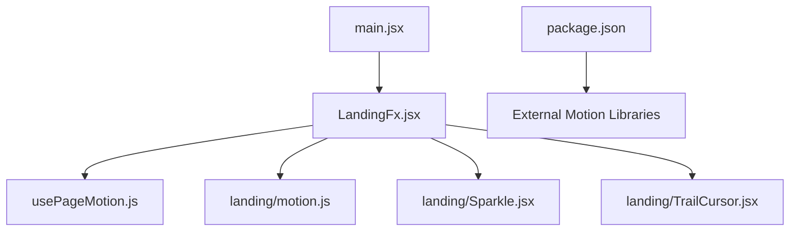
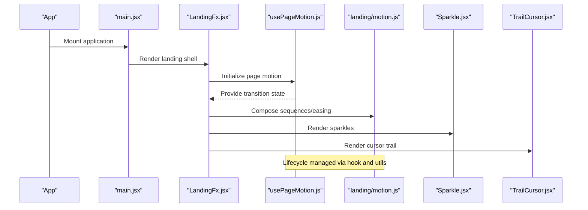
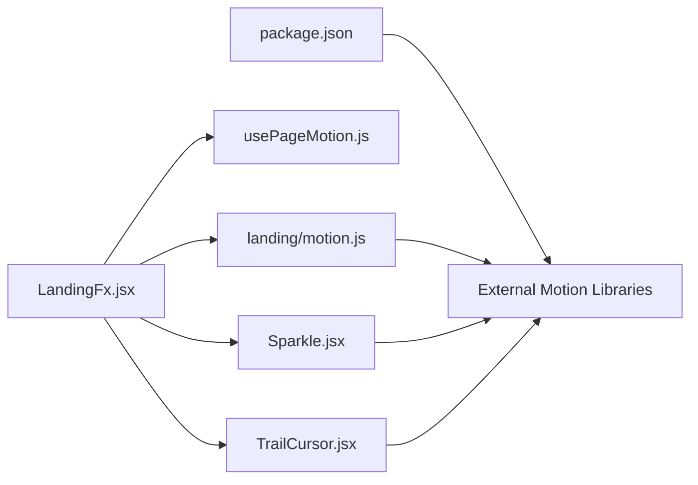

# JavaScript Motion Libraries and Hooks

<cite>
**Referenced Files in This Document**
- [usePageMotion.js](file://src/usePageMotion.js)
- [motion.js](file://src/landing/motion.js)
- [Sparkle.jsx](file://src/landing/Sparkle.jsx)
- [TrailCursor.jsx](file://src/landing/TrailCursor.jsx)
- [LandingFx.jsx](file://src/LandingFx.jsx)
- [main.jsx](file://src/main.jsx)
- [package.json](file://package.json)
</cite>

## Table of Contents
1. [Introduction](#introduction)
2. [Project Structure](#project-structure)
3. [Core Components](#core-components)
4. [Architecture Overview](#architecture-overview)
5. [Detailed Component Analysis](#detailed-component-analysis)
6. [Dependency Analysis](#dependency-analysis)
7. [Performance Considerations](#performance-considerations)
8. [Troubleshooting Guide](#troubleshooting-guide)
9. [Conclusion](#conclusion)
10. [Appendices](#appendices)

## Introduction
This document explains the JavaScript-powered motion system used across PodiumMinds, focusing on custom hooks for page-level animations, integration with motion libraries for complex effects (sparkles, interactive elements), lifecycle management, performance optimization, and memory cleanup patterns. It also provides practical examples for scroll-triggered animations, parallax effects, and dynamic motion sequences.

## Project Structure
The motion system is implemented primarily through:
- A reusable hook for page-level transitions and entrance animations
- A landing-specific motion utility module
- Feature components that implement sparkle effects and cursor trails
- Entry points that wire up global styles and behaviors

**Diagram sources**
- [main.jsx](file://src/main.jsx)
- [LandingFx.jsx](file://src/LandingFx.jsx)
- [usePageMotion.js](file://src/usePageMotion.js)
- [motion.js](file://src/landing/motion.js)
- [Sparkle.jsx](file://src/landing/Sparkle.jsx)
- [TrailCursor.jsx](file://src/landing/TrailCursor.jsx)
- [package.json](file://package.json)

**Section sources**
- [main.jsx](file://src/main.jsx)
- [LandingFx.jsx](file://src/LandingFx.jsx)
- [usePageMotion.js](file://src/usePageMotion.js)
- [motion.js](file://src/landing/motion.js)
- [Sparkle.jsx](file://src/landing/Sparkle.jsx)
- [TrailCursor.jsx](file://src/landing/TrailCursor.jsx)
- [package.json](file://package.json)

## Core Components
- usePageMotion: Custom React hook providing page-level animation orchestration, including mounting/unmounting transitions and conditional triggers based on visibility or route changes.
- landing/motion.js: Shared motion utilities for sequencing, easing, and composition of complex animations.
- Sparkle component: Interactive sparkle effect driven by motion library primitives.
- TrailCursor component: Cursor trail effect using pointer events and requestAnimationFrame-based updates.
- LandingFx: Orchestrates the landing experience by composing the above building blocks.

Key responsibilities:
- Hook-driven lifecycle control for consistent page transitions
- Centralized motion configuration and helpers
- Reusable visual effects with clear props interfaces
- Performance-conscious rendering and cleanup

**Section sources**
- [usePageMotion.js](file://src/usePageMotion.js)
- [motion.js](file://src/landing/motion.js)
- [Sparkle.jsx](file://src/landing/Sparkle.jsx)
- [TrailCursor.jsx](file://src/landing/TrailCursor.jsx)
- [LandingFx.jsx](file://src/LandingFx.jsx)

## Architecture Overview
The motion architecture separates concerns into a hook layer, shared motion utilities, and feature components. The entry point wires these together to deliver a cohesive user experience.

**Diagram sources**
- [main.jsx](file://src/main.jsx)
- [LandingFx.jsx](file://src/LandingFx.jsx)
- [usePageMotion.js](file://src/usePageMotion.js)
- [motion.js](file://src/landing/motion.js)
- [Sparkle.jsx](file://src/landing/Sparkle.jsx)
- [TrailCursor.jsx](file://src/landing/TrailCursor.jsx)

## Detailed Component Analysis

### usePageMotion Hook
Purpose:
- Manage page-level animation lifecycle (enter/exit)
- Expose computed states for transitions
- Integrate with intersection observer or routing signals when needed

Typical usage pattern:
- Call the hook at the top of a page component
- Consume returned values to drive CSS classes or motion primitives
- Optionally pass options to customize duration, easing, and triggers

Lifecycle considerations:
- Ensure cleanup of any event listeners or timers
- Avoid re-creating animation instances on every render
- Debounce or throttle expensive operations if triggered frequently

**Section sources**
- [usePageMotion.js](file://src/usePageMotion.js)

### Motion Utilities (landing/motion.js)
Responsibilities:
- Provide helper functions for sequencing, staggering, and easing
- Encapsulate common motion primitives used across components
- Offer configuration objects for consistent timing and curves

Integration points:
- Consumed by LandingFx and feature components
- Used to build complex timelines and micro-interactions

**Section sources**
- [motion.js](file://src/landing/motion.js)

### Sparkle Effect (Sparkle.jsx)
Behavior:
- Renders animated particles that respond to interactions
- Uses motion primitives to animate position, scale, opacity, and rotation
- Cleans up event listeners and animation frames on unmount

Props interface (conceptual):
- Trigger conditions (e.g., hover, click)
- Visual parameters (count, size, color palette)
- Timing controls (duration, delay, stagger)

**Section sources**
- [Sparkle.jsx](file://src/landing/Sparkle.jsx)

### Cursor Trail (TrailCursor.jsx)
Behavior:
- Listens to pointer movement and renders trailing nodes
- Updates positions using efficient animation loops
- Removes listeners and cancels frames on unmount

Props interface (conceptual):
- Sensitivity and lag settings
- Visual style (dot size, fade, color)
- Enable/disable flags for accessibility/performance

**Section sources**
- [TrailCursor.jsx](file://src/landing/TrailCursor.jsx)

### Landing Orchestration (LandingFx.jsx)
Role:
- Wires together usePageMotion, motion utilities, Sparkle, and TrailCursor
- Applies layout-aware animations and coordinates cross-component timing
- Ensures consistent performance budgets and fallbacks

**Section sources**
- [LandingFx.jsx](file://src/LandingFx.jsx)

### Application Entry (main.jsx)
Role:
- Bootstraps the app and mounts the root component
- Integrates global styles and motion-related setup

**Section sources**
- [main.jsx](file://src/main.jsx)

## Dependency Analysis
External motion libraries are declared in package.json and consumed by the motion utilities and components. The dependency graph shows how core modules rely on shared utilities and external packages.

**Diagram sources**
- [package.json](file://package.json)
- [LandingFx.jsx](file://src/LandingFx.jsx)
- [usePageMotion.js](file://src/usePageMotion.js)
- [motion.js](file://src/landing/motion.js)
- [Sparkle.jsx](file://src/landing/Sparkle.jsx)
- [TrailCursor.jsx](file://src/landing/TrailCursor.jsx)

**Section sources**
- [package.json](file://package.json)
- [LandingFx.jsx](file://src/LandingFx.jsx)
- [usePageMotion.js](file://src/usePageMotion.js)
- [motion.js](file://src/landing/motion.js)
- [Sparkle.jsx](file://src/landing/Sparkle.jsx)
- [TrailCursor.jsx](file://src/landing/TrailCursor.jsx)

## Performance Considerations
- Prefer GPU-accelerated properties (transform, opacity) for smooth animations.
- Batch DOM reads and writes to avoid layout thrashing.
- Use requestAnimationFrame judiciously; cancel frames on unmount.
- Debounce high-frequency events (scroll, pointermove).
- Limit particle counts and reuse instances where possible.
- Apply will-change sparingly and remove after animations complete.
- Use IntersectionObserver for scroll-triggered animations to avoid constant polling.
- Keep animation durations short and provide reduced-motion preferences.

[No sources needed since this section provides general guidance]

## Troubleshooting Guide
Common issues and resolutions:
- Animations not triggering: Verify hook initialization and prop wiring; ensure correct mount/unmount lifecycle.
- Jank during scroll: Switch to IntersectionObserver and reduce heavy computations inside scroll handlers.
- Memory leaks: Confirm all event listeners and animation frames are cleaned up in useEffect return functions.
- Inconsistent timings: Centralize durations and easings in motion utilities; avoid ad-hoc values scattered across components.
- Accessibility regressions: Respect prefers-reduced-motion and provide non-animated alternatives.

**Section sources**
- [usePageMotion.js](file://src/usePageMotion.js)
- [motion.js](file://src/landing/motion.js)
- [Sparkle.jsx](file://src/landing/Sparkle.jsx)
- [TrailCursor.jsx](file://src/landing/TrailCursor.jsx)

## Conclusion
The PodiumMinds motion system combines a dedicated page-level hook, shared motion utilities, and focused effect components to deliver performant, maintainable animations. By centralizing lifecycle management and adhering to performance best practices, the system scales across pages and features while remaining accessible and easy to extend.

[No sources needed since this section summarizes without analyzing specific files]

## Appendices

### Practical Examples

#### Scroll-Triggered Animations
Approach:
- Use IntersectionObserver to detect element visibility.
- Toggle a class or trigger a motion sequence when intersecting.
- Debounce or throttle observers if many elements exist.

Implementation references:
- Hook-driven state for enter/exit transitions
- Utility functions for sequencing and easing

**Section sources**
- [usePageMotion.js](file://src/usePageMotion.js)
- [motion.js](file://src/landing/motion.js)

#### Parallax Effects
Approach:
- Bind transform values to scroll position using requestAnimationFrame.
- Apply different speeds per layer to create depth.
- Clean up listeners and frames on unmount.

Implementation references:
- Motion utilities for transforms and timing
- Event handling patterns in interactive components

**Section sources**
- [motion.js](file://src/landing/motion.js)
- [TrailCursor.jsx](file://src/landing/TrailCursor.jsx)

#### Dynamic Motion Sequences
Approach:
- Compose multiple animations using utility functions for sequencing and staggering.
- Drive sequences from user actions or data changes.
- Ensure graceful cancellation and restart behavior.

Implementation references:
- Shared motion helpers for composition
- Hook-managed lifecycle for safe restarts

**Section sources**
- [motion.js](file://src/landing/motion.js)
- [usePageMotion.js](file://src/usePageMotion.js)