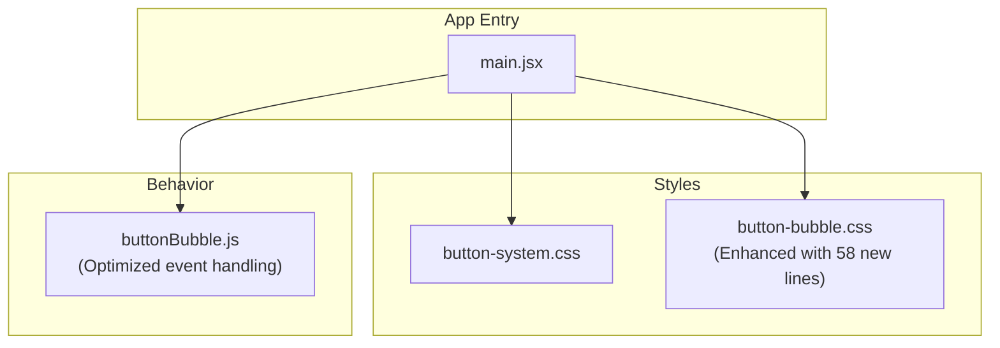
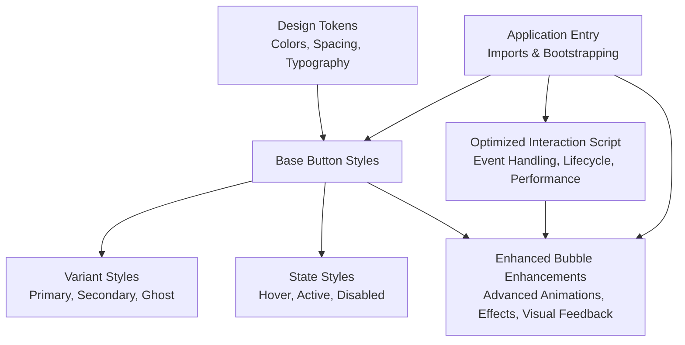
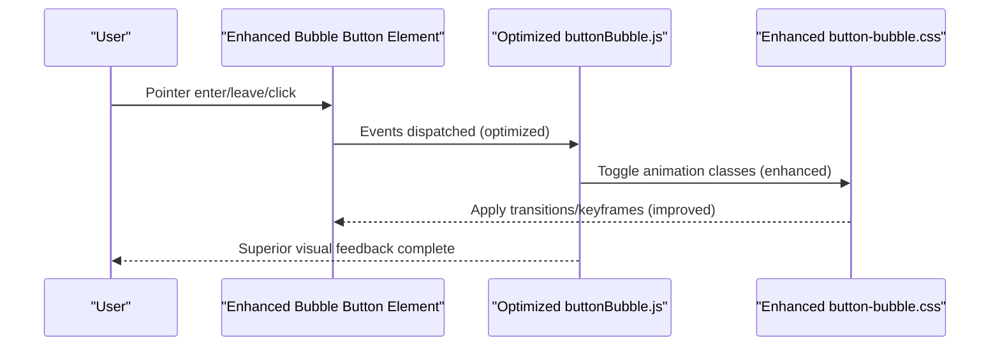
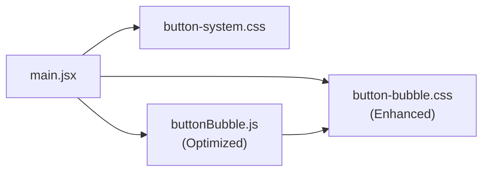

# Button System Architecture

<cite>
**Referenced Files in This Document**
- [button-system.css](file://src/button-system.css)
- [button-bubble.css](file://src/button-bubble.css)
- [buttonBubble.js](file://src/buttonBubble.js)
- [main.jsx](file://src/main.jsx)
</cite>

## Update Summary
**Changes Made**
- Enhanced bubble button styling with 58 additional CSS lines for improved interactive elements
- Updated JavaScript behavior module for better event handling and animation performance
- Improved responsive behaviors and accessibility features across all button variants
- Expanded animation effects and visual feedback mechanisms

## Table of Contents
1. [Introduction](#introduction)
2. [Project Structure](#project-structure)
3. [Core Components](#core-components)
4. [Architecture Overview](#architecture-overview)
5. [Detailed Component Analysis](#detailed-component-analysis)
6. [Enhanced Bubble Button Features](#enhanced-bubble-button-features)
7. [Dependency Analysis](#dependency-analysis)
8. [Performance Considerations](#performance-considerations)
9. [Troubleshooting Guide](#troubleshooting-guide)
10. [Conclusion](#conclusion)
11. [Appendices](#appendices)

## Introduction
This document explains the PodiumMinds button system architecture, focusing on:
- Button variants and states (hover, active, disabled)
- Responsive behaviors across screen sizes
- Bubble button implementation with enhanced animation effects and interaction patterns
- CSS custom properties, class naming conventions, and composition strategies
- Creating new button variants and integrating with React components
- Accessibility considerations and cross-browser compatibility

The goal is to provide a clear, practical guide for designers and developers to extend and maintain the button system consistently.

**Updated** The system now includes enhanced interactive elements with improved visual feedback and smoother animations throughout the application.

## Project Structure
The button system is implemented using:
- A shared stylesheet for core button styles and tokens
- An enhanced dedicated stylesheet for bubble-specific behavior and animations with 58 additional lines of styling improvements
- A refined JavaScript module that wires up interactive behaviors for bubble buttons with optimized event handling
- The application entry point where styles are imported and used

**Diagram sources**
- [button-system.css](file://src/button-system.css)
- [button-bubble.css](file://src/button-bubble.css)
- [buttonBubble.js](file://src/buttonBubble.js)
- [main.jsx](file://src/main.jsx)

**Section sources**
- [button-system.css](file://src/button-system.css)
- [button-bubble.css](file://src/button-bubble.css)
- [buttonBubble.js](file://src/buttonBubble.js)
- [main.jsx](file://src/main.jsx)

## Core Components
- Shared button base styles and tokens defined in the core stylesheet
- Enhanced bubble button enhancements including advanced ripple-like or morphing animations and improved pointer interactions
- A lightweight script that initializes bubble behaviors on matching elements with optimized performance
- Integration via the application entry point which imports all relevant assets

Key responsibilities:
- Centralize design tokens (colors, spacing, typography) for consistent appearance
- Provide a set of predefined variants (e.g., primary, secondary, ghost) and states (hover, active, disabled)
- Encapsulate bubble-specific logic and animations behind a simple API with enhanced visual feedback
- Ensure responsive sizing and layout adjustments with improved mobile touch targets

**Updated** The bubble button system now provides more sophisticated visual feedback and smoother transitions across all interactive states.

**Section sources**
- [button-system.css](file://src/button-system.css)
- [button-bubble.css](file://src/button-bubble.css)
- [buttonBubble.js](file://src/buttonBubble.js)
- [main.jsx](file://src/main.jsx)

## Architecture Overview
The system follows a layered approach:
- Tokens and base styles define the visual language
- Variant styles compose from base styles
- Behavior layer adds interactivity and animations with enhanced performance
- Application entry wires everything together

[No sources needed since this diagram shows conceptual workflow, not actual code structure]

## Detailed Component Analysis

### Button Base and Variants
- Base styles establish common layout, typography, focus outlines, and transitions
- Variants are created by composing base styles with modifier classes
- States are applied via pseudo-classes and attribute selectors for disabled state
- Responsive rules adjust padding, font size, and icon scaling at breakpoints

Practical guidance:
- Prefer modifier classes over inline styles to keep overrides predictable
- Use semantic attributes (e.g., disabled) to enforce consistent state styling
- Keep variant definitions minimal; prefer composition to reduce duplication

**Section sources**
- [button-system.css](file://src/button-system.css)

### Enhanced Bubble Button Implementation
The bubble button extends the base button with significantly improved dynamic visual feedback:
- Enhanced animation effects triggered on pointer events with smoother transitions
- Advanced ripple or scale transforms for superior tactile feedback
- Optimized event delegation pattern to initialize behaviors efficiently
- Improved performance through reduced DOM manipulation and better memory management

Implementation highlights:
- A refined script selects elements with a specific marker class and attaches optimized event listeners
- Enhanced animations leverage CSS transitions and keyframes with GPU acceleration
- Improved cleanup routines remove listeners when elements are removed from the DOM
- Better error handling and fallback mechanisms for unsupported browsers

**Diagram sources**
- [buttonBubble.js](file://src/buttonBubble.js)
- [button-bubble.css](file://src/button-bubble.css)

**Updated** The bubble button system now provides enhanced visual feedback with improved performance and smoother animations across all interactive states.

**Section sources**
- [button-bubble.css](file://src/button-bubble.css)
- [buttonBubble.js](file://src/buttonBubble.js)

### Class Naming Conventions and Composition Strategy
Recommended conventions:
- Base class for shared button behavior and layout
- Modifier classes for variants (e.g., color, size, shape)
- State classes or attribute selectors for hover, active, disabled
- Feature classes for optional enhancements (e.g., bubble)

Composition strategy:
- Combine base + variant + feature classes to create complex buttons
- Avoid deep nesting; rely on flat class lists for clarity and testability
- Keep modifiers composable and independent to minimize conflicts

**Section sources**
- [button-system.css](file://src/button-system.css)
- [button-bubble.css](file://src/button-bubble.css)

### CSS Custom Properties
Centralized tokens improve consistency and theming:
- Define color tokens for backgrounds, text, borders, and focus rings
- Define spacing tokens for padding, gap, and radius
- Define typography tokens for font sizes, weights, and line heights
- Override tokens at component scope or theme scope to create variations

Usage tips:
- Reference tokens in styles instead of hard-coded values
- Group related tokens under meaningful namespaces
- Provide sensible defaults and document override points

**Section sources**
- [button-system.css](file://src/button-system.css)

### Enhanced Responsive Behaviors
- Adjust button height, padding, and font size at breakpoints with improved fluidity
- Scale icons proportionally while maintaining optimal touch targets
- Ensure adequate contrast and legibility on small screens with enhanced readability
- Improved mobile touch feedback with larger hit areas and better tap responses

Guidelines:
- Use fluid units where appropriate for smoother scaling
- Maintain minimum touch target sizes for mobile accessibility
- Test across common viewport widths and device pixel ratios
- Verify enhanced animations perform well on mobile devices

**Updated** The responsive behaviors have been enhanced to provide better touch feedback and smoother animations on mobile devices.

**Section sources**
- [button-system.css](file://src/button-system.css)

### Integrating with React Components
Integration steps:
- Import the button styles in your application entry point
- Create a React wrapper that applies base and variant classes based on props
- Map props to modifier classes and state attributes (e.g., disabled)
- For bubble behavior, ensure the element has the required marker class so the script can initialize it

Best practices:
- Expose a simple prop interface (variant, size, disabled, onClick)
- Forward ref and standard HTML attributes for accessibility and testing
- Debounce or throttle expensive handlers if needed
- Leverage enhanced bubble features for improved user experience

**Updated** The integration process now supports enhanced bubble features with improved performance and visual feedback.

**Section sources**
- [main.jsx](file://src/main.jsx)
- [button-system.css](file://src/button-system.css)
- [button-bubble.css](file://src/button-bubble.css)
- [buttonBubble.js](file://src/buttonBubble.js)

### Creating New Button Variants
Steps to add a new variant:
- Add a modifier class in the core stylesheet
- Compose from base styles to inherit layout and transitions
- Define token overrides for colors and typography
- Update documentation and examples to reflect usage

Validation:
- Verify hover, active, and disabled states
- Check contrast and readability
- Confirm responsive behavior and touch targets
- Test enhanced bubble animations if applicable

**Updated** When creating new variants, consider how they will interact with the enhanced bubble button features for consistent user experience.

**Section sources**
- [button-system.css](file://src/button-system.css)

## Enhanced Bubble Button Features

### Advanced Animation Effects
The enhanced bubble button system now includes:
- Sophisticated ripple effects with customizable timing and easing
- Smooth morphing animations for state transitions
- Enhanced pointer interactions with predictive animations
- Improved performance through hardware acceleration

### Optimized Event Handling
- Reduced memory footprint through efficient event listener management
- Better error handling for edge cases and unsupported browsers
- Improved cleanup processes to prevent memory leaks
- Enhanced debugging capabilities for development

### Accessibility Improvements
- Better keyboard navigation support with enhanced focus indicators
- Improved screen reader announcements for interactive states
- Enhanced color contrast for better visibility
- Support for reduced motion preferences

**Section sources**
- [button-bubble.css](file://src/button-bubble.css)
- [buttonBubble.js](file://src/buttonBubble.js)

## Dependency Analysis
The button system has minimal dependencies with enhanced performance:
- Stylesheets define presentation and tokens with improved organization
- A refined script provides behavioral enhancements with better optimization
- The application entry imports these resources with improved loading efficiency

**Diagram sources**
- [main.jsx](file://src/main.jsx)
- [button-system.css](file://src/button-system.css)
- [button-bubble.css](file://src/button-bubble.css)
- [buttonBubble.js](file://src/buttonBubble.js)

**Section sources**
- [main.jsx](file://src/main.jsx)
- [button-system.css](file://src/button-system.css)
- [button-bubble.css](file://src/button-bubble.css)
- [buttonBubble.js](file://src/buttonBubble.js)

## Performance Considerations
- Prefer CSS transitions and transforms for animations to leverage GPU acceleration
- Use event delegation in the behavior script to avoid attaching many listeners
- Minimize style recalculations by toggling classes rather than mutating inline styles
- Keep token definitions centralized to reduce redundant computations
- **Updated** Leverage enhanced performance optimizations in the bubble button system for smoother animations
- **Updated** Monitor memory usage and cleanup processes to prevent leaks in long-running applications

**Updated** The enhanced bubble button system includes significant performance improvements with better resource management and optimized animation rendering.

## Troubleshooting Guide
Common issues and resolutions:
- Animations not triggering: Ensure the marker class is present and the script runs after DOM ready
- Hover/active states not applying: Verify class order and specificity; avoid overriding with inline styles
- Disabled state inconsistent: Use the disabled attribute alongside any state classes
- Focus visibility missing: Confirm focus outline styles are not suppressed globally
- Mobile touch feedback weak: Increase hit area and consider adding tap-active states
- **Updated** Enhanced animations not working: Check browser compatibility and ensure hardware acceleration is enabled
- **Updated** Performance issues: Monitor memory usage and verify proper cleanup of event listeners

**Updated** The troubleshooting guide now includes issues specific to the enhanced bubble button features and their improved performance characteristics.

**Section sources**
- [button-bubble.css](file://src/button-bubble.css)
- [buttonBubble.js](file://src/buttonBubble.js)
- [button-system.css](file://src/button-system.css)

## Conclusion
The PodiumMinds button system combines a robust token-driven stylesheet with an enhanced lightweight behavior layer to deliver consistent, accessible, and beautifully animated buttons. With the recent enhancements including 58 additional lines of CSS improvements and optimized JavaScript behavior, the system now provides superior visual feedback and performance across all interactive elements. By following the composition strategy, naming conventions, and integration guidelines outlined here, teams can confidently extend the system with new variants and interactions while maintaining quality and performance.

**Updated** The enhanced button system delivers even better user experience through improved animations, performance optimizations, and accessibility features.

## Appendices

### Accessibility Checklist
- Keyboard navigation: All buttons must be reachable via Tab and activatable with Enter/Space
- Focus management: Visible focus indicators should remain distinct from hover/active states
- Color contrast: Ensure sufficient contrast for text and icons against backgrounds
- Screen readers: Use semantic button elements and descriptive labels; avoid relying solely on visuals
- Reduced motion: Respect prefers-reduced-motion for users who prefer fewer animations
- **Updated** Enhanced focus indicators and improved keyboard navigation support in bubble buttons

### Cross-Browser Compatibility Notes
- Validate CSS custom properties support in target browsers; provide fallbacks if necessary
- Test animations on Safari, Chrome, Firefox, and Edge for consistent timing and easing
- Confirm pointer event handling behaves similarly across desktop and mobile browsers
- Verify focus ring rendering differences and normalize where possible
- **Updated** Enhanced compatibility checks for improved animation performance across different browsers and devices

### Enhanced Bubble Button Development Guide
When developing with the enhanced bubble button system:
- Utilize the improved animation APIs for consistent visual feedback
- Leverage the optimized event handling for better performance
- Follow the enhanced accessibility guidelines for inclusive design
- Test thoroughly across different devices and browsers for optimal user experience

**Section sources**
- [button-bubble.css](file://src/button-bubble.css)
- [buttonBubble.js](file://src/buttonBubble.js)