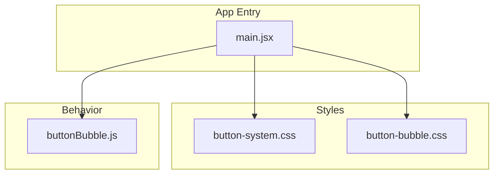
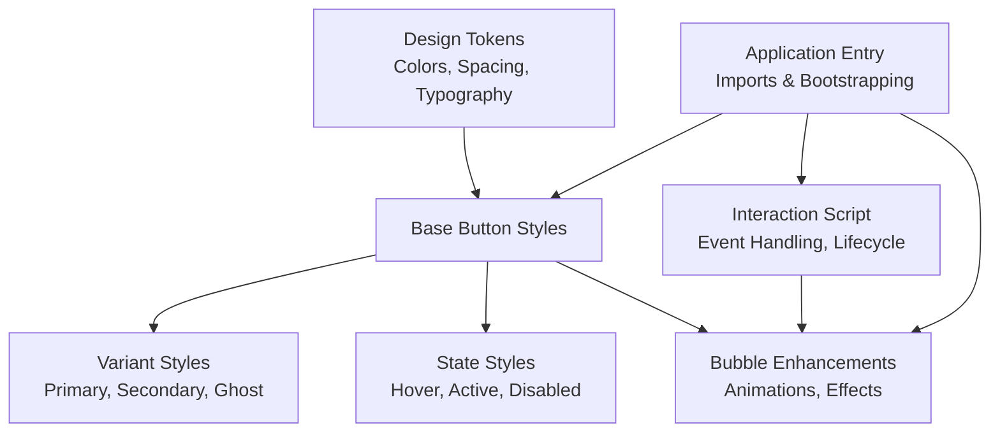
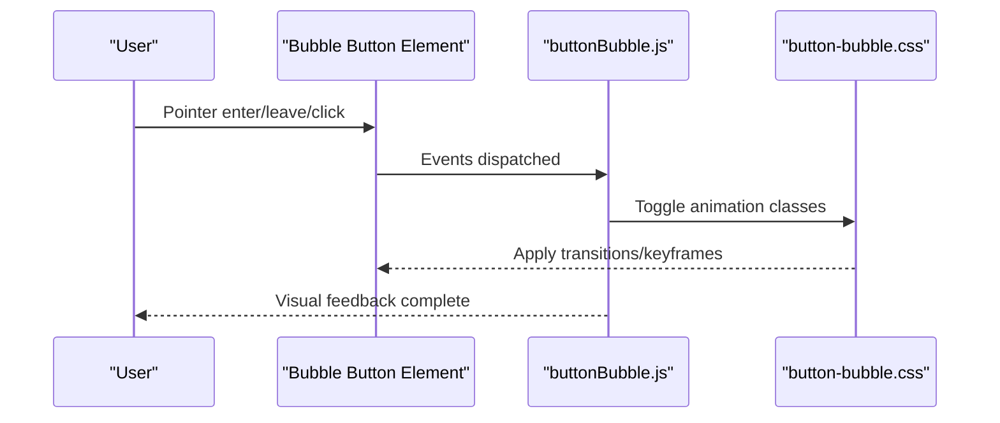
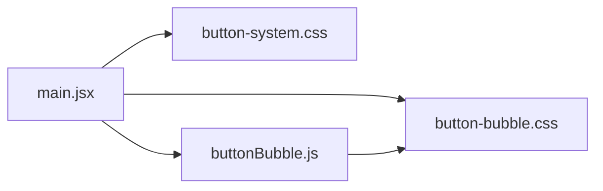

# Button System Architecture

<cite>
**Referenced Files in This Document**
- [button-system.css](file://src/button-system.css)
- [button-bubble.css](file://src/button-bubble.css)
- [buttonBubble.js](file://src/buttonBubble.js)
- [main.jsx](file://src/main.jsx)
</cite>

## Table of Contents
1. [Introduction](#introduction)
2. [Project Structure](#project-structure)
3. [Core Components](#core-components)
4. [Architecture Overview](#architecture-overview)
5. [Detailed Component Analysis](#detailed-component-analysis)
6. [Dependency Analysis](#dependency-analysis)
7. [Performance Considerations](#performance-considerations)
8. [Troubleshooting Guide](#troubleshooting-guide)
9. [Conclusion](#conclusion)
10. [Appendices](#appendices)

## Introduction
This document explains the PodiumMinds button system architecture, focusing on:
- Button variants and states (hover, active, disabled)
- Responsive behaviors across screen sizes
- Bubble button implementation with animation effects and interaction patterns
- CSS custom properties, class naming conventions, and composition strategies
- Creating new button variants and integrating with React components
- Accessibility considerations and cross-browser compatibility

The goal is to provide a clear, practical guide for designers and developers to extend and maintain the button system consistently.

## Project Structure
The button system is implemented using:
- A shared stylesheet for core button styles and tokens
- A dedicated stylesheet for bubble-specific behavior and animations
- A small JavaScript module that wires up interactive behaviors for bubble buttons
- The application entry point where styles are imported and used

**Diagram sources**
- [button-system.css](file://src/button-system.css)
- [button-bubble.css](file://src/button-bubble.css)
- [buttonBubble.js](file://src/buttonBubble.js)
- [main.jsx](file://src/main.jsx)

**Section sources**
- [button-system.css](file://src/button-system.css)
- [button-bubble.css](file://src/button-bubble.css)
- [buttonBubble.js](file://src/buttonBubble.js)
- [main.jsx](file://src/main.jsx)

## Core Components
- Shared button base styles and tokens defined in the core stylesheet
- Bubble button enhancements including ripple-like or morphing animations and pointer interactions
- A lightweight script that initializes bubble behaviors on matching elements
- Integration via the application entry point which imports all relevant assets

Key responsibilities:
- Centralize design tokens (colors, spacing, typography) for consistent appearance
- Provide a set of predefined variants (e.g., primary, secondary, ghost) and states (hover, active, disabled)
- Encapsulate bubble-specific logic and animations behind a simple API
- Ensure responsive sizing and layout adjustments

**Section sources**
- [button-system.css](file://src/button-system.css)
- [button-bubble.css](file://src/button-bubble.css)
- [buttonBubble.js](file://src/buttonBubble.js)
- [main.jsx](file://src/main.jsx)

## Architecture Overview
The system follows a layered approach:
- Tokens and base styles define the visual language
- Variant styles compose from base styles
- Behavior layer adds interactivity and animations
- Application entry wires everything together

[No sources needed since this diagram shows conceptual workflow, not actual code structure]

## Detailed Component Analysis

### Button Base and Variants
- Base styles establish common layout, typography, focus outlines, and transitions
- Variants are created by composing base styles with modifier classes
- States are applied via pseudo-classes and attribute selectors for disabled state
- Responsive rules adjust padding, font size, and icon scaling at breakpoints

Practical guidance:
- Prefer modifier classes over inline styles to keep overrides predictable
- Use semantic attributes (e.g., disabled) to enforce consistent state styling
- Keep variant definitions minimal; prefer composition to reduce duplication

**Section sources**
- [button-system.css](file://src/button-system.css)

### Bubble Button Implementation
The bubble button extends the base button with dynamic visual feedback:
- Animation effects triggered on pointer events
- Optional ripple or scale transforms for tactile feedback
- Event delegation pattern to initialize behaviors efficiently

Implementation highlights:
- A small script selects elements with a specific marker class and attaches event listeners
- Animations leverage CSS transitions and keyframes for performance
- Cleanup routines remove listeners when elements are removed from the DOM

**Diagram sources**
- [buttonBubble.js](file://src/buttonBubble.js)
- [button-bubble.css](file://src/button-bubble.css)

**Section sources**
- [button-bubble.css](file://src/button-bubble.css)
- [buttonBubble.js](file://src/buttonBubble.js)

### Class Naming Conventions and Composition Strategy
Recommended conventions:
- Base class for shared button behavior and layout
- Modifier classes for variants (e.g., color, size, shape)
- State classes or attribute selectors for hover, active, disabled
- Feature classes for optional enhancements (e.g., bubble)

Composition strategy:
- Combine base + variant + feature classes to create complex buttons
- Avoid deep nesting; rely on flat class lists for clarity and testability
- Keep modifiers composable and independent to minimize conflicts

**Section sources**
- [button-system.css](file://src/button-system.css)
- [button-bubble.css](file://src/button-bubble.css)

### CSS Custom Properties
Centralized tokens improve consistency and theming:
- Define color tokens for backgrounds, text, borders, and focus rings
- Define spacing tokens for padding, gap, and radius
- Define typography tokens for font sizes, weights, and line heights
- Override tokens at component scope or theme scope to create variations

Usage tips:
- Reference tokens in styles instead of hard-coded values
- Group related tokens under meaningful namespaces
- Provide sensible defaults and document override points

**Section sources**
- [button-system.css](file://src/button-system.css)

### Responsive Behaviors
- Adjust button height, padding, and font size at breakpoints
- Scale icons proportionally while maintaining touch targets
- Ensure adequate contrast and legibility on small screens

Guidelines:
- Use fluid units where appropriate for smoother scaling
- Maintain minimum touch target sizes for mobile accessibility
- Test across common viewport widths and device pixel ratios

**Section sources**
- [button-system.css](file://src/button-system.css)

### Integrating with React Components
Integration steps:
- Import the button styles in your application entry point
- Create a React wrapper that applies base and variant classes based on props
- Map props to modifier classes and state attributes (e.g., disabled)
- For bubble behavior, ensure the element has the required marker class so the script can initialize it

Best practices:
- Expose a simple prop interface (variant, size, disabled, onClick)
- Forward ref and standard HTML attributes for accessibility and testing
- Debounce or throttle expensive handlers if needed

**Section sources**
- [main.jsx](file://src/main.jsx)
- [button-system.css](file://src/button-system.css)
- [button-bubble.css](file://src/button-bubble.css)
- [buttonBubble.js](file://src/buttonBubble.js)

### Creating New Button Variants
Steps to add a new variant:
- Add a modifier class in the core stylesheet
- Compose from base styles to inherit layout and transitions
- Define token overrides for colors and typography
- Update documentation and examples to reflect usage

Validation:
- Verify hover, active, and disabled states
- Check contrast and readability
- Confirm responsive behavior and touch targets

**Section sources**
- [button-system.css](file://src/button-system.css)

## Dependency Analysis
The button system has minimal dependencies:
- Stylesheets define presentation and tokens
- A small script provides behavioral enhancements
- The application entry imports these resources

**Diagram sources**
- [main.jsx](file://src/main.jsx)
- [button-system.css](file://src/button-system.css)
- [button-bubble.css](file://src/button-bubble.css)
- [buttonBubble.js](file://src/buttonBubble.js)

**Section sources**
- [main.jsx](file://src/main.jsx)
- [button-system.css](file://src/button-system.css)
- [button-bubble.css](file://src/button-bubble.css)
- [buttonBubble.js](file://src/buttonBubble.js)

## Performance Considerations
- Prefer CSS transitions and transforms for animations to leverage GPU acceleration
- Use event delegation in the behavior script to avoid attaching many listeners
- Minimize style recalculations by toggling classes rather than mutating inline styles
- Keep token definitions centralized to reduce redundant computations

[No sources needed since this section provides general guidance]

## Troubleshooting Guide
Common issues and resolutions:
- Animations not triggering: Ensure the marker class is present and the script runs after DOM ready
- Hover/active states not applying: Verify class order and specificity; avoid overriding with inline styles
- Disabled state inconsistent: Use the disabled attribute alongside any state classes
- Focus visibility missing: Confirm focus outline styles are not suppressed globally
- Mobile touch feedback weak: Increase hit area and consider adding tap-active states

**Section sources**
- [button-bubble.css](file://src/button-bubble.css)
- [buttonBubble.js](file://src/buttonBubble.js)
- [button-system.css](file://src/button-system.css)

## Conclusion
The PodiumMinds button system combines a robust token-driven stylesheet with a lightweight behavior layer to deliver consistent, accessible, and animated buttons. By following the composition strategy, naming conventions, and integration guidelines outlined here, teams can confidently extend the system with new variants and interactions while maintaining quality and performance.

[No sources needed since this section summarizes without analyzing specific files]

## Appendices

### Accessibility Checklist
- Keyboard navigation: All buttons must be reachable via Tab and activatable with Enter/Space
- Focus management: Visible focus indicators should remain distinct from hover/active states
- Color contrast: Ensure sufficient contrast for text and icons against backgrounds
- Screen readers: Use semantic button elements and descriptive labels; avoid relying solely on visuals
- Reduced motion: Respect prefers-reduced-motion for users who prefer fewer animations

[No sources needed since this section provides general guidance]

### Cross-Browser Compatibility Notes
- Validate CSS custom properties support in target browsers; provide fallbacks if necessary
- Test animations on Safari, Chrome, Firefox, and Edge for consistent timing and easing
- Confirm pointer event handling behaves similarly across desktop and mobile browsers
- Verify focus ring rendering differences and normalize where possible

[No sources needed since this section provides general guidance]