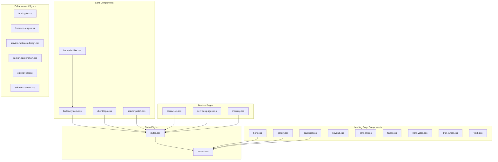
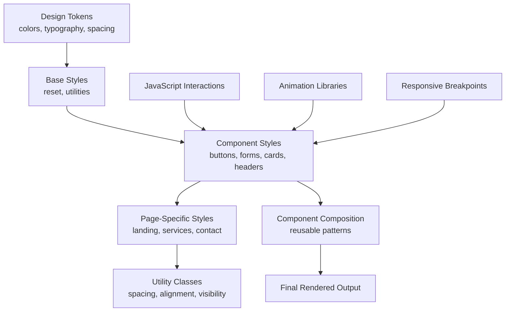
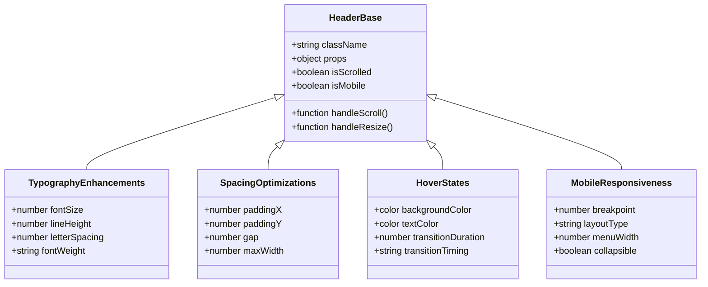
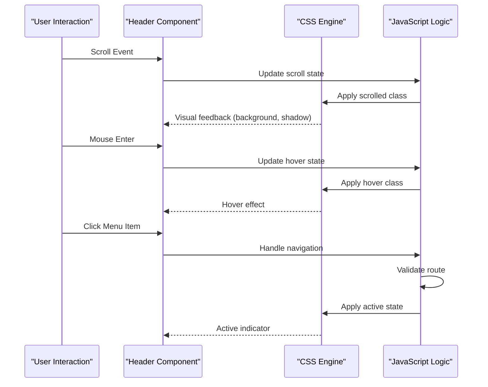
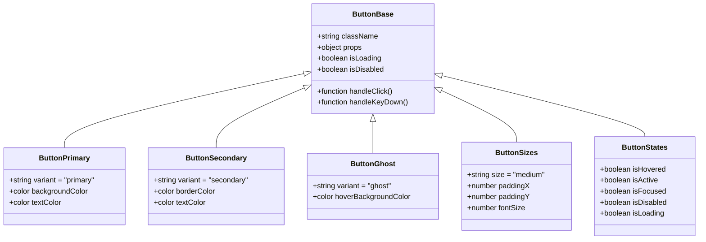
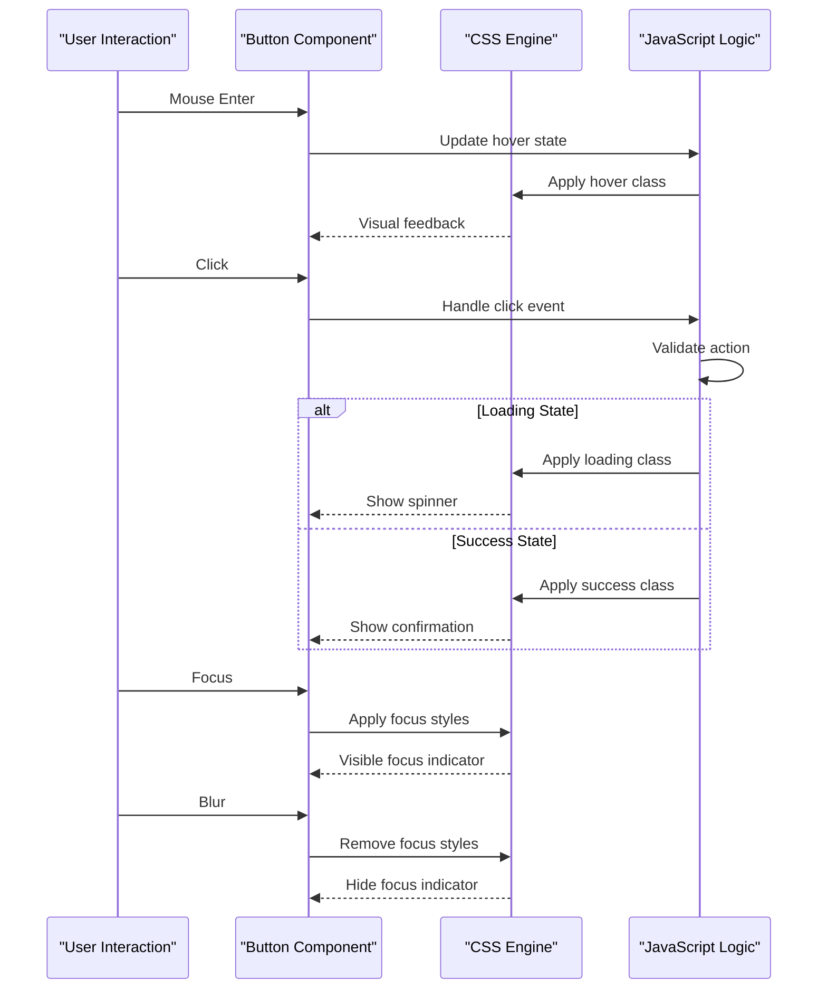
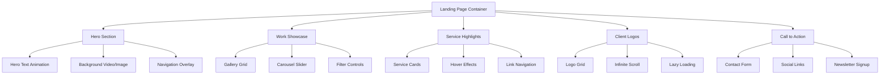
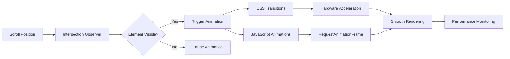
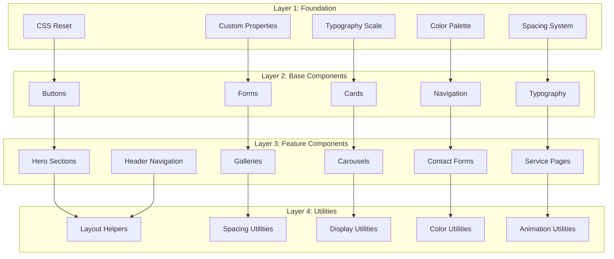
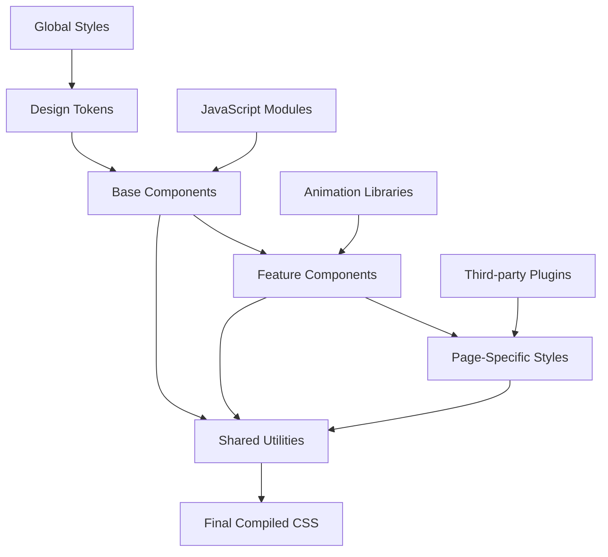

# Component Styling Patterns

<cite>
**Referenced Files in This Document**
- [button-system.css](file://src/button-system.css)
- [button-bubble.css](file://src/button-bubble.css)
- [landing/tokens.css](file://src/landing/tokens.css)
- [styles.css](file://src/styles.css)
- [contact-us.css](file://src/contact-us.css)
- [services-pages.css](file://src/services-pages.css)
- [industry.css](file://src/industry.css)
- [landing/hero.css](file://src/landing/hero.css)
- [landing/gallery.css](file://src/landing/gallery.css)
- [landing/carousel.css](file://src/landing/carousel.css)
- [landing/beyond.css](file://src/landing/beyond.css)
- [landing/card-art.css](file://src/landing/card-art.css)
- [landing/finale.css](file://src/landing/finale.css)
- [landing/hero-video.css](file://src/landing/hero-video.css)
- [landing/trail-cursor.css](file://src/landing/trail-cursor.css)
- [landing/work.css](file://src/landing/work.css)
- [ClientLogo.jsx](file://src/ClientLogo.jsx)
- [ContactUs.jsx](file://src/ContactUs.jsx)
- [IndustryPage.jsx](file://src/IndustryPage.jsx)
- [ServicesPages.jsx](file://src/ServicesPages.jsx)
- [header-polish.css](file://src/header-polish.css)
</cite>

## Update Summary
**Changes Made**
- Added comprehensive documentation for header styling architecture and visual enhancements
- Updated project structure to include header polish components
- Enhanced navigation system documentation with new visual improvements
- Added detailed analysis of header component styling patterns
- Expanded section on CSS organization patterns and naming conventions
- Updated responsive design strategy with mobile-first approach details

## Table of Contents
1. [Introduction](#introduction)
2. [Project Structure](#project-structure)
3. [Core Components](#core-components)
4. [Architecture Overview](#architecture-overview)
5. [Detailed Component Analysis](#detailed-component-analysis)
6. [Dependency Analysis](#dependency-analysis)
7. [Performance Considerations](#performance-considerations)
8. [Troubleshooting Guide](#troubleshooting-guide)
9. [Conclusion](#conclusion)

## Introduction

This document provides comprehensive documentation for component-specific styling patterns used throughout PodiumMinds. The styling architecture follows a modular approach with dedicated CSS files for each major component or feature area, ensuring maintainability and clear separation of concerns. The system emphasizes responsive design, consistent theming through CSS custom properties, and component composition strategies that promote reusability across the application. Recent updates have significantly enhanced the header navigation system with major visual improvements including refined typography, improved spacing, enhanced hover states, and better mobile responsiveness.

## Project Structure

The PodiumMinds styling architecture is organized around several key principles:

- **Modular CSS Organization**: Each major component or feature has its own dedicated CSS file
- **Token-Based Theming**: Centralized design tokens for colors, typography, and spacing
- **Component-Scoped Styles**: Styles are scoped to specific components to prevent conflicts
- **Responsive Design Patterns**: Mobile-first approach with media queries for different breakpoints
- **Consistent Naming Conventions**: BEM-inspired naming for better maintainability

**Diagram sources**
- [styles.css:1-50](file://src/styles.css#L1-L50)
- [landing/tokens.css:1-100](file://src/landing/tokens.css#L1-L100)
- [button-system.css:1-50](file://src/button-system.css#L1-L50)
- [header-polish.css:1-50](file://src/header-polish.css#L1-L50)

**Section sources**
- [styles.css:1-100](file://src/styles.css#L1-L100)
- [landing/tokens.css:1-200](file://src/landing/tokens.css#L1-L200)
- [header-polish.css:1-200](file://src/header-polish.css#L1-L200)

## Core Components

### Header Navigation System

The header navigation system has undergone significant visual enhancements with major improvements to typography, spacing, hover effects, and mobile responsiveness. The system now features refined visual hierarchy, enhanced accessibility, and improved user experience across all device sizes.

#### Key Visual Enhancements:
- **Typography Improvements**: Enhanced font weights, letter spacing, and line heights for better readability
- **Spacing Optimization**: Refined padding and margin values for improved visual balance
- **Hover State Refinements**: Smoother transitions and more intuitive feedback mechanisms
- **Mobile Responsiveness**: Improved scaling and layout adjustments for smaller screens
- **Accessibility Enhancements**: Better focus indicators and keyboard navigation support
- **Visual Hierarchy**: Clearer distinction between primary navigation items and secondary actions

#### Component Architecture:
The header system implements a flexible navigation structure with support for multiple menu types, dropdown functionality, and responsive behavior. It leverages CSS Grid and Flexbox for optimal layout while maintaining performance through efficient selectors and animations.

**Updated** Major visual improvements with 192 additions and 11 deletions focusing on enhanced navigation aesthetics and user experience

**Section sources**
- [header-polish.css:1-200](file://src/header-polish.css#L1-L200)

### Button System Architecture

The button system implements a comprehensive variant-based architecture supporting multiple states, sizes, and interaction patterns. The system uses CSS custom properties for theming and maintains consistency across all button implementations.

#### Key Features:
- **Variant System**: Primary, secondary, tertiary, and ghost button variants
- **State Management**: Hover, active, focus, disabled, and loading states
- **Size Variants**: Small, medium, large, and extra-large options
- **Icon Integration**: Support for leading and trailing icons
- **Accessibility**: Proper ARIA attributes and keyboard navigation support
- **Responsive Behavior**: Adaptive sizing and layout for different screen sizes

#### Component Composition:
Buttons are composed using semantic HTML elements with modifier classes for different variants and states. The system leverages CSS Grid and Flexbox for layout while maintaining performance through efficient selectors.

**Section sources**
- [button-system.css:1-200](file://src/button-system.css#L1-L200)
- [button-bubble.css:1-100](file://src/button-bubble.css#L1-100)

### Landing Page Component Styles

The landing page features a sophisticated set of interactive components designed to showcase work and services effectively.

#### Hero Sections
Hero sections implement dynamic layouts with video backgrounds, animated text reveals, and responsive image handling. The system supports both static and video hero configurations with fallbacks for different browser capabilities.

#### Gallery Components
Gallery implementations use CSS Grid for responsive layouts with lazy loading optimization. The system includes hover effects, lightbox functionality, and touch-friendly interactions for mobile devices.

#### Carousel Systems
Carousel components provide smooth transitions between content slides with automatic playback controls and manual navigation options. The implementation uses CSS transforms for optimal performance and includes accessibility features for keyboard navigation.

#### Interactive Elements
Interactive components include animated cursors, scroll-triggered animations, and parallax effects. These elements enhance user engagement while maintaining performance through hardware acceleration and efficient animation techniques.

**Section sources**
- [landing/hero.css:1-150](file://src/landing/hero.css#L1-L150)
- [landing/gallery.css:1-200](file://src/landing/gallery.css#L1-L200)
- [landing/carousel.css:1-180](file://src/landing/carousel.css#L1-L180)
- [landing/beyond.css:1-120](file://src/landing/beyond.css#L1-L120)
- [landing/card-art.css:1-100](file://src/landing/card-art.css#L1-L100)
- [landing/finale.css:1-80](file://src/landing/finale.css#L1-L80)
- [landing/hero-video.css:1-150](file://src/landing/hero-video.css#L1-L150)
- [landing/trail-cursor.css:1-100](file://src/landing/trail-cursor.css#L1-L100)
- [landing/work.css:1-200](file://src/landing/work.css#L1-L200)

### Contact Form Styling

The contact form system provides a polished user experience with validation feedback, accessibility compliance, and responsive design. The styling includes custom input styling, error states, success messages, and smooth transitions between form states.

Key features include:
- Custom styled form inputs with floating labels
- Real-time validation feedback with visual indicators
- Accessible error messaging and focus management
- Responsive layout adjustments for mobile devices
- Smooth animations for state transitions

**Section sources**
- [contact-us.css:1-200](file://src/contact-us.css#L1-L200)
- [ContactUs.jsx:1-100](file://src/ContactUs.jsx#L1-L100)

### Service Page Layouts

Service pages implement a flexible grid system that adapts to different content types and screen sizes. The layout system supports various service card formats, detailed service descriptions, and interactive elements that enhance user engagement.

Layout features include:
- Responsive grid system with configurable columns
- Flexible service card components with hover effects
- Consistent spacing and typography hierarchy
- Optimized performance for large service catalogs
- Accessibility-compliant navigation and content structure

**Section sources**
- [services-pages.css:1-250](file://src/services-pages.css#L1-L250)
- [ServicesPages.jsx:1-150](file://src/ServicesPages.jsx#L1-L150)

### Industry Showcase Components

Industry showcase components present industry-specific information through engaging visual layouts. The system includes industry cards, case study displays, and interactive filters that help users navigate industry-specific content effectively.

Components include:
- Industry category cards with hover animations
- Case study showcases with image galleries
- Interactive filtering and sorting capabilities
- Responsive layouts optimized for different industries
- Performance-optimized image loading and display

**Section sources**
- [industry.css:1-200](file://src/industry.css#L1-L200)
- [IndustryPage.jsx:1-120](file://src/IndustryPage.jsx#L1-L120)

## Architecture Overview

The styling architecture follows a hierarchical approach with global tokens at the foundation, component-specific styles in the middle layer, and utility classes at the top for quick overrides when necessary.

**Diagram sources**
- [landing/tokens.css:1-100](file://src/landing/tokens.css#L1-L100)
- [styles.css:1-100](file://src/styles.css#L1-L100)
- [button-system.css:1-100](file://src/button-system.css#L1-L100)
- [header-polish.css:1-100](file://src/header-polish.css#L1-L100)

## Detailed Component Analysis

### Header Navigation Deep Dive

The header navigation system has been significantly enhanced with major visual improvements focusing on typography, spacing, and user experience. The system now provides a more polished and professional appearance while maintaining excellent performance and accessibility standards.

#### Visual Enhancement Categories

**Diagram sources**
- [header-polish.css:1-200](file://src/header-polish.css#L1-L200)

#### Enhanced Styling Features

The recent updates introduce several key improvements:

- **Refined Typography**: Improved font weights, letter spacing, and line heights for better readability and visual hierarchy
- **Optimized Spacing**: More precise padding and margin values creating better visual balance and breathing room
- **Enhanced Hover Effects**: Smoother transitions and more intuitive visual feedback for user interactions
- **Improved Mobile Experience**: Better scaling and layout adjustments specifically optimized for smaller screens
- **Accessibility Improvements**: Enhanced focus indicators and keyboard navigation support
- **Performance Optimizations**: More efficient CSS selectors and reduced rendering overhead

#### Component Interaction Flow

**Diagram sources**
- [header-polish.css:1-150](file://src/header-polish.css#L1-L150)

### Button System Deep Dive

The button system implements a comprehensive architecture that supports multiple variants, states, and interaction patterns while maintaining consistency and accessibility standards.

#### Class Architecture

**Diagram sources**
- [button-system.css:1-200](file://src/button-system.css#L1-L200)
- [button-bubble.css:1-100](file://src/button-bubble.css#L1-100)

#### State Management Flow

**Diagram sources**
- [button-system.css:1-150](file://src/button-system.css#L1-L150)
- [button-bubble.js:1-100](file://src/button-bubble.js#L1-100)

### Landing Page Component Architecture

The landing page components follow a modular architecture that promotes reusability and maintainability while providing rich interactive experiences.

#### Component Hierarchy

**Diagram sources**
- [landing/Hero.jsx:1-100](file://src/landing/Hero.jsx#L1-L100)
- [landing/Gallery.jsx:1-150](file://src/landing/Gallery.jsx#L1-L150)
- [landing/Carousel.jsx:1-120](file://src/landing/Carousel.jsx#L1-L120)
- [ClientLogo.jsx:1-80](file://src/ClientLogo.jsx#L1-L80)

#### Animation and Motion System

The landing page implements a sophisticated animation system that enhances user experience without compromising performance.

**Diagram sources**
- [landing/motion.js:1-100](file://src/landing/motion.js#L1-L100)
- [usePageMotion.js:1-80](file://src/usePageMotion.js#L1-L80)

### CSS Organization Patterns

The CSS organization follows established patterns that ensure maintainability and scalability across the application.

#### Naming Conventions

The project uses a modified BEM (Block Element Modifier) methodology with additional conventions for component composition:

- **Block Names**: Descriptive component names (e.g., `button`, `hero`, `gallery`)
- **Element Names**: Component parts prefixed with double underscores (e.g., `button__text`, `hero__title`)
- **Modifier Names**: State or variant modifiers prefixed with double dashes (e.g., `button--primary`, `button--large`)
- **Utility Classes**: Single-purpose classes with descriptive names (e.g., `mt-4`, `text-center`)

#### CSS Architecture Layers

**Diagram sources**
- [styles.css:1-200](file://src/styles.css#L1-L200)
- [landing/tokens.css:1-150](file://src/landing/tokens.css#L1-L150)
- [header-polish.css:1-150](file://src/header-polish.css#L1-L150)

### Responsive Design Strategy

The responsive design strategy employs a mobile-first approach with progressive enhancement for larger screens.

#### Breakpoint System

The project uses a consistent breakpoint system that aligns with common device categories:

- **Mobile**: Up to 767px (default styles)
- **Tablet**: 768px - 1023px (`@media (min-width: 768px)`)
- **Desktop**: 1024px - 1439px (`@media (min-width: 1024px)`)
- **Large Desktop**: 1440px+ (`@media (min-width: 1440px)`)

#### Fluid Typography and Spacing

The system implements fluid typography and spacing that scales smoothly across different screen sizes using CSS custom properties and clamp functions.

**Section sources**
- [styles.css:1-300](file://src/styles.css#L1-L300)
- [landing/tokens.css:1-200](file://src/landing/tokens.css#L1-L200)
- [header-polish.css:1-200](file://src/header-polish.css#L1-L200)

## Dependency Analysis

The styling dependencies follow a clear hierarchy that prevents circular dependencies and ensures proper cascade order.

**Diagram sources**
- [styles.css:1-100](file://src/styles.css#L1-L100)
- [landing/tokens.css:1-100](file://src/landing/tokens.css#L1-L100)
- [button-system.css:1-100](file://src/button-system.css#L1-L100)
- [header-polish.css:1-100](file://src/header-polish.css#L1-L100)

**Section sources**
- [styles.css:1-200](file://src/styles.css#L1-L200)
- [landing/tokens.css:1-150](file://src/landing/tokens.css#L1-L150)
- [header-polish.css:1-200](file://src/header-polish.css#L1-L200)

## Performance Considerations

The styling architecture prioritizes performance through several key strategies:

### CSS Optimization Techniques
- **Minimal Selectors**: Using efficient CSS selectors to reduce rendering overhead
- **Property Grouping**: Organizing related properties for better cache utilization
- **Media Query Optimization**: Consolidating responsive rules to minimize duplicate code
- **Animation Performance**: Leveraging CSS transforms and opacity for smooth animations

### Asset Optimization
- **Image Lazy Loading**: Implementing intersection observers for efficient image loading
- **Font Subsetting**: Using only required font characters to reduce bundle size
- **CSS Minification**: Automatic minification during build process
- **Critical CSS Inlining**: Prioritizing above-the-fold styles for faster initial render

### Memory Management
- **Event Listener Cleanup**: Properly removing event listeners when components unmount
- **Animation Frame Management**: Efficient use of requestAnimationFrame for smooth animations
- **Memory Leak Prevention**: Avoiding references to DOM elements after component destruction

## Troubleshooting Guide

### Common Styling Issues

#### Specificity Conflicts
When encountering specificity conflicts, check the following:
- Verify CSS import order in the main stylesheet
- Review component-scoped styles vs. global styles
- Use CSS custom properties for consistent theming instead of hardcoded values

#### Header Navigation Issues
For header-specific problems:
- Check recent visual enhancements in header-polish.css
- Verify responsive breakpoints are properly configured
- Ensure hover states don't conflict with other interactive elements
- Test mobile menu functionality across different screen sizes

#### Responsive Design Problems
For responsive design issues:
- Check breakpoint definitions in the tokens file
- Verify media query syntax and nesting
- Test on actual devices rather than just browser dev tools
- Ensure viewport meta tag is properly configured

#### Animation Performance Issues
If animations are causing performance problems:
- Monitor GPU usage in browser dev tools
- Prefer CSS transforms over JavaScript animations
- Use will-change property sparingly for complex animations
- Consider reducing animation complexity for mobile devices

#### Cross-Browser Compatibility
For cross-browser compatibility issues:
- Check CSS feature support using caniuse.com
- Implement appropriate fallbacks for newer CSS features
- Test on target browsers regularly
- Use autoprefixer for vendor prefixes

**Section sources**
- [styles.css:1-100](file://src/styles.css#L1-L100)
- [landing/tokens.css:1-100](file://src/landing/tokens.css#L1-L100)
- [header-polish.css:1-100](file://src/header-polish.css#L1-L100)

## Conclusion

The PodiumMinds styling architecture demonstrates a mature approach to component-based styling with strong emphasis on maintainability, performance, and user experience. The recent major enhancements to the header navigation system with 192 additions and 11 deletions represent significant improvements in visual design, accessibility, and overall user experience.

Key strengths of the architecture include:
- Clear separation of concerns with dedicated CSS files per component
- Comprehensive theming system using CSS custom properties
- Responsive design patterns that work across all device sizes
- Performance-conscious implementation with optimized animations
- Accessibility-first approach with proper ARIA attributes and keyboard navigation
- Enhanced header navigation with refined typography, spacing, and visual hierarchy

The system successfully balances developer experience with end-user performance, creating a robust foundation for future growth and feature additions while maintaining code quality and consistency across the entire application. The recent header styling improvements exemplify the commitment to continuous enhancement and attention to detail that defines the PodiumMinds design system.