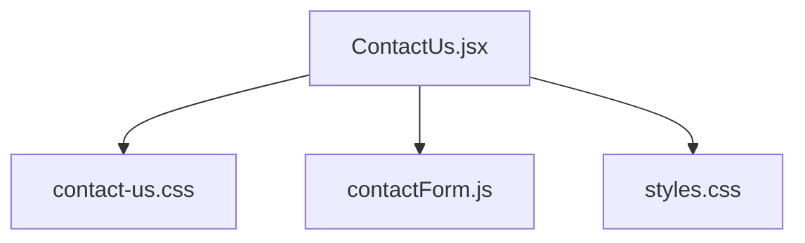
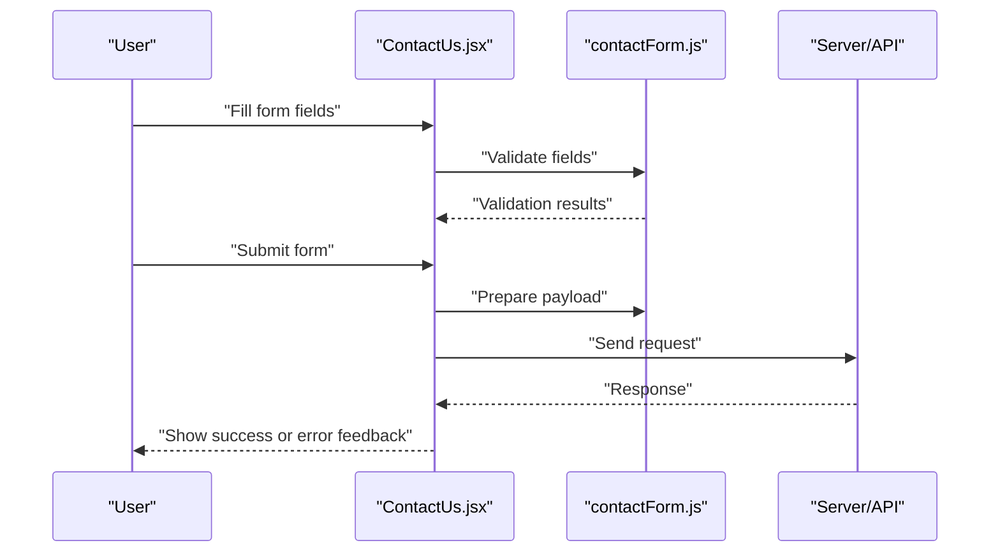
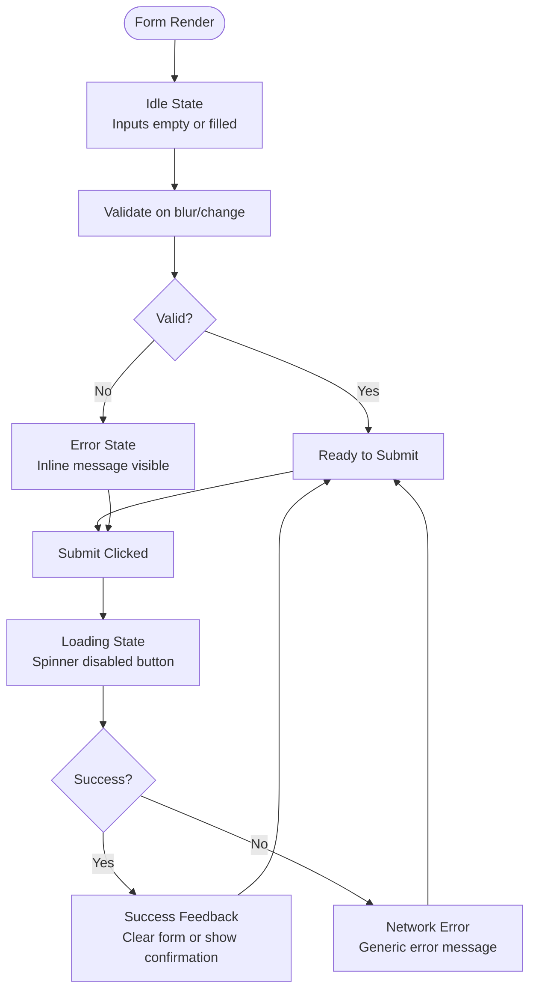
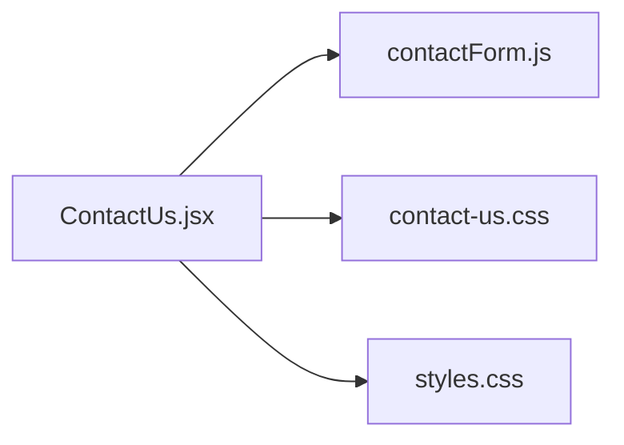

# Form Component Styling

<cite>
**Referenced Files in This Document**
- [ContactUs.jsx](file://src/ContactUs.jsx)
- [contact-us.css](file://src/contact-us.css)
- [contactForm.js](file://src/contactForm.js)
- [styles.css](file://src/styles.css)
</cite>

## Table of Contents
1. [Introduction](#introduction)
2. [Project Structure](#project-structure)
3. [Core Components](#core-components)
4. [Architecture Overview](#architecture-overview)
5. [Detailed Component Analysis](#detailed-component-analysis)
6. [Dependency Analysis](#dependency-analysis)
7. [Performance Considerations](#performance-considerations)
8. [Troubleshooting Guide](#troubleshooting-guide)
9. [Conclusion](#conclusion)
10. [Appendices](#appendices)

## Introduction
This document explains how forms are styled and behave in PodiumMinds, focusing on the contact form. It covers layout, input styling, validation states, submission feedback, responsive patterns, error handling visuals, success states, loading animations, accessibility best practices, and guidelines for consistent form experiences across the application.

## Project Structure
The contact form is implemented as a React component with associated styles and a helper module for form logic. The key files are:
- ContactUs.jsx: The main contact form component
- contact-us.css: Styles specific to the contact form
- contactForm.js: Helper utilities for form behavior (e.g., validation, submission)
- styles.css: Global styles that may influence form elements

**Diagram sources**
- [ContactUs.jsx](file://src/ContactUs.jsx)
- [contact-us.css](file://src/contact-us.css)
- [contactForm.js](file://src/contactForm.js)
- [styles.css](file://src/styles.css)

**Section sources**
- [ContactUs.jsx](file://src/ContactUs.jsx)
- [contact-us.css](file://src/contact-us.css)
- [contactForm.js](file://src/contactForm.js)
- [styles.css](file://src/styles.css)

## Core Components
- ContactUs.jsx: Renders the contact form UI, manages state for inputs and submission feedback, and integrates validation and submission helpers.
- contactForm.js: Provides reusable logic for validation rules, field normalization, and submission flow orchestration.
- contact-us.css: Defines layout, spacing, typography, colors, borders, focus rings, and responsive breakpoints for the contact form.
- styles.css: Contains global CSS variables and base styles that affect form controls globally.

Key responsibilities:
- Layout and structure of the form fields
- Input field styling (typography, spacing, borders, focus states)
- Validation state indicators (error/success)
- Submission feedback (loading spinner, success message, error messages)
- Responsive design across screen sizes
- Accessibility attributes and behaviors

**Section sources**
- [ContactUs.jsx](file://src/ContactUs.jsx)
- [contactForm.js](file://src/contactForm.js)
- [contact-us.css](file://src/contact-us.css)
- [styles.css](file://src/styles.css)

## Architecture Overview
The contact form follows a simple component + styles + helper pattern:
- The component orchestrates user interactions and renders the form.
- The helper encapsulates validation and submission logic.
- Styles define visual appearance and responsive behavior.

[No diagram sources needed since this diagram shows conceptual workflow]

## Detailed Component Analysis

### ContactUs.jsx
Responsibilities:
- Manages local state for form fields and submission status
- Integrates validation from contactForm.js
- Displays feedback messages and loading indicators
- Applies accessible labels and roles where appropriate

Styling integration:
- Uses classes defined in contact-us.css for layout and control styling
- Inherits global styles from styles.css

Accessibility considerations:
- Ensure each input has an associated label
- Provide aria-describedby for inline errors
- Manage focus on first invalid field after submit attempt
- Announce success/error via aria-live regions

**Section sources**
- [ContactUs.jsx](file://src/ContactUs.jsx)

### contactForm.js
Responsibilities:
- Validates individual fields and aggregates results
- Normalizes input values before submission
- Handles submission lifecycle (start, success, error)
- Exposes functions used by ContactUs.jsx

Error handling:
- Returns structured validation errors per field
- Supports generic network error messaging

**Section sources**
- [contactForm.js](file://src/contactForm.js)

### contact-us.css
Responsibilities:
- Defines form container layout (grid/flex), spacing, and alignment
- Styles input fields (padding, border, radius, typography)
- Implements focus ring styles for keyboard navigation
- Provides validation state styles (error/success)
- Includes responsive breakpoints for mobile/tablet/desktop

Responsive patterns:
- Single-column layout on small screens
- Multi-column or side-by-side fields on larger screens
- Adjusted font sizes and spacing for readability

**Section sources**
- [contact-us.css](file://src/contact-us.css)

### styles.css
Responsibilities:
- Global CSS variables (colors, spacing, typography)
- Base styles for common HTML elements including form controls
- Consistent defaults that ensure uniformity across components

Impact on forms:
- Colors and fonts applied to inputs and buttons
- Default focus outlines and transitions

**Section sources**
- [styles.css](file://src/styles.css)

### Visual State Flow

[No diagram sources needed since this diagram shows conceptual workflow]

## Dependency Analysis
- ContactUs.jsx depends on:
  - contactForm.js for validation and submission logic
  - contact-us.css for component-specific styles
  - styles.css for global design tokens and base styles

**Diagram sources**
- [ContactUs.jsx](file://src/ContactUs.jsx)
- [contactForm.js](file://src/contactForm.js)
- [contact-us.css](file://src/contact-us.css)
- [styles.css](file://src/styles.css)

**Section sources**
- [ContactUs.jsx](file://src/ContactUs.jsx)
- [contactForm.js](file://src/contactForm.js)
- [contact-us.css](file://src/contact-us.css)
- [styles.css](file://src/styles.css)

## Performance Considerations
- Debounce validation on rapid typing to reduce re-renders
- Avoid heavy computations inside render; keep validation pure and memoized where possible
- Use CSS transitions sparingly; prefer transform and opacity for smooth animations
- Keep asset sizes minimal; avoid large images within form contexts

[No sources needed since this section provides general guidance]

## Troubleshooting Guide
Common issues and resolutions:
- Inputs not receiving focus:
  - Verify tabindex and programmatic focus calls
  - Ensure no overlay blocks pointer events
- Validation messages not appearing:
  - Confirm aria-describedby references correct IDs
  - Check conditional rendering logic tied to validation state
- Submit button remains disabled:
  - Inspect validation aggregation and submit guard conditions
- Screen reader announcements missing:
  - Add aria-live="polite" to feedback containers
  - Update live region content on success/error transitions

**Section sources**
- [ContactUs.jsx](file://src/ContactUs.jsx)
- [contactForm.js](file://src/contactForm.js)
- [contact-us.css](file://src/contact-us.css)
- [styles.css](file://src/styles.css)

## Conclusion
PodiumMinds’ contact form combines a clear component structure with dedicated styles and helper logic to deliver a robust, accessible, and responsive experience. By following the guidelines here—consistent labeling, clear validation states, accessible focus management, and thoughtful responsive design—you can maintain a cohesive form system across the application.

[No sources needed since this section summarizes without analyzing specific files]

## Appendices

### Accessibility Checklist
- Every input has a visible label or aria-label
- Inline errors use aria-describedby linked to the input
- Focus order matches visual reading order
- Keyboard users can navigate and submit using Enter/Space
- Live regions announce success and error messages

### Responsive Design Guidelines
- Mobile-first approach with single-column layouts
- Increase column count at tablet/desktop breakpoints
- Scale typography and spacing proportionally
- Ensure touch targets meet minimum size recommendations

### Submission Feedback Patterns
- Show a spinner and disable the submit button during requests
- Display concise success confirmations
- Present actionable error messages with recovery steps

[No sources needed since this section provides general guidance]