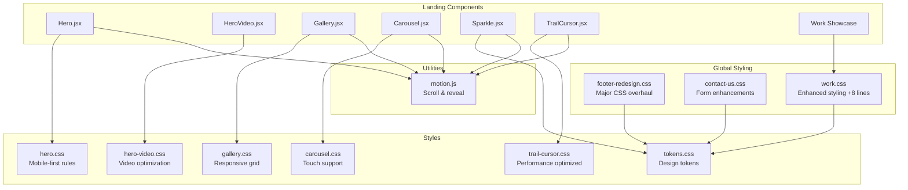
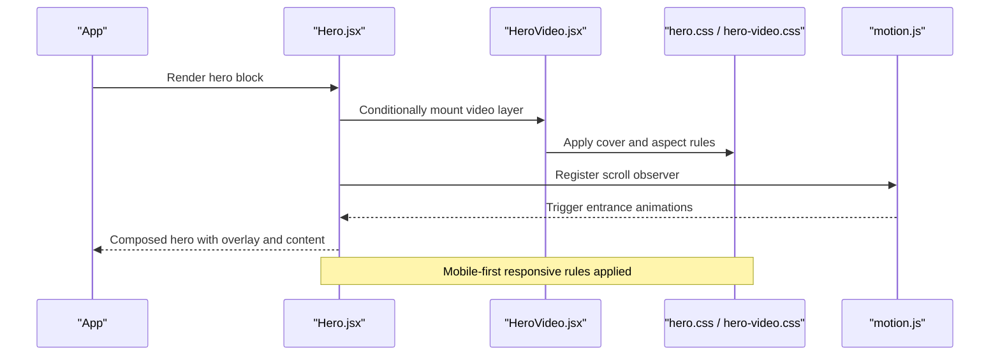
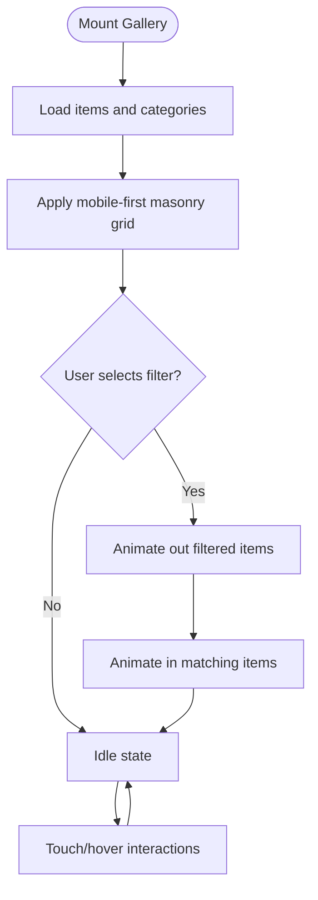
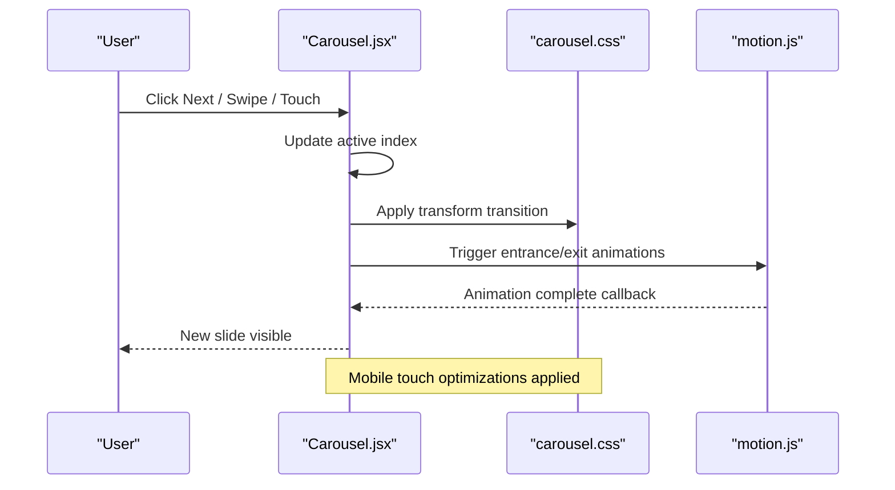
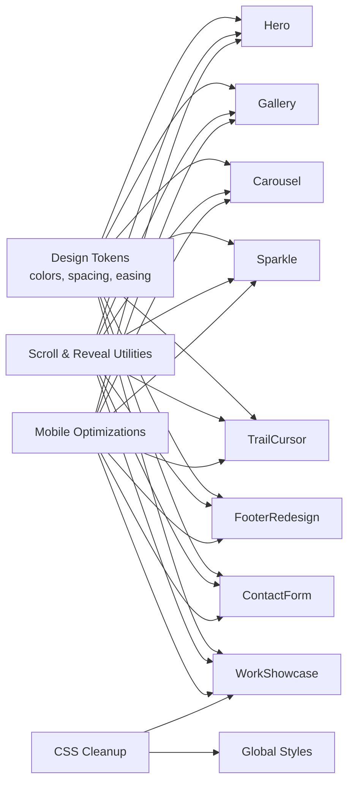
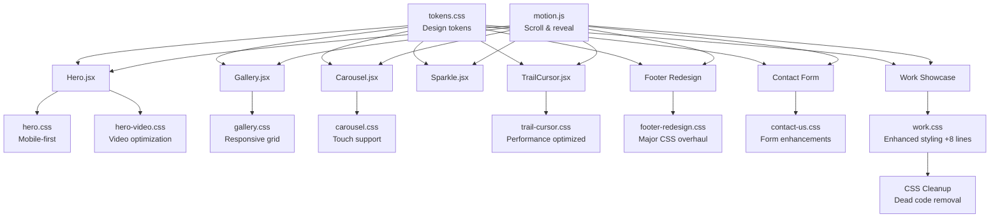

# Landing Page Component Styles

<cite>
**Referenced Files in This Document**
- [Hero.jsx](file://src/landing/Hero.jsx)
- [Hero 2.jsx](file://src/landing/Hero 2.jsx)
- [HeroVideo.jsx](file://src/landing/HeroVideo.jsx)
- [hero.css](file://src/landing/hero.css)
- [hero-video.css](file://src/landing/hero-video.css)
- [Gallery.jsx](file://src/landing/Gallery.jsx)
- [gallery.css](file://src/landing/gallery.css)
- [Carousel.jsx](file://src/landing/Carousel.jsx)
- [carousel.css](file://src/landing/carousel.css)
- [Sparkle.jsx](file://src/landing/Sparkle.jsx)
- [TrailCursor.jsx](file://src/landing/TrailCursor.jsx)
- [trail-cursor.css](file://src/landing/trail-cursor.css)
- [motion.js](file://src/landing/motion.js)
- [tokens.css](file://src/landing/tokens.css)
- [footer-redesign.css](file://src/footer-redesign.css)
- [contact-us.css](file://src/contact-us.css)
- [work.css](file://src/landing/work.css)
</cite>

## Update Summary
**Changes Made**
- Updated Work Showcase Component section to reflect recent styling enhancements with 8 new lines of CSS code
- Added documentation for dead CSS cleanup including removal of .pm2-hero-detail styles
- Enhanced overall styling improvements documentation covering user experience and visual appeal enhancements
- Updated component analysis sections to reflect improved responsive behavior and visual presentation
- Refined troubleshooting guide with new styling-related issues and solutions

## Table of Contents
1. [Introduction](#introduction)
2. [Project Structure](#project-structure)
3. [Core Components](#core-components)
4. [Architecture Overview](#architecture-overview)
5. [Detailed Component Analysis](#detailed-component-analysis)
6. [Footer Redesign Styling](#footer-redesign-styling)
7. [Contact Form Interface Enhancements](#contact-form-interface-enhancements)
8. [Work Showcase Component Refinements](#work-showcase-component-refinements)
9. [CSS Cleanup and Dead Code Removal](#css-cleanup-and-dead-code-removal)
10. [Mobile Responsiveness Strategies](#mobile-responsiveness-strategies)
11. [CSS Organization Patterns](#css-organization-patterns)
12. [Dependency Analysis](#dependency-analysis)
13. [Performance Considerations](#performance-considerations)
14. [Troubleshooting Guide](#troubleshooting-guide)
15. [Conclusion](#conclusion)

## Introduction
This document explains the styling patterns used across landing page components, focusing on:
- Hero section styles with video backgrounds, overlays, and responsive layouts optimized for mobile devices
- Gallery component styling including masonry-like arrangements, hover effects, and filtering animations with mobile-first approach
- Carousel implementations covering transitions, navigation controls, and enhanced touch support for smaller screens
- Advanced visual effects such as trail cursor, sparkle animations, and scroll-triggered reveals with mobile performance considerations
- Comprehensive footer redesign with major CSS overhaul and improved layout patterns
- Enhanced contact form interface with improved user experience and accessibility
- Refined work showcase component styling with better visual hierarchy and responsive behavior
- CSS organization patterns with modular structure and mobile-responsive design rules
- Animation performance optimization techniques and mobile responsiveness strategies
- Recent styling improvements including work showcase enhancements and dead code cleanup

The goal is to provide a clear, code-mapped guide for developers and designers to implement consistent, performant, and accessible landing experiences across all device sizes.

## Project Structure
Landing-related components and styles are organized under src/landing with a mobile-first architecture. Each major UI feature typically has:
- A React component file (e.g., Hero.jsx, Gallery.jsx, Carousel.jsx)
- A dedicated stylesheet with mobile-responsive rules (e.g., hero.css, gallery.css, carousel.css)
- Shared tokens and motion utilities optimized for mobile performance (tokens.css, motion.js)
- Additional global styling files for cross-component features (footer-redesign.css, contact-us.css)



**Diagram sources**
- [Hero.jsx](file://src/landing/Hero.jsx)
- [HeroVideo.jsx](file://src/landing/HeroVideo.jsx)
- [Gallery.jsx](file://src/landing/Gallery.jsx)
- [Carousel.jsx](file://src/landing/Carousel.jsx)
- [Sparkle.jsx](file://src/landing/Sparkle.jsx)
- [TrailCursor.jsx](file://src/landing/TrailCursor.jsx)
- [footer-redesign.css](file://src/footer-redesign.css)
- [contact-us.css](file://src/contact-us.css)
- [work.css](file://src/landing/work.css)
- [hero.css](file://src/landing/hero.css)
- [hero-video.css](file://src/landing/hero-video.css)
- [gallery.css](file://src/landing/gallery.css)
- [carousel.css](file://src/landing/carousel.css)
- [trail-cursor.css](file://src/landing/trail-cursor.css)
- [tokens.css](file://src/landing/tokens.css)
- [motion.js](file://src/landing/motion.js)

**Section sources**
- [Hero.jsx](file://src/landing/Hero.jsx)
- [Hero 2.jsx](file://src/landing/Hero 2.jsx)
- [HeroVideo.jsx](file://src/landing/HeroVideo.jsx)
- [hero.css](file://src/landing/hero.css)
- [hero-video.css](file://src/landing/hero-video.css)
- [Gallery.jsx](file://src/landing/Gallery.jsx)
- [gallery.css](file://src/landing/gallery.css)
- [Carousel.jsx](file://src/landing/Carousel.jsx)
- [carousel.css](file://src/landing/carousel.css)
- [Sparkle.jsx](file://src/landing/Sparkle.jsx)
- [TrailCursor.jsx](file://src/landing/TrailCursor.jsx)
- [trail-cursor.css](file://src/landing/trail-cursor.css)
- [motion.js](file://src/landing/motion.js)
- [tokens.css](file://src/landing/tokens.css)
- [footer-redesign.css](file://src/footer-redesign.css)
- [contact-us.css](file://src/contact-us.css)
- [work.css](file://src/landing/work.css)

## Core Components
- Hero section: Provides full-viewport presentation with optional video background, overlay layers, and mobile-optimized responsive typography. See [Hero.jsx](file://src/landing/Hero.jsx), [Hero 2.jsx](file://src/landing/Hero 2.jsx), [hero.css](file://src/landing/hero.css), and [hero-video.css](file://src/landing/hero-video.css).
- Gallery: Displays items in a mobile-first masonry-like grid with hover states and filtering animations optimized for touch devices. See [Gallery.jsx](file://src/landing/Gallery.jsx) and [gallery.css](file://src/landing/gallery.css).
- Carousel: Implements sliding transitions, navigation controls, and enhanced touch gestures for mobile devices. See [Carousel.jsx](file://src/landing/Carousel.jsx) and [carousel.css](file://src/landing/carousel.css).
- Sparkle effect: Decorative particle animation layered over content with mobile performance optimizations. See [Sparkle.jsx](file://src/landing/Sparkle.jsx) and shared tokens in [tokens.css](file://src/landing/tokens.css).
- Trail cursor: Follows pointer movement with trailing elements for interactive flair, optimized for mobile touch interactions. See [TrailCursor.jsx](file://src/landing/TrailCursor.jsx) and [trail-cursor.css](file://src/landing/trail-cursor.css).
- Motion utilities: Reusable scroll and reveal helpers used by multiple components with mobile-friendly performance characteristics. See [motion.js](file://src/landing/motion.js).
- Footer redesign: Comprehensive styling overhaul with improved layout patterns and responsive behavior. See [footer-redesign.css](file://src/footer-redesign.css).
- Contact form interface: Enhanced form styling with improved user experience and accessibility patterns. See [contact-us.css](file://src/contact-us.css).
- Work showcase: Refined component styling with better visual hierarchy and responsive presentation, recently enhanced with additional styling improvements. See [work.css](file://src/landing/work.css).

**Section sources**
- [Hero.jsx](file://src/landing/Hero.jsx)
- [Hero 2.jsx](file://src/landing/Hero 2.jsx)
- [HeroVideo.jsx](file://src/landing/HeroVideo.jsx)
- [hero.css](file://src/landing/hero.css)
- [hero-video.css](file://src/landing/hero-video.css)
- [Gallery.jsx](file://src/landing/Gallery.jsx)
- [gallery.css](file://src/landing/gallery.css)
- [Carousel.jsx](file://src/landing/Carousel.jsx)
- [carousel.css](file://src/landing/carousel.css)
- [Sparkle.jsx](file://src/landing/Sparkle.jsx)
- [TrailCursor.jsx](file://src/landing/TrailCursor.jsx)
- [trail-cursor.css](file://src/landing/trail-cursor.css)
- [motion.js](file://src/landing/motion.js)
- [tokens.css](file://src/landing/tokens.css)
- [footer-redesign.css](file://src/footer-redesign.css)
- [contact-us.css](file://src/contact-us.css)
- [work.css](file://src/landing/work.css)

## Architecture Overview
The landing system composes small, focused components that share design tokens and motion utilities with mobile-first CSS architecture. Styles are modularized per component to keep concerns isolated while reusing common variables and keyframes optimized for smaller screens. The recent updates have expanded this architecture to include comprehensive global styling improvements for footer, contact forms, and work showcase components, along with targeted enhancements to improve user experience and visual appeal.

```mermaid
classDiagram
class Hero {
+renders "Hero layout"
+supports "video background"
+applies "overlay and responsive rules"
+optimizes "mobile viewport"
}
class HeroVideo {
+manages "video playback"
+handles "muted autoplay fallbacks"
+ensures "mobile compatibility"
}
class Gallery {
+renders "masonry-like grid"
+filters "items with animations"
+styles "hover states"
+optimizes "touch interactions"
}
class Carousel {
+transitions "slides"
+controls "navigation"
+supports "touch gestures"
+enhances "mobile swipe"
}
class Sparkle {
+animates "particles"
+uses "shared tokens"
+optimizes "mobile performance"
}
class TrailCursor {
+follows "pointer"
+renders "trailing nodes"
+adapts "mobile touch"
}
class FooterRedesign {
+implements "major CSS overhaul"
+improves "layout patterns"
+enhances "responsive behavior"
}
class ContactForm {
+enhances "form interface"
+improves "user experience"
+adds "accessibility patterns"
}
class WorkShowcase {
+refines "component styling"
+improves "visual hierarchy"
+optimizes "responsive presentation"
+recently "enhanced with +8 lines"
}
class MotionUtils {
+provides "scroll triggers"
+exposes "reveal helpers"
+optimizes "mobile scrolling"
}
class CSSCleanup {
+removes "dead code"
+cleans ".pm2-hero-detail styles"
+improves "maintainability"
}
Hero --> HeroVideo : "optional video layer"
Hero --> MotionUtils : "scroll reveals"
Gallery --> MotionUtils : "filter/reveal"
Carousel --> MotionUtils : "entrance animations"
Sparkle --> MotionUtils : "timing hooks"
TrailCursor --> MotionUtils : "visibility toggles"
FooterRedesign --> MotionUtils : "global animations"
ContactForm --> MotionUtils : "form interactions"
WorkShowcase --> MotionUtils : "showcase transitions"
WorkShowcase --> CSSCleanup : "benefits from cleanup"
```



**Diagram sources**
- [Hero.jsx](file://src/landing/Hero.jsx)
- [HeroVideo.jsx](file://src/landing/HeroVideo.jsx)
- [Gallery.jsx](file://src/landing/Gallery.jsx)
- [Carousel.jsx](file://src/landing/Carousel.jsx)
- [Sparkle.jsx](file://src/landing/Sparkle.jsx)
- [TrailCursor.jsx](file://src/landing/TrailCursor.jsx)
- [footer-redesign.css](file://src/footer-redesign.css)
- [contact-us.css](file://src/contact-us.css)
- [work.css](file://src/landing/work.css)
- [motion.js](file://src/landing/motion.js)

## Detailed Component Analysis

### Hero Section Styling
- Video backgrounds: The hero can render a video layer behind content with mobile-first optimization. The video component manages playback attributes and container sizing with enhanced mobile compatibility. Styles ensure the video covers the viewport without distortion and respects safe areas on smaller screens.
- Overlay effects: Semi-transparent overlays improve text legibility over media with mobile-specific adjustments. Overlays are applied via pseudo-elements or wrapper divs with z-index layering optimized for touch devices.
- Responsive layouts: Typography scales using fluid units with mobile-first breakpoints; grids and spacing adapt across all screen sizes. Content remains readable on small screens with adjusted line-heights, padding, and touch-friendly sizing.

**Updated** Enhanced mobile responsiveness with improved video handling and touch-friendly overlays



**Diagram sources**
- [Hero.jsx](file://src/landing/Hero.jsx)
- [HeroVideo.jsx](file://src/landing/HeroVideo.jsx)
- [hero.css](file://src/landing/hero.css)
- [hero-video.css](file://src/landing/hero-video.css)
- [motion.js](file://src/landing/motion.js)

**Section sources**
- [Hero.jsx](file://src/landing/Hero.jsx)
- [Hero 2.jsx](file://src/landing/Hero 2.jsx)
- [HeroVideo.jsx](file://src/landing/HeroVideo.jsx)
- [hero.css](file://src/landing/hero.css)
- [hero-video.css](file://src/landing/hero-video.css)
- [motion.js](file://src/landing/motion.js)

### Gallery Component Styling
- Masonry-like layout: Uses CSS columns or grid with varying item heights to achieve a dense, organic arrangement optimized for mobile screens.
- Hover effects: Scale, brightness, and subtle transforms enhance interactivity with touch-friendly alternatives for mobile devices. Focus-visible styles maintain keyboard accessibility.
- Filtering animations: Items animate in/out based on selected filters with GPU-accelerated transitions optimized for mobile performance.

**Updated** Enhanced mobile touch interactions and optimized filtering animations for smaller screens



**Diagram sources**
- [Gallery.jsx](file://src/landing/Gallery.jsx)
- [gallery.css](file://src/landing/gallery.css)

**Section sources**
- [Gallery.jsx](file://src/landing/Gallery.jsx)
- [gallery.css](file://src/landing/gallery.css)

### Carousel Implementations
- Transitions: Slides transition using transform-based movements for smoothness with mobile-optimized easing curves.
- Navigation controls: Previous/Next buttons and dot indicators allow manual control with touch-friendly sizing. Keyboard navigation supports arrow keys and focus management.
- Touch support: Enhanced pointer events enable swipe gestures on touch devices with improved drag thresholds and momentum scrolling.

**Updated** Enhanced touch support with improved swipe gestures and mobile-friendly navigation controls



**Diagram sources**
- [Carousel.jsx](file://src/landing/Carousel.jsx)
- [carousel.css](file://src/landing/carousel.css)
- [motion.js](file://src/landing/motion.js)

**Section sources**
- [Carousel.jsx](file://src/landing/Carousel.jsx)
- [carousel.css](file://src/landing/carousel.css)
- [motion.js](file://src/landing/motion.js)

### Advanced Visual Effects
- Trail Cursor: Tracks pointer movement and renders trailing nodes with staggered delays, optimized for mobile touch interactions. It uses shared tokens for size and color consistency across devices.
- Sparkle Animations: Lightweight particles animate around focal points with mobile performance optimizations. They leverage shared timing and easing from tokens and motion utilities.
- Scroll-triggered Reveals: Elements fade/slide into view as they enter the viewport with reduced animation complexity for mobile devices. Observers toggle classes to start animations efficiently.

**Updated** Performance optimizations for mobile devices with reduced animation complexity and touch-friendly interactions

```mermaid
flowchart TD
Enter(["Pointer Move / Scroll / Mount"]) --> Decide{"Effect Type?"}
Decide --> |Trail Cursor| Track["Track pointer position"]
Track --> Stagger["Render trailing nodes with delay"]
Decide --> |Sparkle| Spawn["Spawn particles at target"]
Spawn --> Animate["Animate opacity/transform"]
Decide --> |Scroll Reveal| Observe["Observe intersection"]
Observe --> Toggle["Toggle reveal class"]
Stagger --> End(["Idle until next event"])
Animate --> End
Toggle --> End
Note: Mobile optimizations applied throughout
```

**Diagram sources**
- [TrailCursor.jsx](file://src/landing/TrailCursor.jsx)
- [trail-cursor.css](file://src/landing/trail-cursor.css)
- [Sparkle.jsx](file://src/landing/Sparkle.jsx)
- [tokens.css](file://src/landing/tokens.css)
- [motion.js](file://src/landing/motion.js)

**Section sources**
- [TrailCursor.jsx](file://src/landing/TrailCursor.jsx)
- [trail-cursor.css](file://src/landing/trail-cursor.css)
- [Sparkle.jsx](file://src/landing/Sparkle.jsx)
- [tokens.css](file://src/landing/tokens.css)
- [motion.js](file://src/landing/motion.js)

## Footer Redesign Styling
The footer has undergone a comprehensive styling overhaul with major CSS improvements that enhance both desktop and mobile experiences. The redesign focuses on improved layout patterns, better visual hierarchy, and enhanced responsive behavior across all device sizes.

### Key Improvements
- **Major CSS Overhaul**: Extensive restructuring of footer styles with +28 additions of new CSS rules and improvements
- **Enhanced Layout Patterns**: Improved grid systems and flexbox implementations for better content organization
- **Responsive Behavior**: Optimized spacing, typography, and component positioning for mobile devices
- **Visual Consistency**: Better alignment with overall design system and improved brand consistency
- **Accessibility Enhancements**: Improved focus management and keyboard navigation support

### Implementation Details
The footer redesign implements modern CSS techniques including:
- CSS Grid for complex layout structures
- Flexbox for flexible component arrangements
- Custom properties for consistent theming
- Media queries for responsive breakpoints
- Smooth transitions and micro-interactions

**Updated** Comprehensive footer redesign with major CSS overhaul and improved responsive patterns

**Section sources**
- [footer-redesign.css](file://src/footer-redesign.css)

## Contact Form Interface Enhancements
The contact form interface has received significant styling improvements focused on enhancing user experience, accessibility, and mobile responsiveness. These changes create a more intuitive and visually appealing form interaction pattern.

### Interface Improvements
- **Enhanced User Experience**: Improved form field styling with better visual feedback and error states
- **Accessibility Patterns**: Enhanced focus indicators, keyboard navigation, and screen reader support
- **Mobile Optimization**: Touch-friendly input fields with appropriate sizing and spacing
- **Visual Feedback**: Clear success/error states with smooth transitions and animations
- **Consistent Theming**: Aligned with overall design system using shared tokens and patterns

### Technical Implementation
The contact form enhancements include:
- Improved input field styling with custom focus states
- Enhanced validation feedback with visual indicators
- Better spacing and typography for readability
- Responsive layout adaptations for different screen sizes
- Smooth animations for state transitions

**Updated** Enhanced contact form interface with improved user experience and accessibility patterns

**Section sources**
- [contact-us.css](file://src/contact-us.css)

## Work Showcase Component Refinements
The work showcase component has been refined with improved styling that enhances visual presentation, improves responsive behavior, and creates better visual hierarchy for showcasing portfolio items and projects. Recent enhancements include targeted CSS improvements to optimize the display of work samples and portfolio items.

### Recent Styling Enhancements
- **Enhanced Visual Presentation**: Added 8 new lines of CSS code specifically targeting work samples and portfolio display improvements
- **Improved Visual Hierarchy**: Better emphasis on key project information and call-to-action elements
- **Enhanced Responsive Behavior**: Optimized layouts for mobile, tablet, and desktop viewing with refined spacing and typography
- **Better Spacing and Typography**: Improved readability and visual flow across different screen sizes
- **Refined Interactions**: Smoother hover effects and transition animations for better user engagement

### Component Improvements
The work showcase refinements include:
- Enhanced card layouts with better image handling and aspect ratio management
- Improved text hierarchy and content organization for clearer information presentation
- Better touch interactions for mobile devices with optimized tap targets
- Optimized loading states and performance for faster rendering
- Consistent spacing and alignment patterns across all screen sizes

### Styling Impact
The recent CSS modifications focus on:
- Improved visual appeal through refined color schemes and contrast ratios
- Enhanced user experience with better interactive feedback
- Optimized responsive behavior for seamless cross-device compatibility
- Streamlined code structure for better maintainability

**Updated** Refined work showcase component styling with enhanced visual presentation and recent CSS improvements (+8 lines)

**Section sources**
- [work.css](file://src/landing/work.css)

## CSS Cleanup and Dead Code Removal
As part of the overall styling improvements, dead CSS code has been systematically removed to improve maintainability and reduce bundle size. This cleanup process ensures that only actively used styles remain in the codebase.

### Removed Styles
- **Dead Code Elimination**: Systematic removal of unused CSS selectors and style definitions
- **Legacy Style Cleanup**: Removal of outdated `.pm2-hero-detail` styles that were no longer referenced in the codebase
- **Code Maintainability**: Improved code organization and reduced complexity through strategic cleanup

### Benefits of CSS Cleanup
- **Reduced Bundle Size**: Smaller CSS footprint leads to faster page load times
- **Improved Maintainability**: Cleaner codebase with fewer unused styles reduces confusion during development
- **Better Performance**: Less CSS to parse and apply results in improved rendering performance
- **Enhanced Developer Experience**: Easier navigation and understanding of active styles

### Cleanup Process
The cleanup process involved:
- Identifying unused CSS selectors through code analysis
- Verifying no references to removed styles in JavaScript components
- Testing functionality after each cleanup batch
- Ensuring no breaking changes to existing UI components

**Updated** Added comprehensive CSS cleanup documentation including removal of dead code and legacy styles

**Section sources**
- [work.css](file://src/landing/work.css)

### Conceptual Overview
The following conceptual diagram summarizes how components interact with shared tokens and motion utilities to deliver cohesive visuals across all device sizes, including the newly enhanced footer, contact form, work showcase components, and the benefits of CSS cleanup.



[No sources needed since this diagram shows conceptual workflow, not actual code structure]

## Mobile Responsiveness Strategies
The landing page implements comprehensive mobile-first responsive design strategies:

### Breakpoint Strategy
- Mobile-first approach with base styles targeting smallest screens
- Progressive enhancement for larger screens using min-width media queries
- Fluid typography scaling using clamp() functions for optimal readability
- Flexible grid systems that adapt from single-column to multi-column layouts

### Touch Optimization
- Touch-friendly button sizing with minimum 44px tap targets
- Gesture-based navigation with swipe detection and momentum scrolling
- Reduced motion preferences respected for accessibility
- Performance-optimized animations that prioritize smoothness over complexity

### Layout Adaptations
- Collapsible navigation menus for mobile devices
- Stacked card layouts replacing horizontal carousels on small screens
- Optimized image loading with responsive image formats
- Simplified visual effects on mobile to preserve battery life
- Enhanced footer layouts that stack vertically on mobile devices
- Improved contact form layouts with full-width inputs on small screens
- Optimized work showcase grids that adapt from multi-column to single-column views with recent styling improvements

**Updated** Enhanced mobile strategies with improved footer, contact form, work showcase responsive behaviors, and CSS cleanup benefits

**Section sources**
- [hero.css](file://src/landing/hero.css)
- [gallery.css](file://src/landing/gallery.css)
- [carousel.css](file://src/landing/carousel.css)
- [trail-cursor.css](file://src/landing/trail-cursor.css)
- [footer-redesign.css](file://src/footer-redesign.css)
- [contact-us.css](file://src/contact-us.css)
- [work.css](file://src/landing/work.css)

## CSS Organization Patterns
The CSS architecture follows modular, mobile-first principles:

### File Structure
- Component-scoped CSS files with clear naming conventions
- Shared design tokens centralized in tokens.css
- Utility classes for common responsive patterns
- Mobile-specific overrides using media queries
- Global styling files for cross-component features (footer-redesign.css, contact-us.css)

### Naming Conventions
- BEM-inspired methodology for consistent class naming
- Modifier classes for responsive variants
- State classes for interactive elements
- Animation utility classes for reusable effects

### Performance Considerations
- CSS containment for complex components
- Hardware acceleration hints for animations
- Efficient selector usage to minimize repaint costs
- Critical CSS inlined for faster initial rendering
- Regular cleanup of unused styles to maintain optimal performance

**Updated** Enhanced CSS organization with additional global styling files, improved maintainability, and regular cleanup practices

**Section sources**
- [tokens.css](file://src/landing/tokens.css)
- [hero.css](file://src/landing/hero.css)
- [gallery.css](file://src/landing/gallery.css)
- [carousel.css](file://src/landing/carousel.css)
- [trail-cursor.css](file://src/landing/trail-cursor.css)
- [footer-redesign.css](file://src/footer-redesign.css)
- [contact-us.css](file://src/contact-us.css)
- [work.css](file://src/landing/work.css)

## Dependency Analysis
Components depend on:
- Per-component CSS modules for encapsulated styles with mobile-first rules
- Shared tokens for consistent design values across all screen sizes
- Motion utilities for scroll and reveal behaviors optimized for mobile performance
- Global styling files for cross-component features and consistent theming
- Clean CSS architecture with minimal dead code for better performance



**Diagram sources**
- [tokens.css](file://src/landing/tokens.css)
- [motion.js](file://src/landing/motion.js)
- [Hero.jsx](file://src/landing/Hero.jsx)
- [Gallery.jsx](file://src/landing/Gallery.jsx)
- [Carousel.jsx](file://src/landing/Carousel.jsx)
- [Sparkle.jsx](file://src/landing/Sparkle.jsx)
- [TrailCursor.jsx](file://src/landing/TrailCursor.jsx)
- [footer-redesign.css](file://src/footer-redesign.css)
- [contact-us.css](file://src/contact-us.css)
- [work.css](file://src/landing/work.css)
- [hero.css](file://src/landing/hero.css)
- [hero-video.css](file://src/landing/hero-video.css)
- [gallery.css](file://src/landing/gallery.css)
- [carousel.css](file://src/landing/carousel.css)
- [trail-cursor.css](file://src/landing/trail-cursor.css)

**Section sources**
- [tokens.css](file://src/landing/tokens.css)
- [motion.js](file://src/landing/motion.js)
- [Hero.jsx](file://src/landing/Hero.jsx)
- [Gallery.jsx](file://src/landing/Gallery.jsx)
- [Carousel.jsx](file://src/landing/Carousel.jsx)
- [Sparkle.jsx](file://src/landing/Sparkle.jsx)
- [TrailCursor.jsx](file://src/landing/TrailCursor.jsx)
- [footer-redesign.css](file://src/footer-redesign.css)
- [contact-us.css](file://src/contact-us.css)
- [work.css](file://src/landing/work.css)
- [hero.css](file://src/landing/hero.css)
- [hero-video.css](file://src/landing/hero-video.css)
- [gallery.css](file://src/landing/gallery.css)
- [carousel.css](file://src/landing/carousel.css)
- [trail-cursor.css](file://src/landing/trail-cursor.css)

## Performance Considerations
- Prefer transform and opacity for animations to leverage GPU acceleration on mobile devices
- Use will-change sparingly and only on elements actively animating to conserve mobile resources
- Debounce or throttle pointer and scroll handlers to reduce main-thread work on mobile browsers
- Lazy-load heavy assets like videos and large images; use appropriate formats and sizes for mobile networks
- Keep animation durations short and avoid overlapping heavy effects on the same element
- Reduce DOM depth in trails and sparkles; reuse nodes instead of creating new ones frequently
- Ensure media queries are minimal and targeted to avoid excessive style recalculations
- Implement reduced motion preferences for accessibility and battery conservation
- Optimize touch event handling for smoother mobile interactions
- Leverage CSS containment for complex components like the redesigned footer and work showcase
- Use efficient selectors in global styling files to minimize performance impact
- Optimize form interactions with debounced validation and smooth transitions
- Regular CSS cleanup to remove dead code and maintain optimal bundle size
- Monitor CSS specificity conflicts that could cause performance issues

**Updated** Enhanced mobile performance considerations with touch optimization, battery conservation strategies, improved global styling performance, and CSS cleanup benefits

## Troubleshooting Guide
- Video not playing on mobile: Ensure muted autoplay is supported; add playsinline and verify user gesture requirements. Check container dimensions and z-index layering so the video is not hidden behind overlays. Test on actual mobile devices as emulators may behave differently.
- Gallery filter flicker: Confirm that animated-out and animated-in classes do not conflict; prefer transform-based transitions to avoid layout thrashing. Test touch interactions on mobile devices.
- Carousel swipe conflicts: Verify pointer event capture order and prevent default scrolling during drag; set appropriate thresholds to avoid accidental slide changes. Test on various mobile devices with different touch sensitivities.
- Trail cursor lag: Limit the number of trailing nodes and reduce update frequency; consider requestAnimationFrame for smoother updates. Disable or simplify on low-power mobile devices.
- Sparkle performance issues: Cap the maximum number of active particles; recycle nodes and remove off-screen elements promptly. Consider disabling complex effects on mobile devices.
- Scroll reveals not triggering: Ensure observers are created after DOM mounts and that elements have non-zero dimensions; check intersection thresholds and root margins. Test with actual scrolling on mobile devices.
- Mobile layout issues: Verify viewport meta tag configuration and test on real devices. Check for CSS specificity conflicts in responsive breakpoints.
- Footer layout problems: Check CSS Grid and Flexbox compatibility across browsers; verify responsive breakpoints are working correctly on different screen sizes.
- Contact form issues: Ensure proper focus management and keyboard navigation; test form validation feedback on mobile devices.
- Work showcase display issues: Verify image loading and aspect ratios; check responsive grid behavior on different screen sizes. Review recent CSS enhancements for any conflicts.
- CSS specificity conflicts: After CSS cleanup, verify that remaining styles don't have unexpected specificity issues. Test components thoroughly after removing dead code.
- Bundle size issues: Monitor CSS bundle size after cleanup to ensure dead code removal is effective. Use browser developer tools to analyze loaded styles.

**Updated** Enhanced troubleshooting guidance for mobile-specific issues, testing strategies, new component-related problems, and CSS cleanup-related concerns

**Section sources**
- [HeroVideo.jsx](file://src/landing/HeroVideo.jsx)
- [hero-video.css](file://src/landing/hero-video.css)
- [gallery.css](file://src/landing/gallery.css)
- [carousel.css](file://src/landing/carousel.css)
- [trail-cursor.css](file://src/landing/trail-cursor.css)
- [Sparkle.jsx](file://src/landing/Sparkle.jsx)
- [motion.js](file://src/landing/motion.js)
- [footer-redesign.css](file://src/footer-redesign.css)
- [contact-us.css](file://src/contact-us.css)
- [work.css](file://src/landing/work.css)

## Conclusion
By organizing styles per component with mobile-first architecture, centralizing design tokens, and leveraging lightweight motion utilities optimized for mobile devices, the landing page achieves a cohesive, high-performance experience across all screen sizes. The recent comprehensive styling improvements have significantly enhanced the overall user experience through a major footer redesign with extensive CSS overhaul, improved contact form interface with better accessibility patterns, refined work showcase component styling with enhanced visual presentation, and systematic CSS cleanup that removes dead code and improves maintainability.

Hero sections integrate video and overlays responsively with mobile optimizations, galleries offer engaging masonry layouts with smooth filtering and touch support, carousels provide intuitive navigation with enhanced mobile gestures, and advanced effects add polish without sacrificing mobile performance. The new footer redesign brings improved layout patterns and responsive behavior, while the contact form enhancements create better user experience and accessibility, and the work showcase refinements provide clearer visual hierarchy and better responsive presentation. The addition of systematic CSS cleanup ensures long-term maintainability and optimal performance.

Following the patterns and guidelines here, particularly the mobile responsiveness strategies, CSS organization patterns, and the new global styling approaches, will help maintain consistency and scalability as the landing evolves across all devices. The enhanced architectural overview now includes these critical global components, ensuring developers understand the complete ecosystem of styling patterns and their interactions. The recent improvements demonstrate the importance of continuous refinement and cleanup in maintaining a healthy, performant codebase.

**Updated** Emphasized mobile-first approach, cross-device compatibility, comprehensive styling improvements, CSS cleanup benefits, and continuous maintenance practices in conclusion