# Page Layout and Section Styling

<cite>
**Referenced Files in This Document**
- [main.jsx](file://src/main.jsx)
- [styles.css](file://src/styles.css)
- [services-pages.css](file://src/services-pages.css)
- [industry.css](file://src/industry.css)
- [solution-section.css](file://src/solution-section.css)
- [client-logo.css](file://src/client-logo.css)
- [footer-redesign.css](file://src/footer-redesign.css)
- [header-polish.css](file://src/header-polish.css)
- [landing-fx.css](file://src/landing-fx.css)
- [landing-hero.css](file://src/landing-hero.css)
- [section-card-motion.css](file://src/section-card-motion.css)
- [service-motion-redesign.css](file://src/service-motion-redesign.css)
- [split-reveal.css](file://src/split-reveal.css)
- [button-system.css](file://src/button-system.css)
- [button-bubble.css](file://src/button-bubble.css)
- [contact-us.css](file://src/contact-us.css)
- [heroClientLogos.js](file://src/heroClientLogos.js)
- [industries.js](file://src/industries.js)
- [servicesData.js](file://src/servicesData.js)
- [projectBrands.js](file://src/projectBrands.js)
- [Hero.jsx](file://src/landing/Hero.jsx)
- [Landing2.jsx](file://src/landing/Landing2.jsx)
- [ServicesPages.jsx](file://src/ServicesPages.jsx)
- [IndustryPage.jsx](file://src/IndustryPage.jsx)
</cite>

## Table of Contents
1. [Introduction](#introduction)
2. [Project Structure](#project-structure)
3. [Core Components](#core-components)
4. [Architecture Overview](#architecture-overview)
5. [Detailed Component Analysis](#detailed-component-analysis)
6. [Dependency Analysis](#dependency-analysis)
7. [Performance Considerations](#performance-considerations)
8. [Troubleshooting Guide](#troubleshooting-guide)
9. [Conclusion](#conclusion)

## Introduction
This document explains the page layout and section styling patterns used across PodiumMinds. It focuses on service page layouts, industry showcase sections, solution presentation components, client logo grids, footer redesign patterns, header polish implementations, section-based layout approaches, spacing systems, typography hierarchies, responsive design strategies for complex layouts and grids, content organization patterns, and performance considerations for large pages and image-heavy sections.

## Project Structure
The project is organized around a small set of core CSS modules that define global styles, component-level styles, and feature-specific themes. JavaScript files provide data and dynamic behavior for landing, services, industries, and client logos. The main entry renders the application shell and imports global styles.

```mermaid
graph TB
A["Entry: main.jsx"] --> B["Global Styles: styles.css"]
A --> C["Header Polish: header-polish.css"]
A --> D["Footer Redesign: footer-redesign.css"]
A --> E["Button System: button-system.css"]
A --> F["Section Card Motion: section-card-motion.css"]
A --> G["Service Motion Redesign: service-motion-redesign.css"]
A --> H["Split Reveal: split-reveal.css"]
A --> I["Contact Us: contact-us.css"]
A --> J["Landing FX: landing-fx.css"]
A --> K["Landing Hero: landing-hero.css"]
A --> L["Services Pages: services-pages.css"]
A --> M["Industry Showcase: industry.css"]
A --> N["Solution Section: solution-section.css"]
A --> O["Client Logo Grid: client-logo.css"]
A --> P["Data: heroClientLogos.js, industries.js, servicesData.js, projectBrands.js"]
A --> Q["Components: Hero.jsx, Landing2.jsx, ServicesPages.jsx, IndustryPage.jsx"]
```

**Diagram sources**
- [main.jsx](file://src/main.jsx)
- [styles.css](file://src/styles.css)
- [header-polish.css](file://src/header-polish.css)
- [footer-redesign.css](file://src/footer-redesign.css)
- [button-system.css](file://src/button-system.css)
- [section-card-motion.css](file://src/section-card-motion.css)
- [service-motion-redesign.css](file://src/service-motion-redesign.css)
- [split-reveal.css](file://src/split-reveal.css)
- [contact-us.css](file://src/contact-us.css)
- [landing-fx.css](file://src/landing-fx.css)
- [landing-hero.css](file://src/landing-hero.css)
- [services-pages.css](file://src/services-pages.css)
- [industry.css](file://src/industry.css)
- [solution-section.css](file://src/solution-section.css)
- [client-logo.css](file://src/client-logo.css)
- [heroClientLogos.js](file://src/heroClientLogos.js)
- [industries.js](file://src/industries.js)
- [servicesData.js](file://src/servicesData.js)
- [projectBrands.js](file://src/projectBrands.js)
- [Hero.jsx](file://src/landing/Hero.jsx)
- [Landing2.jsx](file://src/landing/Landing2.jsx)
- [ServicesPages.jsx](file://src/ServicesPages.jsx)
- [IndustryPage.jsx](file://src/IndustryPage.jsx)

**Section sources**
- [main.jsx](file://src/main.jsx)
- [styles.css](file://src/styles.css)

## Core Components
- Global layout and typography are defined in the global stylesheet to ensure consistent spacing, grid baselines, and type scales across all pages.
- Feature-specific styles are modularized per area: services, industries, solutions, clients, header, footer, buttons, motion effects, and contact forms.
- Data-driven components consume arrays of objects (e.g., services, industries, brands) to render structured sections with consistent markup and styling hooks.

Key responsibilities:
- Header polish: sticky positioning, backdrop blur, elevation, and transition behaviors.
- Footer redesign: multi-column grid, link grouping, and responsive stacking.
- Button system: size variants, states, focus rings, and accessibility attributes.
- Section card motion: entrance animations, hover lift, and shadow transitions.
- Service motion redesign: staggered reveals and scroll-linked effects.
- Split reveal: two-panel content transitions for storytelling sections.
- Contact us: form layout, validation feedback, and responsive fields.

**Section sources**
- [header-polish.css](file://src/header-polish.css)
- [footer-redesign.css](file://src/footer-redesign.css)
- [button-system.css](file://src/button-system.css)
- [section-card-motion.css](file://src/section-card-motion.css)
- [service-motion-redesign.css](file://src/service-motion-redesign.css)
- [split-reveal.css](file://src/split-reveal.css)
- [contact-us.css](file://src/contact-us.css)

## Architecture Overview
The layout architecture follows a section-based approach where each major page region is implemented as a styled component or module with its own CSS file. Data flows from JS arrays into React components, which apply semantic class names consumed by the corresponding CSS modules.

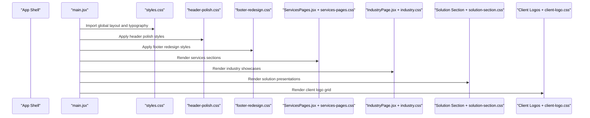

**Diagram sources**
- [main.jsx](file://src/main.jsx)
- [styles.css](file://src/styles.css)
- [header-polish.css](file://src/header-polish.css)
- [footer-redesign.css](file://src/footer-redesign.css)
- [ServicesPages.jsx](file://src/ServicesPages.jsx)
- [services-pages.css](file://src/services-pages.css)
- [IndustryPage.jsx](file://src/IndustryPage.jsx)
- [industry.css](file://src/industry.css)
- [solution-section.css](file://src/solution-section.css)
- [client-logo.css](file://src/client-logo.css)

## Detailed Component Analysis

### Services Page Layouts
- Uses a sectioned layout with consistent padding, max-width containers, and grid-based service cards.
- Cards include title, description, and optional media; hover and motion effects are applied via dedicated motion styles.
- Staggered reveal animations improve perceived performance and guide attention through long lists.

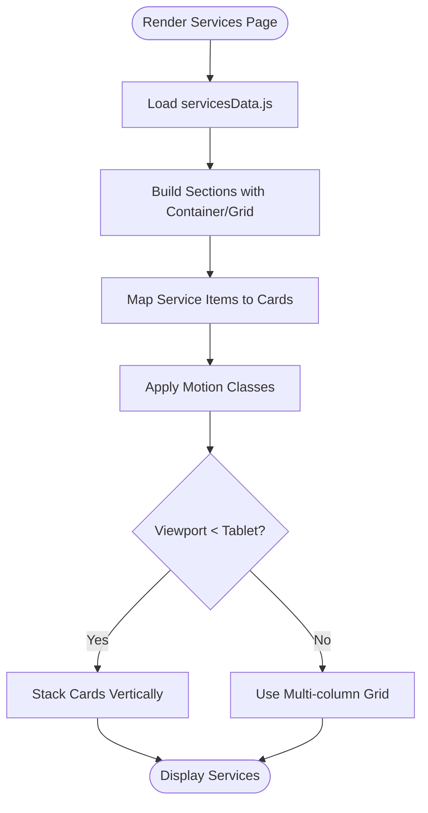

**Diagram sources**
- [ServicesPages.jsx](file://src/ServicesPages.jsx)
- [services-pages.css](file://src/services-pages.css)
- [servicesData.js](file://src/servicesData.js)
- [service-motion-redesign.css](file://src/service-motion-redesign.css)

**Section sources**
- [ServicesPages.jsx](file://src/ServicesPages.jsx)
- [services-pages.css](file://src/services-pages.css)
- [servicesData.js](file://src/servicesData.js)
- [service-motion-redesign.css](file://src/service-motion-redesign.css)

### Industry Showcase Sections
- Presents industry categories with visual tiles and descriptive overlays.
- Employs a responsive grid with equal-height tiles and consistent aspect ratios.
- Hover states emphasize titles and call-to-action elements.

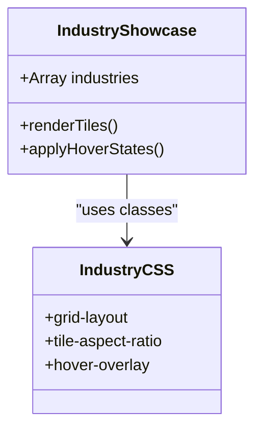

**Diagram sources**
- [IndustryPage.jsx](file://src/IndustryPage.jsx)
- [industry.css](file://src/industry.css)
- [industries.js](file://src/industries.js)

**Section sources**
- [IndustryPage.jsx](file://src/IndustryPage.jsx)
- [industry.css](file://src/industry.css)
- [industries.js](file://src/industries.js)

### Solution Presentation Components
- Solution sections use split-reveal or side-by-side layouts to pair narrative text with visuals.
- Animations coordinate between text panels and images to create engaging storytelling experiences.
- Spacing and alignment follow the global baseline grid for consistency.

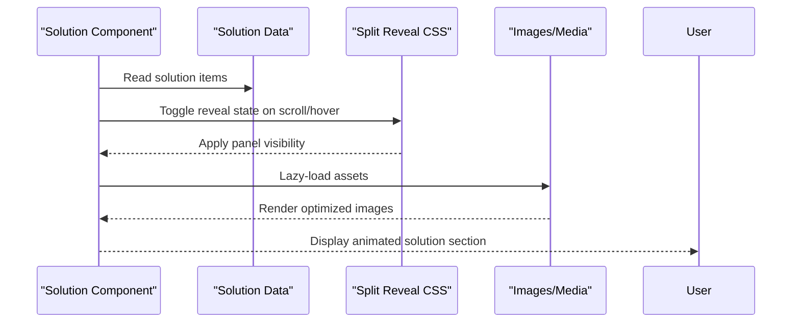

**Diagram sources**
- [solution-section.css](file://src/solution-section.css)
- [split-reveal.css](file://src/split-reveal.css)

**Section sources**
- [solution-section.css](file://src/solution-section.css)
- [split-reveal.css](file://src/split-reveal.css)

### Client Logo Grid Styling
- Displays brand logos in a uniform grid with consistent sizing and spacing.
- Uses grayscale or desaturated filters for visual harmony; color returns on hover.
- Responsive breakpoints adjust columns to maintain readability and touch targets.

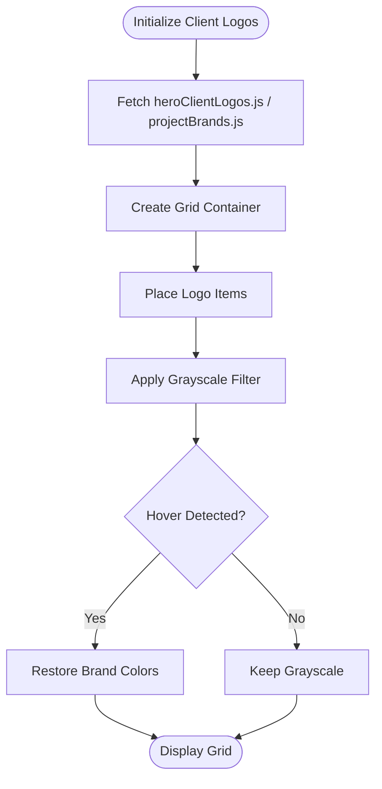

**Diagram sources**
- [client-logo.css](file://src/client-logo.css)
- [heroClientLogos.js](file://src/heroClientLogos.js)
- [projectBrands.js](file://src/projectBrands.js)

**Section sources**
- [client-logo.css](file://src/client-logo.css)
- [heroClientLogos.js](file://src/heroClientLogos.js)
- [projectBrands.js](file://src/projectBrands.js)

### Footer Redesign Patterns
- Multi-column layout with grouped links, social icons, and legal information.
- Sticky bottom behavior and clear hierarchy using typographic scale and spacing tokens.
- Responsive stacking ensures usability on narrow screens.

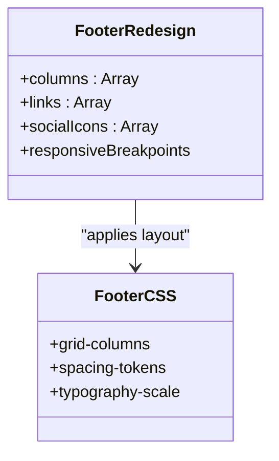

**Diagram sources**
- [footer-redesign.css](file://src/footer-redesign.css)

**Section sources**
- [footer-redesign.css](file://src/footer-redesign.css)

### Header Polish Implementations
- Sticky header with backdrop blur and subtle elevation on scroll.
- Smooth transitions for background changes and navigation highlights.
- Accessible focus states and keyboard navigation support.

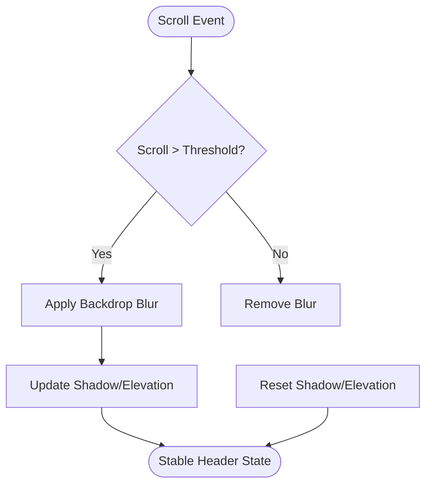

**Diagram sources**
- [header-polish.css](file://src/header-polish.css)

**Section sources**
- [header-polish.css](file://src/header-polish.css)

### Section-Based Layout Approaches
- Each major page region is encapsulated in a container with consistent padding and max-width constraints.
- Grid baselines align text and media across sections for visual rhythm.
- Motion classes are conditionally applied based on viewport and interaction state.

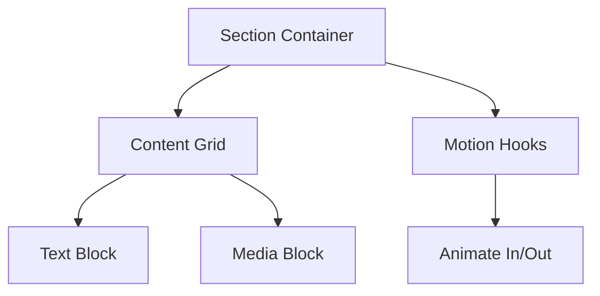

**Diagram sources**
- [styles.css](file://src/styles.css)
- [section-card-motion.css](file://src/section-card-motion.css)

**Section sources**
- [styles.css](file://src/styles.css)
- [section-card-motion.css](file://src/section-card-motion.css)

### Spacing Systems and Typography Hierarchies
- Global spacing tokens define margins, paddings, and gaps to maintain consistent rhythm.
- Type scale establishes headings, subheadings, body copy, and captions with clear hierarchy.
- Line heights and letter spacing tuned for readability at various sizes.

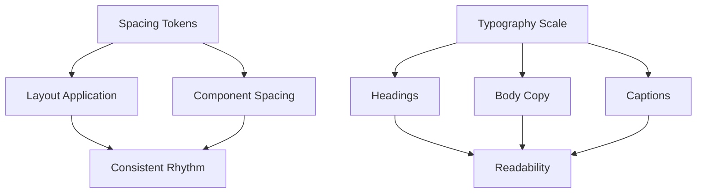

**Diagram sources**
- [styles.css](file://src/styles.css)

**Section sources**
- [styles.css](file://src/styles.css)

### Responsive Design Strategies
- Fluid grids adapt column counts based on breakpoints.
- Touch-friendly targets and legible font sizes on mobile.
- Progressive enhancement: heavy animations disabled or simplified on low-power devices.

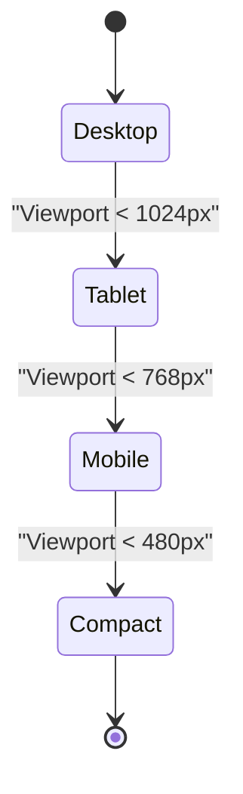

[No sources needed since this diagram shows conceptual workflow, not actual code structure]

## Dependency Analysis
The layout and styling dependencies are modular and cohesive. Global styles provide foundational rules, while feature-specific CSS files depend on those rules and add component-level overrides. Data files feed components without introducing tight coupling to styles.

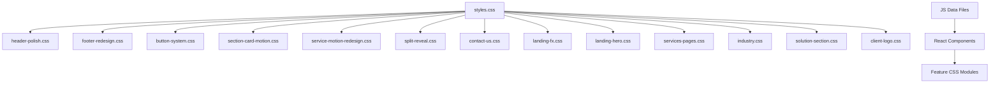

**Diagram sources**
- [styles.css](file://src/styles.css)
- [header-polish.css](file://src/header-polish.css)
- [footer-redesign.css](file://src/footer-redesign.css)
- [button-system.css](file://src/button-system.css)
- [section-card-motion.css](file://src/section-card-motion.css)
- [service-motion-redesign.css](file://src/service-motion-redesign.css)
- [split-reveal.css](file://src/split-reveal.css)
- [contact-us.css](file://src/contact-us.css)
- [landing-fx.css](file://src/landing-fx.css)
- [landing-hero.css](file://src/landing-hero.css)
- [services-pages.css](file://src/services-pages.css)
- [industry.css](file://src/industry.css)
- [solution-section.css](file://src/solution-section.css)
- [client-logo.css](file://src/client-logo.css)
- [heroClientLogos.js](file://src/heroClientLogos.js)
- [industries.js](file://src/industries.js)
- [servicesData.js](file://src/servicesData.js)
- [projectBrands.js](file://src/projectBrands.js)

**Section sources**
- [styles.css](file://src/styles.css)
- [heroClientLogos.js](file://src/heroClientLogos.js)
- [industries.js](file://src/industries.js)
- [servicesData.js](file://src/servicesData.js)
- [projectBrands.js](file://src/projectBrands.js)

## Performance Considerations
- Prefer lazy loading for images and media in large sections to reduce initial payload.
- Use CSS containment and will-change sparingly to avoid layout thrashing during animations.
- Minimize reflows by batching DOM updates and avoiding synchronous style reads/writes.
- Optimize asset formats and sizes; leverage modern image formats and responsive srcsets.
- Defer non-critical animations until after first paint or user interaction.
- Use memoization for expensive computations in components rendering large lists.

[No sources needed since this section provides general guidance]

## Troubleshooting Guide
Common issues and resolutions:
- Header overlap: Ensure section top padding accounts for sticky header height; verify backdrop blur does not clip content.
- Footer misalignment: Confirm grid columns reset properly on small viewports; check for overflow hidden on parent containers.
- Button focus missing: Validate focus ring styles and tabindex attributes; ensure contrast meets accessibility standards.
- Animation jank: Reduce animation complexity on mobile; disable heavy transforms when not visible.
- Image flicker: Provide explicit width/height or aspect ratio placeholders; preload critical images.

**Section sources**
- [header-polish.css](file://src/header-polish.css)
- [footer-redesign.css](file://src/footer-redesign.css)
- [button-system.css](file://src/button-system.css)
- [section-card-motion.css](file://src/section-card-motion.css)

## Conclusion
PodiumMinds employs a modular, section-based layout strategy with clear separation between global styles and feature-specific CSS. Consistent spacing and typography underpin a cohesive visual language, while responsive grids and motion enhancements deliver engaging experiences. By adhering to the patterns outlined here—semantic class naming, data-driven rendering, and performance-conscious practices—you can extend and maintain the site effectively.