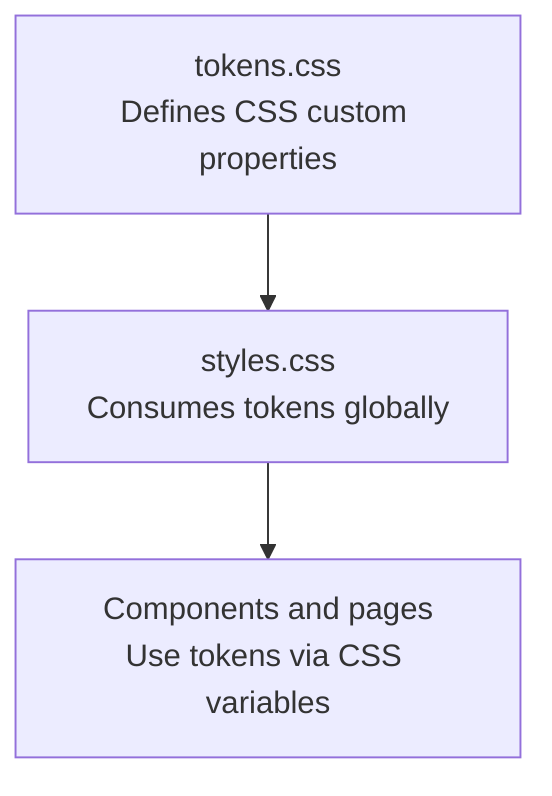
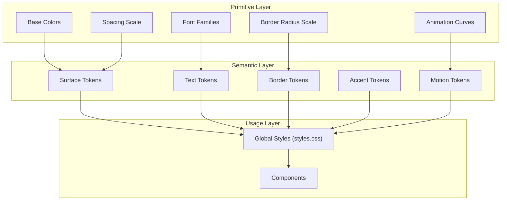

# Design Tokens and Variables

<cite>
**Referenced Files in This Document**
- [tokens.css](file://src/landing/tokens.css)
- [styles.css](file://src/styles.css)
</cite>

## Table of Contents
1. [Introduction](#introduction)
2. [Project Structure](#project-structure)
3. [Core Components](#core-components)
4. [Architecture Overview](#architecture-overview)
5. [Detailed Component Analysis](#detailed-component-analysis)
6. [Dependency Analysis](#dependency-analysis)
7. [Performance Considerations](#performance-considerations)
8. [Troubleshooting Guide](#troubleshooting-guide)
9. [Conclusion](#conclusion)
10. [Appendices](#appendices)

## Introduction
This document explains the design tokens system used across PodiumMinds, focusing on CSS custom properties that define colors, typography scales, spacing units, border radius values, and animation timing functions. It describes how tokens are organized in tokens.css and styles.css, provides guidelines for adding new tokens, maintaining consistency, following token hierarchy, and demonstrates usage patterns and best practices for theme customization.

## Project Structure
The design tokens are primarily centralized in a dedicated tokens file and consumed by global styles:
- tokens.css: Defines semantic and primitive tokens as CSS custom properties.
- styles.css: Applies tokens to global UI elements and components.

**Diagram sources**
- [tokens.css](file://src/landing/tokens.css)
- [styles.css](file://src/styles.css)

**Section sources**
- [tokens.css](file://src/landing/tokens.css)
- [styles.css](file://src/styles.css)

## Core Components
The token system is composed of the following categories:
- Color palette: Semantic color tokens (e.g., backgrounds, text, borders, accents).
- Typography scale: Font families, sizes, weights, line heights, and letter spacing.
- Spacing units: Consistent spacing scale for margins, paddings, gaps, and layout dimensions.
- Border radius values: Standardized corner radii for consistent shapes.
- Animation timing functions: Reusable easing curves and durations for motion.

These tokens are declared as CSS custom properties and referenced throughout styles.css and component styles.

**Section sources**
- [tokens.css](file://src/landing/tokens.css)
- [styles.css](file://src/styles.css)

## Architecture Overview
Tokens follow a layered architecture:
- Primitive tokens: Low-level values such as base colors, font stacks, and spacing steps.
- Semantic tokens: Meaningful names that map to primitives (e.g., surface, text-primary, accent).
- Usage layer: Global styles and components consume semantic tokens.

[No sources needed since this diagram shows conceptual workflow, not actual code structure]

## Detailed Component Analysis

### Color Palette Tokens
- Purpose: Provide consistent color semantics across surfaces, text, borders, and accents.
- Organization:
  - Primitive color tokens define base hues and shades.
  - Semantic color tokens describe roles (e.g., background, foreground, border, highlight).
- Usage:
  - Apply semantic color tokens to backgrounds, text, borders, and interactive states.
  - Avoid using raw color values directly in components; prefer semantic tokens.

Guidelines:
- Add new colors by introducing a semantic token that maps to an existing primitive or a new primitive if necessary.
- Maintain contrast ratios for accessibility when defining text and interactive colors.

**Section sources**
- [tokens.css](file://src/landing/tokens.css)
- [styles.css](file://src/styles.css)

### Typography Scale Tokens
- Purpose: Ensure consistent type scale, readability, and brand voice.
- Organization:
  - Primitive tokens include font families, base size, weight, line height, and letter spacing.
  - Semantic tokens represent typographic roles (e.g., headings, body, captions).
- Usage:
  - Reference semantic typography tokens in headings, paragraphs, labels, and metadata.
  - Keep responsive scaling by combining tokens with media queries where appropriate.

Guidelines:
- Introduce new typographic roles only when a clear use case exists.
- Prefer relative units and maintain consistent vertical rhythm.

**Section sources**
- [tokens.css](file://src/landing/tokens.css)
- [styles.css](file://src/styles.css)

### Spacing Units Tokens
- Purpose: Provide a unified spacing scale for margins, paddings, gaps, and layout dimensions.
- Organization:
  - Primitive tokens define a step-based scale (e.g., small, medium, large).
  - Semantic tokens may represent common spacings (e.g., section gap, card padding).
- Usage:
  - Apply spacing tokens consistently across layouts and components.
  - Use semantic spacing tokens for repeated patterns to improve maintainability.

Guidelines:
- Extend the scale sparingly; reuse existing steps whenever possible.
- Align spacing tokens with baseline grid and rhythm.

**Section sources**
- [tokens.css](file://src/landing/tokens.css)
- [styles.css](file://src/styles.css)

### Border Radius Values Tokens
- Purpose: Standardize corner radii for consistent visual language.
- Organization:
  - Primitive tokens define radius steps (e.g., none, small, medium, full).
  - Semantic tokens can represent shape roles (e.g., button radius, card radius).
- Usage:
  - Apply radius tokens to buttons, cards, inputs, and overlays.
  - Combine with other tokens to create cohesive component designs.

Guidelines:
- Limit the number of radius steps to reduce complexity.
- Ensure radius values work well at different sizes and aspect ratios.

**Section sources**
- [tokens.css](file://src/landing/tokens.css)
- [styles.css](file://src/styles.css)

### Animation Timing Functions Tokens
- Purpose: Centralize easing curves and durations for consistent motion.
- Organization:
  - Primitive tokens define standard easings and duration steps.
  - Semantic tokens represent motion roles (e.g., entrance, exit, micro-interaction).
- Usage:
  - Reference motion tokens in transitions and keyframe animations.
  - Keep animations subtle and purposeful; avoid overly long durations.

Guidelines:
- Reuse motion tokens to maintain a coherent interaction feel.
- Respect user preferences (e.g., reduced motion) by providing fallbacks.

**Section sources**
- [tokens.css](file://src/landing/tokens.css)
- [styles.css](file://src/styles.css)

### Token Hierarchy and Naming Conventions
- Hierarchy:
  - Primitive tokens: Lowest level, representing fundamental values.
  - Semantic tokens: Role-based names that abstract over primitives.
  - Usage tokens: Optional higher-level tokens for specific contexts (e.g., component-specific variants).
- Naming:
  - Use descriptive, role-oriented names for semantic tokens.
  - Keep primitive names concise and consistent.
  - Avoid implementation details in token names.

Best Practices:
- Always prefer semantic tokens in components.
- Group related tokens logically within tokens.css.
- Update both primitive and semantic layers when evolving the design system.

**Section sources**
- [tokens.css](file://src/landing/tokens.css)
- [styles.css](file://src/styles.css)

### Token Usage Patterns and Examples
Common patterns:
- Backgrounds and surfaces: Apply surface tokens to page backgrounds and component containers.
- Text and content: Use text tokens for headings, body copy, and captions.
- Borders and dividers: Apply border tokens to outlines and separators.
- Accents and highlights: Use accent tokens for interactive states and emphasis.
- Motion: Reference motion tokens for transitions and animations.

Example references (paths only):
- Global application of tokens in styles.css.
- Component usage patterns referencing tokens from tokens.css.

**Section sources**
- [tokens.css](file://src/landing/tokens.css)
- [styles.css](file://src/styles.css)

### Theme Customization Guidelines
Approaches:
- Override tokens at the root scope to apply theme-wide changes.
- Create theme-scoped blocks that redefine semantic tokens while preserving structure.
- Use conditional overrides for dark mode or brand variations.

Recommendations:
- Keep overrides minimal and focused on semantic tokens.
- Validate contrast and legibility after theme changes.
- Document any custom themes and their token mappings.

**Section sources**
- [tokens.css](file://src/landing/tokens.css)
- [styles.css](file://src/styles.css)

## Dependency Analysis
Token dependencies flow from primitives to semantics to usage:
- tokens.css defines all tokens.
- styles.css consumes tokens to style global elements.
- Components and pages inherit tokens through CSS cascade and specificity rules.

**Diagram sources**
- [tokens.css](file://src/landing/tokens.css)
- [styles.css](file://src/styles.css)

**Section sources**
- [tokens.css](file://src/landing/tokens.css)
- [styles.css](file://src/styles.css)

## Performance Considerations
- Minimize token count: Only add tokens when they provide meaningful abstraction.
- Avoid deep nesting: Keep token definitions flat and easy to locate.
- Leverage browser caching: Tokens are static CSS; ensure proper asset delivery.
- Reduce reflows: Prefer tokens that align with layout constraints to minimize repaints.

[No sources needed since this section provides general guidance]

## Troubleshooting Guide
Common issues and resolutions:
- Token not applied:
  - Verify the token name and scope.
  - Check CSS specificity and override order.
- Inconsistent visuals:
  - Ensure semantic tokens are used instead of raw values.
  - Confirm that theme overrides do not break contrast or alignment.
- Accessibility problems:
  - Validate color contrast for text and interactive elements.
  - Test with reduced motion settings.

Resolution steps:
- Inspect computed styles to confirm token resolution.
- Review tokens.css for correct mapping between primitives and semantics.
- Audit styles.css for direct value usage that should be replaced with tokens.

**Section sources**
- [tokens.css](file://src/landing/tokens.css)
- [styles.css](file://src/styles.css)

## Conclusion
The design tokens system centralizes visual decisions into reusable CSS custom properties, promoting consistency, maintainability, and scalability. By adhering to the token hierarchy, naming conventions, and usage patterns outlined here, teams can confidently extend the design system and customize themes without fragmenting the UI.

[No sources needed since this section summarizes without analyzing specific files]

## Appendices

### Adding New Tokens Checklist
- Identify whether the token is primitive or semantic.
- Define the token in tokens.css under the appropriate category.
- Replace direct values in styles.css and components with the new token.
- Validate accessibility and cross-theme compatibility.
- Document the token’s purpose and usage examples.

[No sources needed since this section provides general guidance]