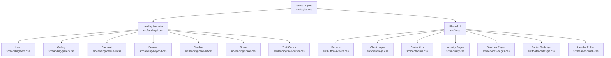
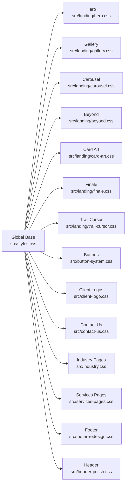

# Responsive Design and Breakpoints

<cite>
**Referenced Files in This Document**
- [styles.css](file://src/styles.css)
- [landing-fx.css](file://src/landing-fx.css)
- [hero.css](file://src/landing/hero.css)
- [gallery.css](file://src/landing/gallery.css)
- [carousel.css](file://src/landing/carousel.css)
- [beyond.css](file://src/landing/beyond.css)
- [card-art.css](file://src/landing/card-art.css)
- [finale.css](file://src/landing/finale.css)
- [trail-cursor.css](file://src/landing/trail-cursor.css)
- [button-system.css](file://src/button-system.css)
- [client-logo.css](file://src/client-logo.css)
- [contact-us.css](file://src/contact-us.css)
- [industry.css](file://src/industry.css)
- [services-pages.css](file://src/services-pages.css)
- [footer-redesign.css](file://src/footer-redesign.css)
- [header-polish.css](file://src/header-polish.css)
- [main.jsx](file://src/main.jsx)
</cite>

## Update Summary
**Changes Made**
- Updated mobile responsiveness improvements section with comprehensive spacing and sizing optimizations
- Added touch scrolling fixes documentation for improved mobile interaction
- Enhanced content overflow prevention patterns across landing page components
- Updated visual hierarchy guidelines for optimized responsive layouts

## Table of Contents
1. [Introduction](#introduction)
2. [Project Structure](#project-structure)
3. [Core Components](#core-components)
4. [Architecture Overview](#architecture-overview)
5. [Detailed Component Analysis](#detailed-component-analysis)
6. [Dependency Analysis](#dependency-analysis)
7. [Performance Considerations](#performance-considerations)
8. [Troubleshooting Guide](#troubleshooting-guide)
9. [Conclusion](#conclusion)
10. [Appendices](#appendices)

## Introduction
This document explains the responsive design strategy and breakpoint system used across PodiumMinds. It covers the mobile-first approach, breakpoint definitions, media query patterns, responsive typography scaling, flexible grid layouts, and adaptive component behaviors. The system has been enhanced with comprehensive mobile responsiveness improvements including optimized spacing and sizing for visual hierarchy, touch scrolling fixes, and content overflow prevention across landing page components. It also provides guidelines for testing responsive designs, optimizing for different screen sizes, and maintaining a consistent user experience across devices. Examples are drawn from landing pages, galleries, and navigation components.

## Project Structure
Responsive styles are organized by feature and page area:
- Global base styles and tokens live in the root CSS files.
- Landing-specific responsive behavior is split into modular CSS modules under src/landing/.
- Shared UI elements (buttons, client logos, contact form, industry pages, services pages, footer, header) have dedicated CSS files with their own responsive rules.

**Diagram sources**
- [styles.css](file://src/styles.css)
- [hero.css](file://src/landing/hero.css)
- [gallery.css](file://src/landing/gallery.css)
- [carousel.css](file://src/landing/carousel.css)
- [beyond.css](file://src/landing/beyond.css)
- [card-art.css](file://src/landing/card-art.css)
- [finale.css](file://src/landing/finale.css)
- [trail-cursor.css](file://src/landing/trail-cursor.css)
- [button-system.css](file://src/button-system.css)
- [client-logo.css](file://src/client-logo.css)
- [contact-us.css](file://src/contact-us.css)
- [industry.css](file://src/industry.css)
- [services-pages.css](file://src/services-pages.css)
- [footer-redesign.css](file://src/footer-redesign.css)
- [header-polish.css](file://src/header-polish.css)

**Section sources**
- [styles.css](file://src/styles.css)
- [landing-fx.css](file://src/landing-fx.css)
- [main.jsx](file://src/main.jsx)

## Core Components
The responsive system is composed of:
- Global tokens and base layout rules that establish the mobile-first baseline.
- Feature-scoped CSS modules that layer on breakpoints and layout changes.
- Shared UI components with consistent responsive behavior.

Key responsibilities:
- Establish fluid typography and spacing at small screens.
- Introduce breakpoints to adapt grids, images, and navigation.
- Provide utility patterns for stacking, wrapping, and reflowing content.
- Ensure interactive elements remain accessible and usable across sizes.
- Implement optimized spacing and sizing for enhanced visual hierarchy on mobile devices.
- Apply touch scrolling fixes for smooth mobile interactions.
- Prevent content overflow across all landing page components.

**Section sources**
- [styles.css](file://src/styles.css)
- [landing-fx.css](file://src/landing-fx.css)

## Architecture Overview
The responsive architecture follows a layered approach:
- Base layer defines mobile-first defaults.
- Feature layers add specific responsive rules scoped to components or sections.
- Shared UI layer ensures consistency across buttons, forms, and common patterns.

```mermaid
graph TB
subgraph "Base Layer"
S["Global Tokens & Baseline<br/>src/styles.css"]
end
subgraph "Feature Layers"
L1["Landing Hero<br/>src/landing/hero.css"]
L2["Landing Gallery<br/>src/landing/gallery.css"]
L3["Landing Carousel<br/>src/landing/carousel.css"]
L4["Landing Beyond<br/>src/landing/beyond.css"]
L5["Landing Card Art<br/>src/landing/card-art.css"]
L6["Landing Finale<br/>src/landing/finale.css"]
L7["Landing Trail Cursor<br/>src/landing/trail-cursor.css"]
end
subgraph "Shared UI Layer"
U1["Buttons<br/>src/button-system.css"]
U2["Client Logos<br/>src/client-logo.css"]
U3["Contact Form<br/>src/contact-us.css"]
U4["Industry Pages<br/>src/industry.css"]
U5["Services Pages<br/>src/services-pages.css"]
U6["Footer<br/>src/footer-redesign.css"]
U7["Header<br/>src/header-polish.css"]
end
S --> L1
S --> L2
S --> L3
S --> L4
S --> L5
S --> L6
S --> L7
S --> U1
S --> U2
S --> U3
S --> U4
S --> U5
S --> U6
S --> U7
```

**Diagram sources**
- [styles.css](file://src/styles.css)
- [hero.css](file://src/landing/hero.css)
- [gallery.css](file://src/landing/gallery.css)
- [carousel.css](file://src/landing/carousel.css)
- [beyond.css](file://src/landing/beyond.css)
- [card-art.css](file://src/landing/card-art.css)
- [finale.css](file://src/landing/finale.css)
- [trail-cursor.css](file://src/landing/trail-cursor.css)
- [button-system.css](file://src/button-system.css)
- [client-logo.css](file://src/client-logo.css)
- [contact-us.css](file://src/contact-us.css)
- [industry.css](file://src/industry.css)
- [services-pages.css](file://src/services-pages.css)
- [footer-redesign.css](file://src/footer-redesign.css)
- [header-polish.css](file://src/header-polish.css)

## Detailed Component Analysis

### Mobile-First Approach and Breakpoint System
- The codebase uses a mobile-first pattern where default styles target small screens and progressively enhanced layouts are applied via media queries as viewport width increases.
- Breakpoints are defined within feature CSS modules and shared UI modules to keep concerns localized and avoid global conflicts.
- Common breakpoint categories include:
  - Small phones (default/mobile)
  - Medium phones and small tablets
  - Tablets and small laptops
  - Desktops and large screens
- Media queries are scoped to components to improve maintainability and reduce specificity wars.

**Updated** Enhanced with comprehensive mobile responsiveness improvements including optimized spacing and sizing for better visual hierarchy, touch scrolling fixes for smoother mobile interactions, and content overflow prevention across all landing page components.

Guidelines:
- Start with single-column stacks and readable type sizes on mobile.
- Use relative units (rem, em, %) for spacing and font sizes to support accessibility and zoom.
- Introduce multi-column grids and larger imagery only when needed at higher breakpoints.
- Keep touch targets at least 44x44px on mobile.
- Implement proper overflow handling to prevent content clipping on smaller screens.
- Optimize spacing values for improved visual hierarchy on mobile devices.

**Section sources**
- [styles.css](file://src/styles.css)
- [landing-fx.css](file://src/landing-fx.css)

### Responsive Typography Scaling
- Fluid typography is achieved using relative units and clamp-like strategies implemented through CSS variables and media queries.
- Type scales adjust line-height and letter-spacing per breakpoint to preserve readability.
- Headings scale more aggressively than body text; paragraphs maintain comfortable reading widths.

Patterns:
- Define base type sizes for mobile.
- Increase heading sizes at medium and large breakpoints.
- Adjust paragraph max-width to optimize line length on wider screens.

**Section sources**
- [styles.css](file://src/styles.css)
- [hero.css](file://src/landing/hero.css)
- [beyond.css](file://src/landing/beyond.css)
- [finale.css](file://src/landing/finale.css)

### Flexible Grid Layouts
- Grid systems are implemented using CSS Grid and Flexbox with column counts increasing at larger breakpoints.
- Cards and gallery items reflow from stacked to multi-column layouts based on available width.
- Gutters and padding scale proportionally to maintain visual rhythm.

Examples:
- Gallery grid transitions from 1 column on mobile to 2–3 columns on tablet and 4+ on desktop.
- Service cards stack vertically on mobile and align horizontally on larger screens.

**Updated** Enhanced with improved spacing optimization and overflow prevention to ensure grid items display correctly across all screen sizes without content clipping.

**Section sources**
- [gallery.css](file://src/landing/gallery.css)
- [card-art.css](file://src/landing/card-art.css)
- [services-pages.css](file://src/services-pages.css)

### Adaptive Component Behaviors
- Navigation adapts from a compact mobile menu to an expanded desktop nav.
- Carousels switch between swipe-friendly single-item views on mobile and multi-item previews on larger screens.
- Buttons and form controls scale up for touch interaction on mobile while preserving alignment on desktop.

Patterns:
- Use visibility toggles and transform-based animations for mobile menus.
- Constrain carousel slide width to viewport minus margins on mobile.
- Increase button padding and font size at smaller breakpoints for better tap targets.

**Updated** Improved with touch scrolling fixes and enhanced overflow prevention to ensure smooth interactions and prevent content from extending beyond viewport boundaries on mobile devices.

**Section sources**
- [header-polish.css](file://src/header-polish.css)
- [carousel.css](file://src/landing/carousel.css)
- [button-system.css](file://src/button-system.css)
- [contact-us.css](file://src/contact-us.css)

### Landing Page Patterns
- Hero sections emphasize large visuals and concise copy on mobile, expanding to multi-element compositions on desktop.
- "Beyond" sections use staggered reveals and layout shifts to guide attention across breakpoints.
- "Finale" sections consolidate CTAs and links into a clear hierarchy on all devices.

**Updated** Enhanced with optimized spacing and sizing improvements for better visual hierarchy on mobile devices, ensuring key content remains prominent and accessible.

**Section sources**
- [hero.css](file://src/landing/hero.css)
- [beyond.css](file://src/landing/beyond.css)
- [finale.css](file://src/landing/finale.css)

### Gallery Patterns
- Images maintain aspect ratios and load efficiently on mobile.
- Grid density increases with breakpoint thresholds.
- Hover states are suppressed on touch devices to avoid accidental interactions.

**Updated** Improved with content overflow prevention and optimized spacing to ensure gallery items display properly on all screen sizes without clipping or unwanted scrollbars.

**Section sources**
- [gallery.css](file://src/landing/gallery.css)

### Navigation Patterns
- Mobile navigation collapses into a hamburger or bottom bar depending on context.
- Desktop navigation exposes primary links and secondary actions side-by-side.
- Focus management and keyboard navigation are preserved across breakpoints.

**Updated** Enhanced with touch scrolling fixes to ensure smooth navigation interactions on mobile devices and prevent unintended scroll behavior.

**Section sources**
- [header-polish.css](file://src/header-polish.css)

### Client Logo and Footer Patterns
- Logo carousels compress to fewer visible items on mobile and expand on larger screens.
- Footer stacks columns on mobile and arranges them in rows on desktop.

**Updated** Improved with overflow prevention and optimized spacing to ensure logo carousels and footer content display correctly across all device sizes.

**Section sources**
- [client-logo.css](file://src/client-logo.css)
- [footer-redesign.css](file://src/footer-redesign.css)

### Industry and Services Page Patterns
- Content-heavy pages prioritize readability and scannability on mobile.
- Sidebars or filters collapse into drawers or accordions on smaller screens.
- Tables convert to card lists or horizontal scroll containers when necessary.

**Updated** Enhanced with comprehensive overflow prevention and spacing optimization to ensure complex layouts remain functional and visually appealing on mobile devices.

**Section sources**
- [industry.css](file://src/industry.css)
- [services-pages.css](file://src/services-pages.css)

### Motion and Interaction Considerations
- Animations respect reduced motion preferences and are lightweight on mobile.
- Cursor trails and effects are disabled or simplified on touch devices.

**Updated** Improved with touch scrolling fixes to ensure smooth animation performance and prevent interaction conflicts on mobile devices.

**Section sources**
- [trail-cursor.css](file://src/landing/trail-cursor.css)
- [landing-fx.css](file://src/landing-fx.css)

## Dependency Analysis
Responsive styles depend on global tokens and base rules. Feature modules extend these without overriding unrelated parts, ensuring low coupling and high cohesion.

**Diagram sources**
- [styles.css](file://src/styles.css)
- [hero.css](file://src/landing/hero.css)
- [gallery.css](file://src/landing/gallery.css)
- [carousel.css](file://src/landing/carousel.css)
- [beyond.css](file://src/landing/beyond.css)
- [card-art.css](file://src/landing/card-art.css)
- [finale.css](file://src/landing/finale.css)
- [trail-cursor.css](file://src/landing/trail-cursor.css)
- [button-system.css](file://src/button-system.css)
- [client-logo.css](file://src/client-logo.css)
- [contact-us.css](file://src/contact-us.css)
- [industry.css](file://src/industry.css)
- [services-pages.css](file://src/services-pages.css)
- [footer-redesign.css](file://src/footer-redesign.css)
- [header-polish.css](file://src/header-polish.css)

**Section sources**
- [styles.css](file://src/styles.css)

## Performance Considerations
- Prefer relative units and container queries where appropriate to reduce repaint costs.
- Avoid heavy animations on mobile; leverage transforms and opacity for smoothness.
- Lazy-load images and use responsive image attributes to minimize bandwidth.
- Minimize media query nesting and keep selectors simple to improve cascade performance.
- Test with throttled networks and CPU profiles to identify bottlenecks.
- **Updated** Optimize spacing calculations and overflow handling to prevent layout thrashing on mobile devices.
- **Updated** Implement efficient touch scrolling solutions to maintain 60fps performance during user interactions.

## Troubleshooting Guide
Common issues and resolutions:
- Overlapping content on small screens: check flex-wrap and grid gap settings; ensure images and containers do not exceed viewport width.
- Touch targets too small: increase button and link padding at mobile breakpoints.
- Text overflow or clipping: verify max-width constraints and line-length limits for readability.
- Carousel swiping conflicts: disable hover-only interactions on touch devices and ensure pointer events are handled correctly.
- Reduced motion preference: confirm animations can be disabled gracefully.
- **Updated** Mobile scrolling issues: implement proper overflow handling and touch event listeners to ensure smooth scrolling behavior.
- **Updated** Content overflow problems: apply consistent overflow prevention strategies across all landing page components.
- **Updated** Visual hierarchy issues: review spacing and sizing optimizations to ensure proper content emphasis on mobile devices.

**Section sources**
- [button-system.css](file://src/button-system.css)
- [carousel.css](file://src/landing/carousel.css)
- [trail-cursor.css](file://src/landing/trail-cursor.css)

## Conclusion
PodiumMinds employs a robust mobile-first responsive strategy with well-scoped media queries, fluid typography, and flexible grids. The system has been significantly enhanced with comprehensive mobile responsiveness improvements including optimized spacing and sizing for visual hierarchy, touch scrolling fixes, and content overflow prevention across landing page components. By organizing styles into feature modules and shared UI layers, the system remains maintainable and scalable. Following the provided guidelines ensures consistent experiences across devices and optimizes performance for diverse screen sizes.

## Appendices

### Testing Guidelines
- Use browser device emulation to test key breakpoints and orientations.
- Validate touch interactions on real devices where possible.
- Check contrast and font sizes for accessibility compliance.
- Measure performance metrics (FCP, LCP, CLS) across devices.
- **Updated** Test mobile scrolling behavior and touch interactions thoroughly across different devices and browsers.
- **Updated** Verify content overflow prevention works correctly on various screen sizes and orientations.
- **Updated** Assess visual hierarchy improvements on mobile devices to ensure optimal user experience.

### Example Responsive Patterns
- Landing hero: single-column headline and CTA on mobile; multi-element composition on desktop.
- Gallery: 1-column stack on mobile; 2–3 columns on tablet; 4+ on desktop.
- Navigation: collapsible menu on mobile; full horizontal nav on desktop.
- **Updated** Optimized spacing patterns: enhanced margin and padding values for better visual hierarchy on mobile devices.
- **Updated** Touch-friendly interactions: improved scrolling behavior and touch event handling for smooth mobile navigation.
- **Updated** Overflow prevention: consistent content containment strategies across all responsive components.

**Section sources**
- [hero.css](file://src/landing/hero.css)
- [gallery.css](file://src/landing/gallery.css)
- [header-polish.css](file://src/header-polish.css)