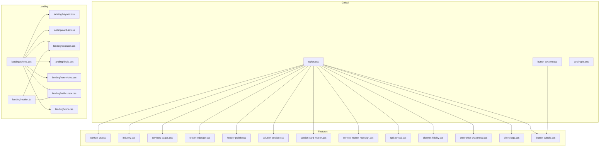
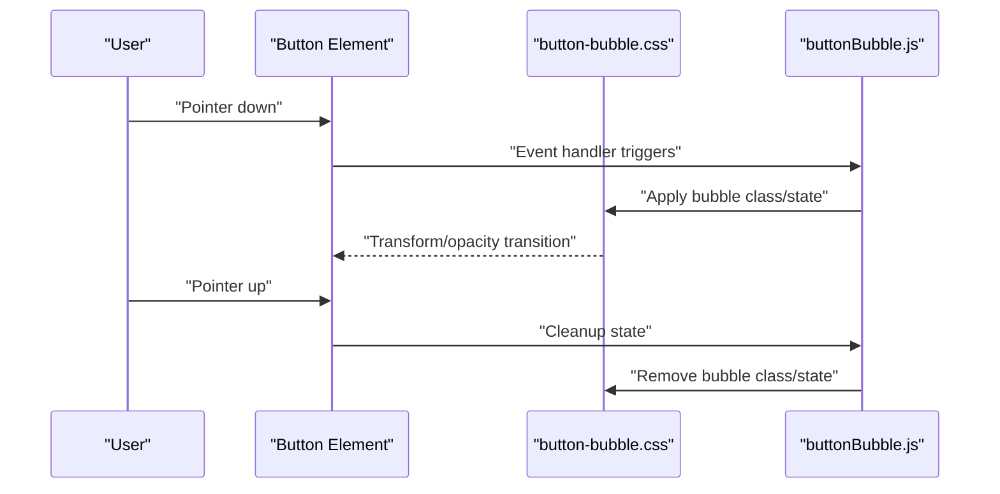
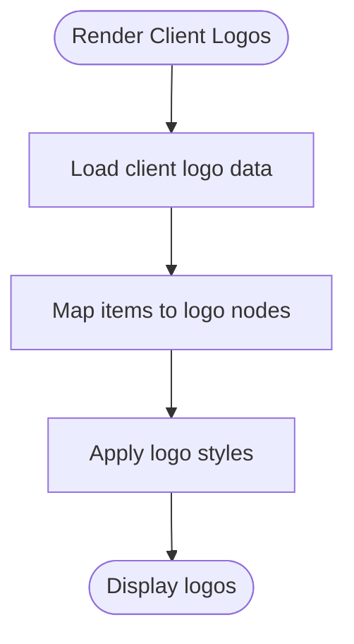
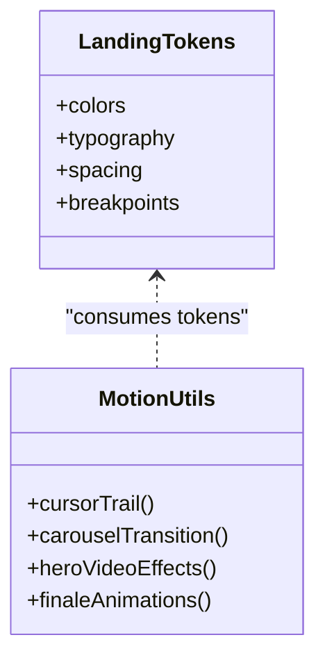
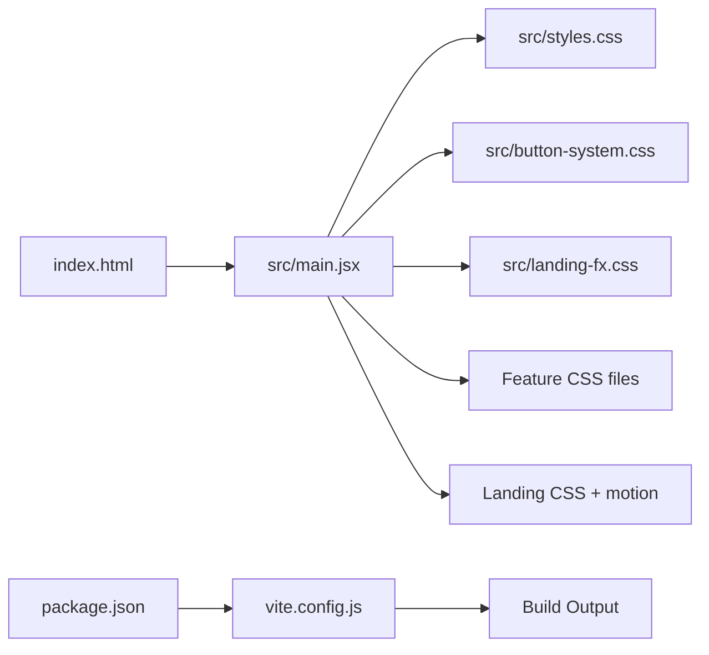

# Styling and Design System

<cite>
**Referenced Files in This Document**
- [index.html](file://index.html)
- [package.json](file://package.json)
- [vite.config.js](file://vite.config.js)
- [src/main.jsx](file://src/main.jsx)
- [src/styles.css](file://src/styles.css)
- [src/button-system.css](file://src/button-system.css)
- [src/landing-fx.css](file://src/landing-fx.css)
- [src/hero-client-logos.js](file://src/hero-client-logos.js)
- [src/ClientLogo.jsx](file://src/ClientLogo.jsx)
- [src/ContactUs.jsx](file://src/ContactUs.jsx)
- [src/contact-us.css](file://src/contact-us.css)
- [src/IndustryPage.jsx](file://src/IndustryPage.jsx)
- [src/industry.css](file://src/industry.css)
- [src/services-pages.css](file://src/services-pages.css)
- [src/footer-redesign.css](file://src/footer-redesign.css)
- [src/header-polish.css](file://src/header-polish.css)
- [src/solution-section.css](file://src/solution-section.css)
- [src/section-card-motion.css](file://src/section-card-motion.css)
- [src/service-motion-redesign.css](file://src/service-motion-redesign.css)
- [src/split-reveal.css](file://src/split-reveal.css)
- [src/eloqwnt-fidelity.css](file://src/eloqwnt-fidelity.css)
- [src/enterprise-sharpness.css](file://src/enterprise-sharpness.css)
- [src/client-logo.css](file://src/client-logo.css)
- [src/button-bubble.css](file://src/button-bubble.css)
- [src/buttonBubble.js](file://src/buttonBubble.js)
- [src/usePageMotion.js](file://src/usePageMotion.js)
- [src/landing/Hero.jsx](file://src/landing/Hero.jsx)
- [src/landing/Hero 2.jsx](file://src/landing/Hero 2.jsx)
- [src/landing/HeroVideo.jsx](file://src/landing/HeroVideo.jsx)
- [src/landing/beyond.css](file://src/landing/beyond.css)
- [src/landing/card-art.css](file://src/landing/card-art.css)
- [src/landing/carousel.css](file://src/landing/carousel.css)
- [src/landing/finale.css](file://src/landing/finale.css)
- [src/landing/hero-video.css](file://src/landing/hero-video.css)
- [src/landing/motion.js](file://src/landing/motion.js)
- [src/landing/tokens.css](file://src/landing/tokens.css)
- [src/landing/trail-cursor.css](file://src/landing/trail-cursor.css)
- [src/landing/work.css](file://src/landing/work.css)
</cite>

## Table of Contents
1. [Introduction](#introduction)
2. [Project Structure](#project-structure)
3. [Core Components](#core-components)
4. [Architecture Overview](#architecture-overview)
5. [Detailed Component Analysis](#detailed-component-analysis)
6. [Dependency Analysis](#dependency-analysis)
7. [Performance Considerations](#performance-considerations)
8. [Troubleshooting Guide](#troubleshooting-guide)
9. [Conclusion](#conclusion)
10. [Appendices](#appendices)

## Introduction
This document describes the styling and design system for the PodiumMinds application. It explains how styles are organized, how tokens and component styles are structured, and how animations and responsive patterns are implemented. It also provides guidelines for adding new styles consistently and optimizing performance across the app.

## Project Structure
The styling is split into global styles, feature-specific CSS modules, and a landing section with its own tokens and motion utilities. The build entry point wires these together via Vite and React.

```mermaid
graph TB
HTML["index.html"] --> MainJSX["src/main.jsx"]
MainJSX --> StylesCSS["src/styles.css"]
MainJSX --> ButtonSystem["src/button-system.css"]
MainJSX --> LandingFX["src/landing-fx.css"]
MainJSX --> ClientLogoJSX["src/ClientLogo.jsx"]
ClientLogoJSX --> ClientLogoCSS["src/client-logo.css"]
MainJSX --> ContactUsJSX["src/ContactUs.jsx"]
ContactUsJSX --> ContactUsCSS["src/contact-us.css"]
MainJSX --> IndustryPageJSX["src/IndustryPage.jsx"]
IndustryPageJSX --> IndustryCSS["src/industry.css"]
MainJSX --> ServicesPagesCSS["src/services-pages.css"]
MainJSX --> FooterRedesignCSS["src/footer-redesign.css"]
MainJSX --> HeaderPolishCSS["src/header-polish.css"]
MainJSX --> SolutionSectionCSS["src/solution-section.css"]
MainJSX --> SectionCardMotionCSS["src/section-card-motion.css"]
MainJSX --> ServiceMotionRedesignCSS["src/service-motion-redesign.css"]
MainJSX --> SplitRevealCSS["src/split-reveal.css"]
MainJSX --> EloqwntFidelityCSS["src/eloqwnt-fidelity.css"]
MainJSX --> EnterpriseSharpnessCSS["src/enterprise-sharpness.css"]
MainJSX --> ButtonBubbleCSS["src/button-bubble.css"]
MainJSX --> ButtonBubbleJS["src/buttonBubble.js"]
MainJSX --> UsePageMotionJS["src/usePageMotion.js"]
MainJSX --> LandingHeroJSX["src/landing/Hero.jsx"]
LandingHeroJSX --> LandingTokensCSS["src/landing/tokens.css"]
LandingHeroJSX --> LandingBeyondCSS["src/landing/beyond.css"]
LandingHeroJSX --> LandingCardArtCSS["src/landing/card-art.css"]
LandingHeroJSX --> LandingCarouselCSS["src/landing/carousel.css"]
LandingHeroJSX --> LandingFinaleCSS["src/landing/finale.css"]
LandingHeroJSX --> LandingHeroVideoCSS["src/landing/hero-video.css"]
LandingHeroJSX --> LandingTrailCursorCSS["src/landing/trail-cursor.css"]
LandingHeroJSX --> LandingWorkCSS["src/landing/work.css"]
LandingHeroJSX --> LandingMotionJS["src/landing/motion.js"]
```

**Diagram sources**
- [index.html:1-200](file://index.html#L1-L200)
- [src/main.jsx:1-200](file://src/main.jsx#L1-L200)
- [src/styles.css:1-200](file://src/styles.css#L1-L200)
- [src/button-system.css:1-200](file://src/button-system.css#L1-L200)
- [src/landing-fx.css:1-200](file://src/landing-fx.css#L1-L200)
- [src/ClientLogo.jsx:1-200](file://src/ClientLogo.jsx#L1-L200)
- [src/client-logo.css:1-200](file://src/client-logo.css#L1-L200)
- [src/ContactUs.jsx:1-200](file://src/ContactUs.jsx#L1-L200)
- [src/contact-us.css:1-200](file://src/contact-us.css#L1-L200)
- [src/IndustryPage.jsx:1-200](file://src/IndustryPage.jsx#L1-L200)
- [src/industry.css:1-200](file://src/industry.css#L1-L200)
- [src/services-pages.css:1-200](file://src/services-pages.css#L1-L200)
- [src/footer-redesign.css:1-200](file://src/footer-redesign.css#L1-L200)
- [src/header-polish.css:1-200](file://src/header-polish.css#L1-L200)
- [src/solution-section.css:1-200](file://src/solution-section.css#L1-L200)
- [src/section-card-motion.css:1-200](file://src/section-card-motion.css#L1-L200)
- [src/service-motion-redesign.css:1-200](file://src/service-motion-redesign.css#L1-L200)
- [src/split-reveal.css:1-200](file://src/split-reveal.css#L1-L200)
- [src/eloqwnt-fidelity.css:1-200](file://src/eloqwnt-fidelity.css#L1-L200)
- [src/enterprise-sharpness.css:1-200](file://src/enterprise-sharpness.css#L1-L200)
- [src/button-bubble.css:1-200](file://src/button-bubble.css#L1-L200)
- [src/buttonBubble.js:1-200](file://src/buttonBubble.js#L1-L200)
- [src/usePageMotion.js:1-200](file://src/usePageMotion.js#L1-L200)
- [src/landing/Hero.jsx:1-200](file://src/landing/Hero.jsx#L1-L200)
- [src/landing/tokens.css:1-200](file://src/landing/tokens.css#L1-L200)
- [src/landing/beyond.css:1-200](file://src/landing/beyond.css#L1-L200)
- [src/landing/card-art.css:1-200](file://src/landing/card-art.css#L1-L200)
- [src/landing/carousel.css:1-200](file://src/landing/carousel.css#L1-L200)
- [src/landing/finale.css:1-200](file://src/landing/finale.css#L1-L200)
- [src/landing/hero-video.css:1-200](file://src/landing/hero-video.css#L1-L200)
- [src/landing/trail-cursor.css:1-200](file://src/landing/trail-cursor.css#L1-L200)
- [src/landing/work.css:1-200](file://src/landing/work.css#L1-L200)
- [src/landing/motion.js:1-200](file://src/landing/motion.js#L1-L200)

**Section sources**
- [index.html:1-200](file://index.html#L1-L200)
- [src/main.jsx:1-200](file://src/main.jsx#L1-L200)
- [vite.config.js:1-200](file://vite.config.js#L1-L200)
- [package.json:1-200](file://package.json#L1-L200)

## Core Components
- Global styles and base layer:
  - Base resets, typography defaults, color tokens, spacing scale, and layout primitives live in the global stylesheet.
  - Feature-level CSS files extend or override base styles where appropriate.
- Button system:
  - A dedicated button stylesheet defines variants, states, and sizing. A small JS helper adds interactive bubble effects to buttons.
- Landing tokens and motion:
  - The landing area has its own token file and motion utilities, including cursor trails and carousel transitions.

Key responsibilities:
- Centralize tokens (colors, typography, spacing) to ensure consistency.
- Keep component styles scoped to their features to avoid cross-feature leakage.
- Provide reusable animation primitives (transitions, transforms, keyframes) used by components.

**Section sources**
- [src/styles.css:1-200](file://src/styles.css#L1-L200)
- [src/button-system.css:1-200](file://src/button-system.css#L1-L200)
- [src/button-bubble.css:1-200](file://src/button-bubble.css#L1-L200)
- [src/buttonBubble.js:1-200](file://src/buttonBubble.js#L1-L200)
- [src/landing/tokens.css:1-200](file://src/landing/tokens.css#L1-L200)
- [src/landing/motion.js:1-200](file://src/landing/motion.js#L1-L200)

## Architecture Overview
The styling architecture follows a layered approach:
- Layer 1: Global base styles and tokens
- Layer 2: Feature-level styles (buttons, contact, industry pages, services, footer, header, solutions)
- Layer 3: Landing-specific tokens and motion utilities
- Integration: Entry points import stylesheets and components that consume them

**Diagram sources**
- [src/styles.css:1-200](file://src/styles.css#L1-L200)
- [src/button-system.css:1-200](file://src/button-system.css#L1-L200)
- [src/landing-fx.css:1-200](file://src/landing-fx.css#L1-L200)
- [src/contact-us.css:1-200](file://src/contact-us.css#L1-L200)
- [src/industry.css:1-200](file://src/industry.css#L1-L200)
- [src/services-pages.css:1-200](file://src/services-pages.css#L1-L200)
- [src/footer-redesign.css:1-200](file://src/footer-redesign.css#L1-L200)
- [src/header-polish.css:1-200](file://src/header-polish.css#L1-L200)
- [src/solution-section.css:1-200](file://src/solution-section.css#L1-L200)
- [src/section-card-motion.css:1-200](file://src/section-card-motion.css#L1-L200)
- [src/service-motion-redesign.css:1-200](file://src/service-motion-redesign.css#L1-L200)
- [src/split-reveal.css:1-200](file://src/split-reveal.css#L1-L200)
- [src/eloqwnt-fidelity.css:1-200](file://src/eloqwnt-fidelity.css#L1-L200)
- [src/enterprise-sharpness.css:1-200](file://src/enterprise-sharpness.css#L1-L200)
- [src/client-logo.css:1-200](file://src/client-logo.css#L1-L200)
- [src/button-bubble.css:1-200](file://src/button-bubble.css#L1-L200)
- [src/landing/tokens.css:1-200](file://src/landing/tokens.css#L1-L200)
- [src/landing/beyond.css:1-200](file://src/landing/beyond.css#L1-L200)
- [src/landing/card-art.css:1-200](file://src/landing/card-art.css#L1-L200)
- [src/landing/carousel.css:1-200](file://src/landing/carousel.css#L1-L200)
- [src/landing/finale.css:1-200](file://src/landing/finale.css#L1-L200)
- [src/landing/hero-video.css:1-200](file://src/landing/hero-video.css#L1-L200)
- [src/landing/trail-cursor.css:1-200](file://src/landing/trail-cursor.css#L1-L200)
- [src/landing/work.css:1-200](file://src/landing/work.css#L1-L200)
- [src/landing/motion.js:1-200](file://src/landing/motion.js#L1-L200)

## Detailed Component Analysis

### Global Tokens and Base Styles
- Purpose: Define foundational tokens (colors, typography, spacing), base typography, link styles, and layout primitives.
- Usage: Imported once at the application root; all feature styles inherit from this baseline.
- Best practices:
  - Prefer tokens over hard-coded values.
  - Keep base selectors minimal and generic to reduce specificity conflicts.

**Section sources**
- [src/styles.css:1-200](file://src/styles.css#L1-L200)

### Button System
- Scope: Variants, sizes, focus/hover/active states, disabled states, and accessibility considerations.
- Interaction enhancement: A small script augments buttons with a ripple/bubble effect on pointer events.
- Guidelines:
  - Use semantic button elements.
  - Apply variant classes rather than inline styles.
  - Ensure sufficient contrast and keyboard focus visibility.

**Diagram sources**
- [src/button-system.css:1-200](file://src/button-system.css#L1-L200)
- [src/button-bubble.css:1-200](file://src/button-bubble.css#L1-L200)
- [src/buttonBubble.js:1-200](file://src/buttonBubble.js#L1-L200)

**Section sources**
- [src/button-system.css:1-200](file://src/button-system.css#L1-L200)
- [src/button-bubble.css:1-200](file://src/button-bubble.css#L1-L200)
- [src/buttonBubble.js:1-200](file://src/buttonBubble.js#L1-L200)

### Contact Form UI
- Scope: Layout, input styles, validation feedback, and responsive behavior for the contact form.
- Integration: The React component imports the corresponding stylesheet.

**Section sources**
- [src/ContactUs.jsx:1-200](file://src/ContactUs.jsx#L1-L200)
- [src/contact-us.css:1-200](file://src/contact-us.css#L1-L200)

### Industry Page
- Scope: Page-level layout, content sections, and media handling specific to industry pages.
- Integration: The page component consumes the industry stylesheet.

**Section sources**
- [src/IndustryPage.jsx:1-200](file://src/IndustryPage.jsx#L1-L200)
- [src/industry.css:1-200](file://src/industry.css#L1-L200)

### Services Pages
- Scope: Shared styles for service listings, cards, and interactions.
- Integration: Consumed by services-related components.

**Section sources**
- [src/services-pages.css:1-200](file://src/services-pages.css#L1-L200)

### Footer Redesign
- Scope: Updated footer layout, links, and branding presentation.

**Section sources**
- [src/footer-redesign.css:1-200](file://src/footer-redesign.css#L1-L200)

### Header Polish
- Scope: Header navigation, sticky behavior, and visual refinements.

**Section sources**
- [src/header-polish.css:1-200](file://src/header-polish.css#L1-L200)

### Solutions Section
- Scope: Dedicated section layout and content styling for solution showcases.

**Section sources**
- [src/solution-section.css:1-200](file://src/solution-section.css#L1-L200)

### Card Motion Utilities
- Scope: Reusable motion classes for card reveals and hover effects.

**Section sources**
- [src/section-card-motion.css:1-200](file://src/section-card-motion.css#L1-L200)

### Service Motion Redesign
- Scope: Enhanced motion behaviors for service components.

**Section sources**
- [src/service-motion-redesign.css:1-200](file://src/service-motion-redesign.css#L1-L200)

### Split Reveal Effects
- Scope: Keyframe-driven reveal animations for text and images.

**Section sources**
- [src/split-reveal.css:1-200](file://src/split-reveal.css#L1-L200)

### Branding and Fidelity Enhancements
- Eloqwnt fidelity: Visual polish aligned with brand fidelity targets.
- Enterprise sharpness: Crisp visuals and refined details for enterprise-facing assets.

**Section sources**
- [src/eloqwnt-fidelity.css:1-200](file://src/eloqwnt-fidelity.css#L1-L200)
- [src/enterprise-sharpness.css:1-200](file://src/enterprise-sharpness.css#L1-L200)

### Client Logo Carousel
- Scope: Logo grid/carousel layout and responsiveness.
- Data source: A data module drives logo rendering.

**Diagram sources**
- [src/ClientLogo.jsx:1-200](file://src/ClientLogo.jsx#L1-L200)
- [src/client-logo.css:1-200](file://src/client-logo.css#L1-L200)
- [src/hero-client-logos.js:1-200](file://src/hero-client-logos.js#L1-L200)

**Section sources**
- [src/ClientLogo.jsx:1-200](file://src/ClientLogo.jsx#L1-L200)
- [src/client-logo.css:1-200](file://src/client-logo.css#L1-L200)
- [src/hero-client-logos.js:1-200](file://src/hero-client-logos.js#L1-L200)

### Landing Tokens and Motion
- Tokens: Color palette, typography scale, spacing units, and breakpoints defined for the landing experience.
- Motion: Cursor trail, carousel transitions, hero video overlays, and finale animations.

**Diagram sources**
- [src/landing/tokens.css:1-200](file://src/landing/tokens.css#L1-L200)
- [src/landing/motion.js:1-200](file://src/landing/motion.js#L1-L200)

**Section sources**
- [src/landing/tokens.css:1-200](file://src/landing/tokens.css#L1-L200)
- [src/landing/motion.js:1-200](file://src/landing/motion.js#L1-L200)
- [src/landing/Hero.jsx:1-200](file://src/landing/Hero.jsx#L1-L200)
- [src/landing/Hero 2.jsx:1-200](file://src/landing/Hero 2.jsx#L1-L200)
- [src/landing/HeroVideo.jsx:1-200](file://src/landing/HeroVideo.jsx#L1-L200)
- [src/landing/beyond.css:1-200](file://src/landing/beyond.css#L1-L200)
- [src/landing/card-art.css:1-200](file://src/landing/card-art.css#L1-L200)
- [src/landing/carousel.css:1-200](file://src/landing/carousel.css#L1-L200)
- [src/landing/finale.css:1-200](file://src/landing/finale.css#L1-L200)
- [src/landing/hero-video.css:1-200](file://src/landing/hero-video.css#L1-L200)
- [src/landing/trail-cursor.css:1-200](file://src/landing/trail-cursor.css#L1-L200)
- [src/landing/work.css:1-200](file://src/landing/work.css#L1-L200)

## Dependency Analysis
- Build and entry:
  - The HTML shell loads the React entry point.
  - The React entry imports global styles and feature styles.
  - Vite configuration manages asset processing and bundling.
- Style dependencies:
  - Feature styles depend on global tokens and base styles.
  - Landing styles depend on landing tokens and motion utilities.

**Diagram sources**
- [index.html:1-200](file://index.html#L1-L200)
- [src/main.jsx:1-200](file://src/main.jsx#L1-L200)
- [vite.config.js:1-200](file://vite.config.js#L1-L200)
- [package.json:1-200](file://package.json#L1-L200)

**Section sources**
- [index.html:1-200](file://index.html#L1-L200)
- [src/main.jsx:1-200](file://src/main.jsx#L1-L200)
- [vite.config.js:1-200](file://vite.config.js#L1-L200)
- [package.json:1-200](file://package.json#L1-L200)

## Performance Considerations
- Prefer transform and opacity for animations to leverage GPU acceleration.
- Avoid layout thrashing by batching DOM reads/writes when animating multiple elements.
- Use will-change sparingly and only on animated layers.
- Minimize large background images; prefer optimized assets and lazy loading where applicable.
- Keep CSS specificity low to reduce reflows and improve maintainability.
- Defer non-critical animations until after initial paint using requestAnimationFrame or intersection observers.

[No sources needed since this section provides general guidance]

## Troubleshooting Guide
- Buttons not showing hover/focus states:
  - Verify the button variant class is applied and no higher-specificity rule overrides it.
  - Check that the bubble effect script is loaded and not throwing errors.
- Animations stuttering:
  - Ensure animations use transform/opacity and avoid expensive properties like width/height.
  - Reduce simultaneous heavy animations on scroll-heavy pages.
- Responsive issues:
  - Confirm breakpoint usage aligns with the token-defined breakpoints.
  - Inspect mobile-first rules and ensure larger-screen overrides are present.
- Token mismatches:
  - Validate that feature styles reference the correct token variables.

**Section sources**
- [src/button-system.css:1-200](file://src/button-system.css#L1-L200)
- [src/button-bubble.css:1-200](file://src/button-bubble.css#L1-L200)
- [src/buttonBubble.js:1-200](file://src/buttonBubble.js#L1-L200)
- [src/landing/tokens.css:1-200](file://src/landing/tokens.css#L1-L200)

## Conclusion
The PodiumMinds styling system is organized around a clear separation of concerns: global tokens and base styles, feature-scoped styles, and landing-specific tokens and motion utilities. By following the guidelines above—using tokens, keeping specificity low, leveraging efficient animations, and adhering to mobile-first patterns—you can maintain consistency and performance as the application grows.

[No sources needed since this section summarizes without analyzing specific files]

## Appendices

### Adding New Styles: Checklist
- Identify if the style belongs to a feature or is global.
- If global, add tokens or base rules to the global stylesheet.
- If feature-specific, create or update the feature’s CSS file.
- Reference tokens instead of hard-coded values.
- Ensure mobile-first rules and include larger-screen overrides.
- Test focus states, hover/active states, and reduced motion preferences.

[No sources needed since this section provides general guidance]

### Animation Patterns Reference
- Transitions: Use for simple state changes (hover, focus).
- Transforms: Preferred for movement and scaling.
- Keyframes: For complex sequences (revelations, carousels).
- Motion utilities: Reuse shared motion classes and scripts to keep animations consistent.

**Section sources**
- [src/section-card-motion.css:1-200](file://src/section-card-motion.css#L1-L200)
- [src/service-motion-redesign.css:1-200](file://src/service-motion-redesign.css#L1-L200)
- [src/split-reveal.css:1-200](file://src/split-reveal.css#L1-L200)
- [src/landing/motion.js:1-200](file://src/landing/motion.js#L1-L200)

### Responsive Breakpoint Strategy
- Define breakpoints in tokens and reuse across features.
- Start with mobile layouts and progressively enhance for larger screens.
- Use relative units (rem, em, %) for scalable typography and spacing.

**Section sources**
- [src/landing/tokens.css:1-200](file://src/landing/tokens.css#L1-L200)
- [src/styles.css:1-200](file://src/styles.css#L1-L200)