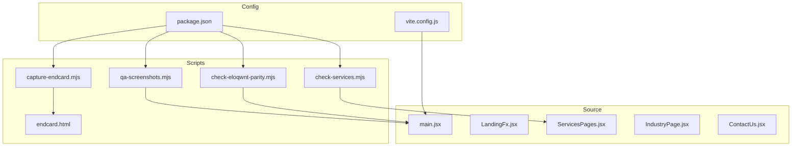
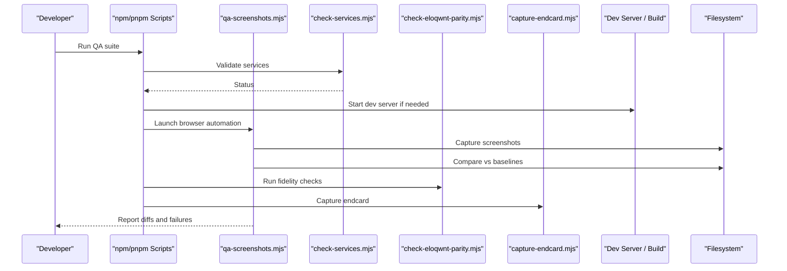
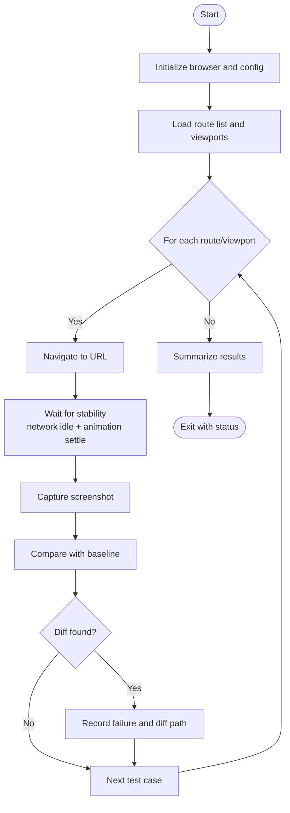
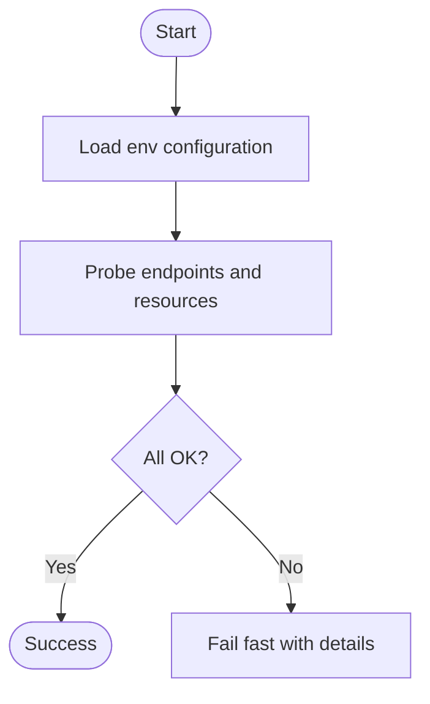
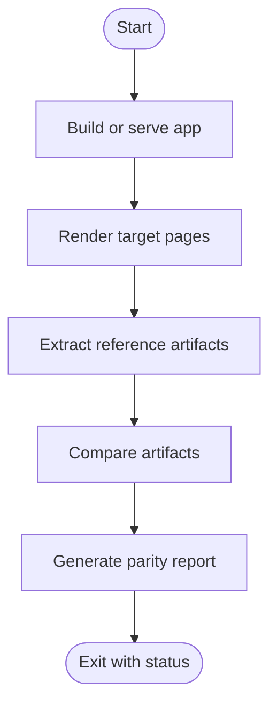
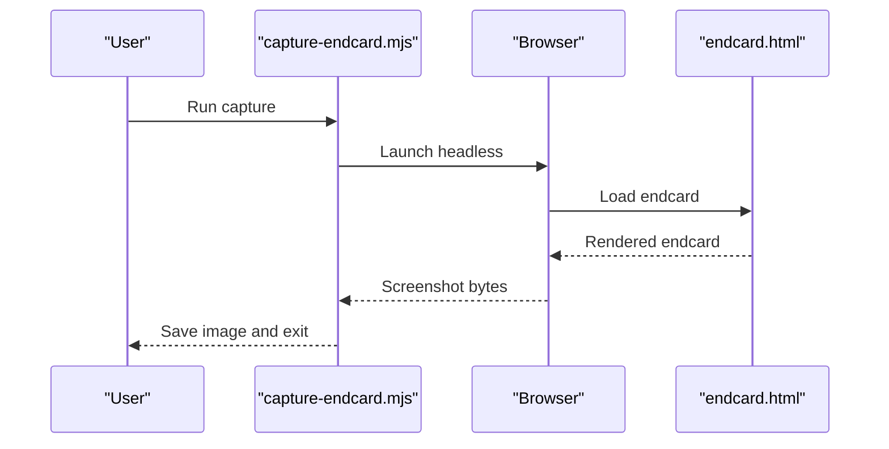
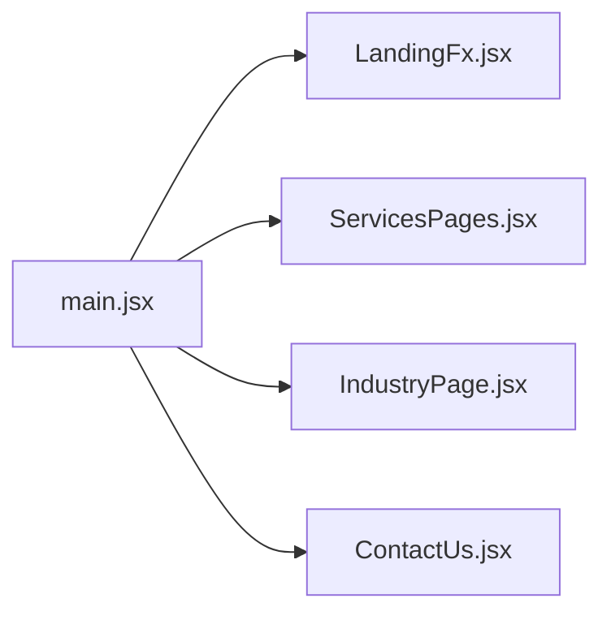
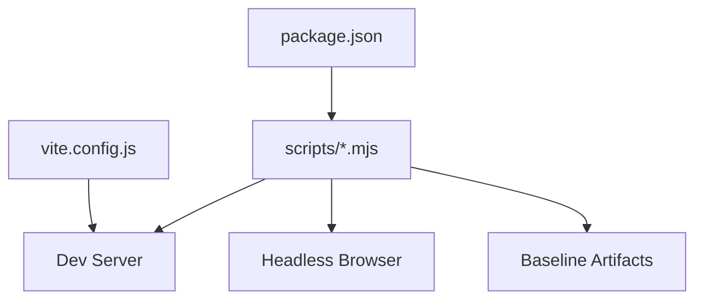

# Testing and Quality Assurance

<cite>
**Referenced Files in This Document**
- [qa-screenshots.mjs](file://scripts/qa-screenshots.mjs)
- [check-services.mjs](file://scripts/check-services.mjs)
- [check-eloqwnt-parity.mjs](file://scripts/check-eloqwnt-parity.mjs)
- [capture-endcard.mjs](file://scripts/capture-endcard.mjs)
- [endcard.html](file://scripts/endcard.html)
- [package.json](file://package.json)
- [vite.config.js](file://vite.config.js)
- [main.jsx](file://src/main.jsx)
- [LandingFx.jsx](file://src/LandingFx.jsx)
- [ServicesPages.jsx](file://src/ServicesPages.jsx)
- [IndustryPage.jsx](file://src/IndustryPage.jsx)
- [ContactUs.jsx](file://src/ContactUs.jsx)
</cite>

## Table of Contents
1. [Introduction](#introduction)
2. [Project Structure](#project-structure)
3. [Core Components](#core-components)
4. [Architecture Overview](#architecture-overview)
5. [Detailed Component Analysis](#detailed-component-analysis)
6. [Dependency Analysis](#dependency-analysis)
7. [Performance Considerations](#performance-considerations)
8. [Troubleshooting Guide](#troubleshooting-guide)
9. [Conclusion](#conclusion)
10. [Appendices](#appendices)

## Introduction

This document provides comprehensive testing and quality assurance guidance for the PodiumMinds application. It covers automated testing scripts including screenshot comparison, service validation, and fidelity checking tools. It also explains the QA workflow using the scripts directory utilities for visual regression testing and content validation, along with testing strategies for React components, CSS animations, and responsive layouts.

## Project Structure

The project is a React-based web application built with Vite. The testing and QA tooling is primarily implemented as Node.js scripts under the scripts directory. These scripts automate visual regression, service checks, and fidelity comparisons against reference assets.

**Diagram sources**
- [qa-screenshots.mjs](file://scripts/qa-screenshots.mjs)
- [check-services.mjs](file://scripts/check-services.mjs)
- [check-eloqwnt-parity.mjs](file://scripts/check-eloqwnt-parity.mjs)
- [capture-endcard.mjs](file://scripts/capture-endcard.mjs)
- [endcard.html](file://scripts/endcard.html)
- [main.jsx](file://src/main.jsx)
- [LandingFx.jsx](file://src/LandingFx.jsx)
- [ServicesPages.jsx](file://src/ServicesPages.jsx)
- [IndustryPage.jsx](file://src/IndustryPage.jsx)
- [ContactUs.jsx](file://src/ContactUs.jsx)
- [package.json](file://package.json)
- [vite.config.js](file://vite.config.js)

**Section sources**
- [package.json](file://package.json)
- [vite.config.js](file://vite.config.js)
- [main.jsx](file://src/main.jsx)

## Core Components

- Visual Regression Screenshot Capture: Orchestrates browser automation to capture full-page screenshots across key routes and compares them against baselines to detect visual regressions.
- Service Validation: Probes critical endpoints or client-side behaviors to ensure services are reachable and functioning before running UI tests.
- Fidelity Checking: Compares current page output against reference assets (e.g., design parity) to maintain visual fidelity.
- Endcard Capture: Captures a specific end-of-funnel view for review or baseline updates.

These scripts integrate with the build system and development server to run consistently across environments.

**Section sources**
- [qa-screenshots.mjs](file://scripts/qa-screenshots.mjs)
- [check-services.mjs](file://scripts/check-services.mjs)
- [check-eloqwnt-parity.mjs](file://scripts/check-eloqwnt-parity.mjs)
- [capture-endcard.mjs](file://scripts/capture-endcard.mjs)
- [endcard.html](file://scripts/endcard.html)

## Architecture Overview

The QA pipeline runs locally or in CI and follows this flow:

**Diagram sources**
- [qa-screenshots.mjs](file://scripts/qa-screenshots.mjs)
- [check-services.mjs](file://scripts/check-services.mjs)
- [check-eloqwnt-parity.mjs](file://scripts/check-eloqwnt-parity.mjs)
- [capture-endcard.mjs](file://scripts/capture-endcard.mjs)
- [package.json](file://package.json)

## Detailed Component Analysis

### Visual Regression Screenshot Tool (qa-screenshots.mjs)

Responsibilities:
- Navigate to defined routes and viewport sizes
- Wait for network idle and animations to settle
- Capture full-page screenshots
- Compare against stored baselines and generate diff reports
- Exit with non-zero status on failures

Typical usage:
- Local pre-commit hook
- CI job after build

**Diagram sources**
- [qa-screenshots.mjs](file://scripts/qa-screenshots.mjs)

**Section sources**
- [qa-screenshots.mjs](file://scripts/qa-screenshots.mjs)

### Service Validation Script (check-services.mjs)

Responsibilities:
- Verify that required backend endpoints or third-party services respond
- Check client-side integrations (e.g., analytics, fonts) by loading pages and asserting behavior
- Fail fast if core services are down to avoid noisy UI tests

Integration points:
- Runs before UI tests
- Can be configured via environment variables

**Diagram sources**
- [check-services.mjs](file://scripts/check-services.mjs)

**Section sources**
- [check-services.mjs](file://scripts/check-services.mjs)

### Fidelity Checker (check-eloqwnt-parity.mjs)

Responsibilities:
- Compare rendered outputs against reference assets to ensure design parity
- Optionally compare DOM snapshots or computed styles for structural consistency
- Generate a report highlighting mismatches

Usage:
- Post-build verification
- Pre-release gating

**Diagram sources**
- [check-eloqwnt-parity.mjs](file://scripts/check-eloqwnt-parity.mjs)

**Section sources**
- [check-eloqwnt-parity.mjs](file://scripts/check-eloqwnt-parity.mjs)

### Endcard Capture Utility (capture-endcard.mjs)

Responsibilities:
- Open a dedicated endcard page (endcard.html)
- Capture a high-resolution screenshot for review or baseline update
- Useful for final funnel or summary views

**Diagram sources**
- [capture-endcard.mjs](file://scripts/capture-endcard.mjs)
- [endcard.html](file://scripts/endcard.html)

**Section sources**
- [capture-endcard.mjs](file://scripts/capture-endcard.mjs)
- [endcard.html](file://scripts/endcard.html)

### Application Entry Points and Key Pages

Testing should cover these primary entry points and pages:
- main.jsx: Application bootstrap
- LandingFx.jsx: Landing experience and animations
- ServicesPages.jsx: Services overview and interactions
- IndustryPage.jsx: Industry-specific content and flows
- ContactUs.jsx: Contact form and submission UX

**Diagram sources**
- [main.jsx](file://src/main.jsx)
- [LandingFx.jsx](file://src/LandingFx.jsx)
- [ServicesPages.jsx](file://src/ServicesPages.jsx)
- [IndustryPage.jsx](file://src/IndustryPage.jsx)
- [ContactUs.jsx](file://src/ContactUs.jsx)

**Section sources**
- [main.jsx](file://src/main.jsx)
- [LandingFx.jsx](file://src/LandingFx.jsx)
- [ServicesPages.jsx](file://src/ServicesPages.jsx)
- [IndustryPage.jsx](file://src/IndustryPage.jsx)
- [ContactUs.jsx](file://src/ContactUs.jsx)

## Dependency Analysis

The QA scripts depend on:
- Node runtime and package manager (pnpm/npm)
- A headless browser engine used by the screenshot/fidelity tools
- The development server or build output for serving pages during tests
- Environment variables for URLs, timeouts, and thresholds

**Diagram sources**
- [package.json](file://package.json)
- [vite.config.js](file://vite.config.js)
- [qa-screenshots.mjs](file://scripts/qa-screenshots.mjs)
- [check-services.mjs](file://scripts/check-services.mjs)
- [check-eloqwnt-parity.mjs](file://scripts/check-eloqwnt-parity.mjs)
- [capture-endcard.mjs](file://scripts/capture-endcard.mjs)

**Section sources**
- [package.json](file://package.json)
- [vite.config.js](file://vite.config.js)

## Performance Considerations

- Use stable waits instead of fixed sleeps; prefer network idle and animation settle conditions before capturing.
- Limit concurrent browser instances to reduce memory pressure; queue navigation tasks when necessary.
- Cache static assets and fonts during tests to avoid flakiness due to CDN latency.
- Prefer partial screenshots for large pages when full-page captures are not required.
- Store baselines per viewport and OS/browser where differences matter.

[No sources needed since this section provides general guidance]

## Troubleshooting Guide

Common issues and resolutions:
- Flaky screenshots due to animations: Increase settle time or disable animations in test mode.
- Network-dependent failures: Ensure check-services.mjs passes before UI tests; add retries for transient errors.
- Baseline drift: Update baselines intentionally after approved changes; document reasons in commit messages.
- Headless rendering differences: Pin browser versions and use consistent font sets across environments.
- Timeouts: Tune wait conditions and increase timeouts for slow networks or heavy assets.

**Section sources**
- [qa-screenshots.mjs](file://scripts/qa-screenshots.mjs)
- [check-services.mjs](file://scripts/check-services.mjs)
- [check-eloqwnt-parity.mjs](file://scripts/check-eloqwnt-parity.mjs)
- [capture-endcard.mjs](file://scripts/capture-endcard.mjs)

## Conclusion

The PodiumMinds QA toolkit centers around robust, script-driven visual regression, service validation, and fidelity checks. By integrating these scripts into local workflows and CI, teams can catch regressions early, maintain design parity, and deliver a reliable user experience across devices and browsers.

[No sources needed since this section summarizes without analyzing specific files]

## Appendices

### Writing Tests and Test Organization

- Unit tests for React components:
  - Focus on pure logic, hooks, and utility functions.
  - Mock external dependencies (analytics, APIs).
  - Keep tests deterministic and isolated.
- Integration tests:
  - Assert component interactions and state transitions.
  - Simulate user events and verify side effects.
- Visual regression tests:
  - Define canonical routes and viewports.
  - Stabilize timing and disable non-essential animations.
  - Maintain baselines per platform/browser where relevant.

### Setting Up the Test Environment

- Install dependencies using the project’s package manager.
- Ensure a compatible headless browser is available.
- Configure environment variables for base URLs, timeouts, and thresholds.
- Start the dev server or build artifacts before running QA scripts.

### Integrating Into Development Workflow

- Pre-commit:
  - Run lightweight checks (lint, unit tests).
- Pre-push:
  - Run service checks and a subset of visual tests.
- CI:
  - Full suite: unit, integration, visual regression, fidelity checks.
  - Upload artifacts (diffs, logs) for review.

### Accessibility Testing

- Automated checks:
  - Keyboard navigation, focus order, color contrast, ARIA attributes.
- Manual audits:
  - Screen reader compatibility, language semantics, dynamic content announcements.
- Integrate accessibility linters and axe-core scans into CI.

### Cross-Browser Compatibility Verification

- Target matrix:
  - Latest two major versions of Chrome, Firefox, Safari, and Edge.
- Viewports:
  - Mobile, tablet, desktop breakpoints aligned with design tokens.
- Strategy:
  - Use cloud testing platforms or containerized browsers in CI.
  - Record and compare screenshots across browsers.

### Performance Testing

- Metrics:
  - First Contentful Paint, Largest Contentful Paint, Time to Interactive, Total Blocking Time.
- Tools:
  - Lighthouse CI, WebPageTest, or equivalent.
- Practices:
  - Budget performance budgets and fail builds on regressions.
  - Monitor bundle size and asset optimization.